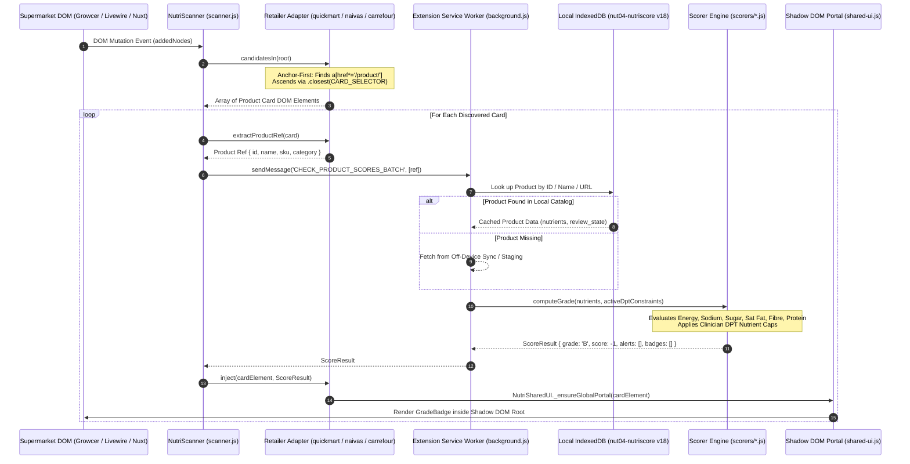
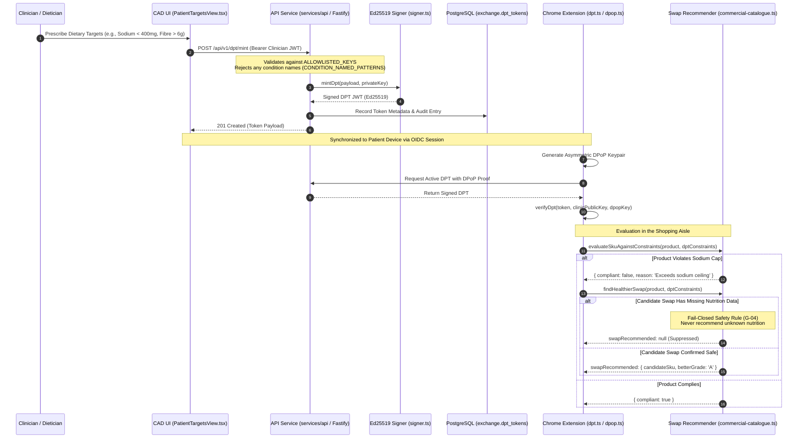
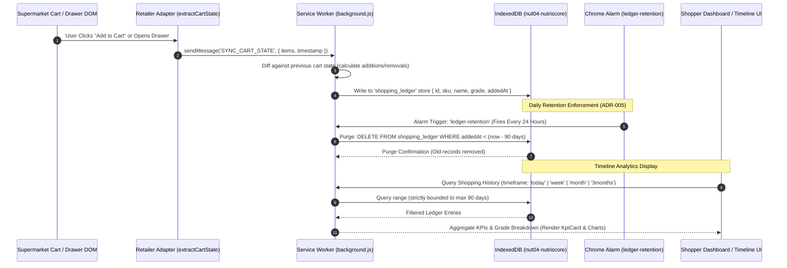

# Living Architectural Blueprint: Data Flow & Event Lifecycles

## Executive Summary
This document provides the authoritative blueprint for the end-to-end data lifecycles across the NUT-04 Checkout Tool ecosystem. It diagrams and details how raw supermarket DOM events become scored food items, how clinician prescriptions become cryptographically signed Dietary Profile Tokens (DPTs), how shopper grocery carts are diffed and retained within privacy ceilings, and how healthcare actions are committed to an immutable WORM audit ledger.

---

## 1. Retailer Product Detection & Scoring Pipeline

The shopper extension monitors supermarket product listings and product detail pages, resolving nutritional profiles and injecting badges within an isolated Shadow DOM without impacting retailer page performance.



### Key Safety Invariants in Product Scoring:
1. **Anchor-First Ascending Discovery:** Resolving products keys off stable anchor links or inputs rather than mutable layout container classes, surviving retailer front-end refreshes (ADR-013).
2. **Shadow DOM Encapsulation:** All badges and tooltips render inside Shadow DOM portals with separate style trees, preventing CSS leakage or collision with retailer layout.
3. **Data-Trust Verification:** Scores are computed only for products with `review_state >= ESTIMATED`. Products with rejected or unverified data display an "Insufficient Data" neutral state.

---

## 2. Dietary Profile Token (DPT) Lifecycle & Fail-Closed Enforcement

When a clinician establishes a nutritional prescription in the Clinic Admin Dashboard (CAD), it is compiled into an un-stigmatizing Dietary Profile Token (DPT) delivered to the patient's browser extension.



### Safety Invariants in DPT Enforcement:
1. **Zero Medical Stigma in Transit:** Tokens contain only numerical thresholds (`sodium_mg_per_100g_max`), never condition strings like "Hypertension" (ADR-010).
2. **Fail-Closed on Recommendations:** While a product violating constraints alerts the user, the recommender *never* proposes a swap product unless that swap product has fully verified nutrient data (ADR-010, Gap G-04).
3. **No Upward Band Rounding:** Upper limits are strictly ceiling-bounded; a 500mg limit is never rounded up to 600mg (Gap G-03).

---

## 3. Shopping Cart Diffing & 90-Day Retention Lifecycle

As shoppers add and remove items from their e-commerce carts, the extension maintains an in-memory cart diff and persists shopping logs subject to the 90-day device ceiling.



### Invariants in Cart Tracking:
1. **Device Ceiling:** Shopping ledger records older than 90 days are purged permanently from IndexedDB; the UI permits only 4 timeframe views (`today`, `week`, `month`, `3months`) (ADR-005).
2. **Cart Diffing Parity:** Product additions and removals key on the exact same `extractProductRef` namespace as the catalog scanner, preventing phantom cart entries (ADR-013).

---

## 4. Cryptographic WORM Audit Trail Flow

Every critical healthcare administrative event (user role assignment, patient linking, target prescription, emergency break-glass, and crypto-shredding) is committed to an immutable, append-only cryptographic ledger.

```mermaid
sequenceDiagram
    autonumber
    participant Actor as Clinician / Administrator
    participant Service as CAD API / Database Trigger
    participant Ledger as PostgreSQL (audit.ledger)
    participant Trigger as trg_audit_ledger_immutable
    participant Script as Audit Verification (verify-audit-chain.mjs)

    Actor->>Service: Perform Clinical Action (e.g. Prescribe Target Bundle)
    Service->>Ledger: INSERT INTO audit.ledger (tenant_id, actor_id, event_type, payload)
    
    Note over Ledger: Compute SHA-256 Hash Chain
    Ledger->>Ledger: Fetch previous_hash from sequence_id - 1
    Ledger->>Ledger: Compute record_hash = SHA256(sequence_id || timestamp || tenant_id || payload || previous_hash)
    Ledger-->>Service: Insert Success (Commit Sequence ID)

    Note over Actor,Ledger: Malicious Tampering Attempt
    Actor-xLedger: UPDATE audit.ledger SET payload = '...' WHERE sequence_id = 42
    Trigger-->>Actor: FATAL ERROR: Mutation Denied (Append-Only Invariant D-009)

    Note over Script,Ledger: Automated Integrity Verification in CI / Scheduled Job
    Script->>Ledger: SELECT sequence_id, previous_hash, record_hash, payload FROM audit.ledger ORDER BY sequence_id ASC
    Script->>Script: Recompute SHA-256 for each row & verify chain continuity
    alt Chain Intact
        Script-->>Script: Log: [PASS] All 6 chains cryptographic hash continuity verified
    else Chain Broken
        Script-->>Script: FATAL: Tampering detected at sequence_id X! Fail CI Gate.
    end
```

### Invariants in Audit Preservation:
1. **Revoked Mutation:** Database privileges explicitly revoke `UPDATE`, `DELETE`, and `TRUNCATE` from all roles on `audit.ledger` (ADR-012).
2. **Cryptographic Continuity:** Every row's `record_hash` is dependent on the `previous_hash`; a modification to any row invalidates all subsequent rows.
3. **Platform Auditor Role:** Platform auditors inspect cryptographic hash proofs without decrypting or viewing clinical patient health payloads (ADR-008, ADR-012).

