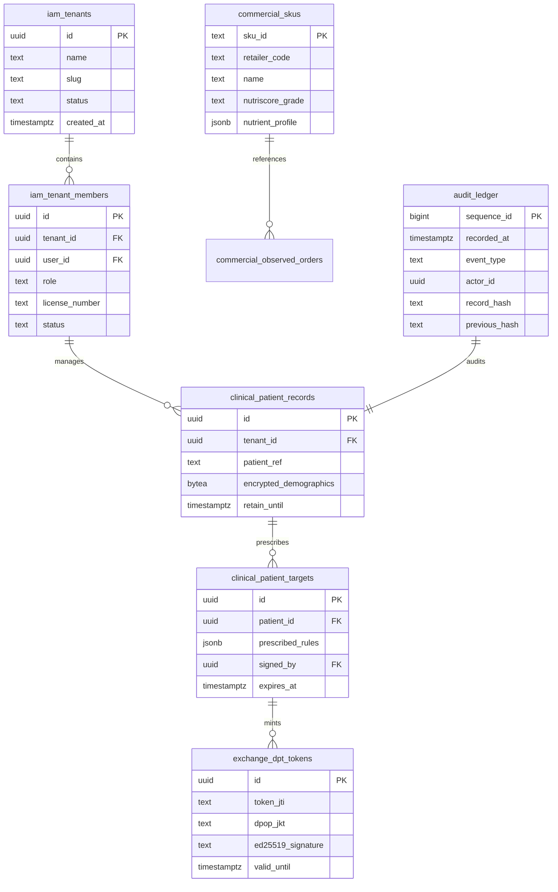

# Living Architectural Blueprint: System Overview & Topology

## Executive Summary
The **NUT-04 Checkout Tool** is an enterprise-grade digital health nutrition platform operating across Kenya. The system empowers clinical nutritionists, dieticians, and physicians to prescribe personalized dietary boundaries to patients managing chronic metabolic conditions (Type 2 diabetes, hypertension, chronic kidney disease, obesity, and dyslipidemia). 

As patients shop for groceries online on Kenyan supermarket e-commerce websites (**Quickmart**, **Naivas**, and **Carrefour**), a Chrome Manifest V3 browser extension intercepts product browsing, scores food items according to validated NutriScore algorithms and clinician-prescribed **Dietary Profile Tokens (DPTs)**, displays real-time health alerts inside an isolated Shadow DOM, and suggests clinically safe food alternatives.

The backend is a sovereign, containerized microservices stack featuring **PostgreSQL 16**, **Keycloak 26.2.5** for OIDC identity, **PostgREST 12.2.3** for secure database REST exposure with Row Level Security (RLS), a **Node.js API service** for server-side cryptographic token minting, and the **Clinic Admin Dashboard (CAD)** served via an unprivileged Nginx container, all reverse-proxied behind **Caddy 2.9.1**.

---

## 1. System Context & Boundaries

```mermaid
flowchart TB
    subgraph CLIENT_TIER["Client Layer (End-User Browser & Chrome Runtime)"]
        direction TB
        EXT["Chrome Extension MV3\n(Background SW, Content Engine, Scanner, DB)"]
        POPUP["Shopper Popup & Side Panel UI\n(Preact/Tailwind/3-Tier Tokens)"]
        CAD_UI["Clinic Admin Dashboard (CAD) UI\n(Vite/Preact Shell & Views)"]
    end

    subgraph RETAILER_TIER["External Supermarket E-Commerce (Kenya)"]
        direction TB
        QM["Quickmart Kenya\n(Growcer Multi-Page CMS)"]
        NV["Naivas Supermarket\n(Laravel Livewire v3 SPA)"]
        CF["Carrefour Kenya\n(Vue/Nuxt Virtual DOM SPA)"]
    end

    subgraph GATEWAY_TIER["Unified Ingress Gateway (Caddy 2.9.1)"]
        direction TB
        GW["Caddy Gateway\n(Port 8080 HTTP / 8443 TLS Internal)\nCaddyfile Reverse Proxy & CSP Routing"]
    end

    subgraph BACKEND_TIER["Core Sovereign Microservices Stack (Docker Compose)"]
        direction TB
        KC["Keycloak 26.2.5 (Quarkus)\n(OIDC, Realm nutriscore, TOTP MFA)\nExposed: /auth/*"]
        PGRST["PostgREST 12.2.3\n(Direct DB REST API with RLS)\nExposed: /api/*"]
        API["Node.js API Service (Node 22)\n(Ported Edge Services, DPT Minting)\nExposed: /api/v1/*"]
        CAD_SVC["CAD Static Host (Nginx Unprivileged)\n(Compiled Single-Page App)\nExposed: /cad/*"]
        MAIL["Mailpit (v1.22.3)\n(Dev SMTP/Alert Sink)\nPort: 8025 / 1025"]
    end

    subgraph DATA_TIER["Persistence & Security (PostgreSQL 16 Bookworm)"]
        direction TB
        PG[("PostgreSQL 16 Database (nutriscore)\nSchemas: iam, clinical, exchange, commercial, audit, app_private")]
        DBM["dbmate 2.24.0 Runner\n(db/migrations/*.sql)"]
    end

    %% Interactions
    EXT -.->|Injects Badges & Scans DOM| QM & NV & CF
    POPUP <-->|Message Bus / Runtime Port| EXT
    CAD_UI -->|HTTPS / WSS| GW
    POPUP -->|OIDC WebAuthFlow| GW

    GW -->|/cad/*| CAD_SVC
    GW -->|/auth/*| KC
    GW -->|/api/* (strip prefix)| PGRST
    GW -->|/api/v1/*| API

    KC -->|JDBC Auth Storage| PG
    PGRST -->|PostgREST JWT / RLS Queries| PG
    API -->|Service Role Connection Pool| PG
    DBM -->|Plain SQL DDL Migrations| PG
    KC -.->|SMTP Outgoing OTPs| MAIL
```

---

## 2. Component Taxonomy & Codebase Directory Mapping

Every architectural responsibility maps strictly to concrete directories in the repository:

| Architectural Component | Repository Location | Tech Stack & Runtimes | Primary Responsibilities |
|---|---|---|---|
| **Chrome Extension Engine** | `src/extension/` | Vanilla JS (ES Modules, MV3) | Background service worker (`background.js`), DOM content engine (`content.js`), mutation scanner (`scanner.js`), IndexedDB engine (`db.js`), scoring pipelines (`engine/`, `pipeline/`). |
| **Retailer Adapters** | `src/extension/adapters/` | Vanilla JS / DOM APIs | Retailer-specific DOM scrapers (`quickmart.js`, `naivas.js`, `carrefour.js`) using anchor-first candidate discovery, cart state extractors, and Shadow DOM portals (`shared-ui.js`). |
| **Shopper UI (Popup & Side Panel)** | `src/ui/src/app/` | Preact, Tailwind CSS v4 | Shopper-facing nutritional overview (`Popup.tsx`, `Dashboard.tsx`), 3-tier accessible design primitives (`components/ui/`), and 90-day shopping timeline charts (`components/charts/`). |
| **Clinic Admin Dashboard (CAD)** | `src/ui/src/cad/` | React/Preact, TypeScript | Clinical healthcare administration shell (`CadApp.tsx`), OIDC authentication context (`AuthContext.tsx`), Clinician workspace (`ClinicianWorkspaceView.tsx`), Patient target prescribing (`PatientTargetsView.tsx`), Audit verification (`AuditLogView.tsx`), and Tenant settings (`TenantSettingsView.tsx`). |
| **Shared Contracts & Cryptography** | `src/shared/` | TypeScript / WebCrypto APIs | Dietary Profile Token minting & verification (`dpt.ts`), DPoP proof of possession (`dpop.ts`), Ed25519 signing (`signer.ts`), JWT claims contracts (`claims.ts`, `claims.schema.json`), RBAC authorization engine (`authz.ts`), and field-level encryption (`field-encryption.ts`). |
| **API Microservice** | `services/api/` | Node.js 22 LTS, Fastify/HTTP | Ported server-side functions, DPT cryptographic minting endpoints, catalog publishing validation, and health probes (`src/server.mjs`). |
| **Database Migrations & Seeds** | `db/migrations/`, `db/seeds/` | PostgreSQL 16 DDL, dbmate | Baseline database migration (`0001_baseline.sql`), companion rollbacks (`0001_baseline.rollback.sql`), reference rule packs (`seeds/reference/rule-packs/`). |
| **API Gateway Configuration** | `infra/caddy/` | Caddy 2.9.1 | Unified ingress gateway routing, internal TLS generation, security headers, and Content Security Policies (`Caddyfile`). |
| **Identity Provider Realm** | `infra/keycloak-realm.json` | Keycloak 26.2.5 JSON export | Multi-tenant OIDC realm definition (`nutriscore`), client definitions (`cad-frontend`, `extension-client`), custom `app_role` protocol mappers, and password/TOTP policies. |
| **Container & CI Toolchain** | `docker/`, `compose.yaml`, `bin/` | Docker Compose v2, BuildKit | Docker multi-stage build definitions (`toolchain.Dockerfile`), host orchestration scripts (`nut.ps1`, `nut`), and service declarations. |
| **Automated CI Guard Scripts** | `scripts/` | Node.js (ESM) | Verification scripts enforcing host isolation, zero hardcoded patient PII (`check-no-hardcoded-data.mjs`), manifest safety (`check-manifest-globals.mjs`), CAD security (`check-cad-security.mjs`), and WORM audit chain continuity (`verify-audit-chain.mjs`). |

---

## 3. Database Schema Group Architecture

The PostgreSQL 16 database (`nutriscore`) enforces strict schema isolation to uphold zero-trust security and prepare for sovereign Kenyan cloud partitioning (ADR-014):



### Schema Responsibilities:
1. `iam`: Source of truth for clinics (`tenants`), staff memberships (`tenant_members`), identity bindings, and patient consent grants (`consents`).
2. `clinical`: Highly protected clinical core containing encrypted patient demographics (`clinical_records`), clinician-prescribed nutritional rules (`patient_targets`, `health_modes`), and emergency break-glass authorizations (`break_glass_grants`). Enforces append-only triggers and 20-year statutory retention (ADR-005, ADR-012).
3. `exchange`: Semantic projection engine. Mints dimensionless Dietary Profile Tokens (DPTs), derives dual un-linkable shopper aliases (`deriveShopperAlias`), and enforces the $k \ge 5$ cohort suppression gate (ADR-010).
4. `commercial`: Public grocery catalog data (`commercial_skus`), nutritional review states (`review_state`), and aggregated demand telemetry. Contains zero patient PII or health condition names.
5. `audit`: Append-only, write-once-read-many (WORM) cryptographic ledger (`audit.ledger`) with SHA-256 hash chaining and tamper-detection triggers.
6. `app_private`: Internal security schema housing JWT claim extraction helpers (`app_private.claims()`, `app_private.uid()`) and tenant membership verification routines (`app_private.is_active_member()`) utilized by PostgREST Row Level Security policies.

---

## 4. Ingress & Security Topology

```mermaid
sequenceDiagram
    autonumber
    participant Browser as Chrome Browser (Client)
    participant Caddy as Caddy Gateway (:8080 / :8443)
    participant Keycloak as Keycloak OIDC (:8080/auth)
    participant PostgREST as PostgREST API (:3000)
    participant Postgres as PostgreSQL 16 (RLS Engine)

    Note over Browser,Keycloak: OIDC Authentication & Token Issuance
    Browser->>Caddy: GET /auth/realms/nutriscore/protocol/openid-connect/auth
    Caddy->>Keycloak: Reverse proxy to Keycloak:8080
    Keycloak-->>Browser: Authenticate + TOTP Challenge
    Browser->>Keycloak: Submit Credentials + TOTP
    Keycloak-->>Browser: Authorization Code
    Browser->>Keycloak: Exchange Code + PKCE Verifier
    Keycloak-->>Browser: Signed JWT (Claims: sub, tenant_id, app_role)

    Note over Browser,Postgres: Authenticated Data Ingress via Gateway
    Browser->>Caddy: GET /api/patient_targets (Bearer <JWT>)
    Caddy->>PostgREST: Strip prefix /api -> Forward to postgrest:3000
    PostgREST->>Postgres: SET LOCAL request.jwt.claims = '<JWT>'; Execute Query
    Note over Postgres: RLS Policy: iam.tenant_id = app_private.claims()->>'tenant_id'
    Postgres-->>PostgREST: Filtered Tenant-Scoped Dataset
    PostgREST-->>Caddy: 200 OK (JSON Payload)
    Caddy-->>Browser: 200 OK
```

### Security Boundary Invariants:
1. **Network Isolation:** No container other than `gateway` (Caddy) publishes ports to the host operating system. All microservice communications traverse Docker internal bridge networks.
2. **Strict RLS Enforcement:** PostgREST runs as `authenticator` role, which immediately switches to `anon` or `authenticated` based on JWT validity. Tables in `iam`, `clinical`, `exchange`, and `commercial` enforce restrictive Row Level Security; no query executes without `tenant_id` validation.
3. **Hermetic Host Boundary (Rule R4):** Build and validation tools operate exclusively inside the `toolchain` container; the host is isolated from all build and runtime execution.

