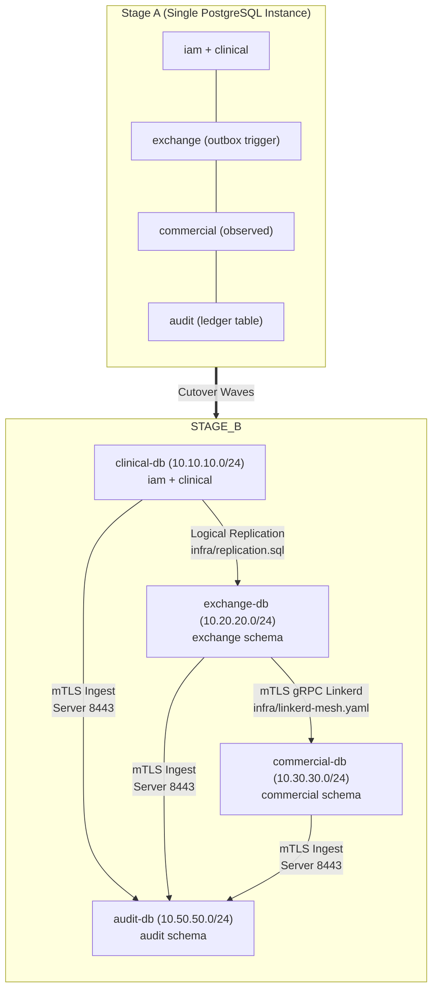

# Sovereign Cloud Cutover Runbook: Stage A to Stage B Architecture
## NutriScore CAD Healthcare Platform — Migration & Split-by-Schema Protocol

**Reference:** Blueprint §1.2, §2.1–§2.6, Decisions D4 & D5, Amendment A5
**Target Infrastructure:** Sovereign Kenyan Cloud (iColo NBO1 / Africa Data Centres NBO1, Nairobi via Servercore / Angani)
**Governing Law:** Kenya Data Protection Act, 2019 (Data Residency & Sensitive Health Data Localization)
**Execution Mode:** Prepared, Never Deployed Locally (Run during scheduled maintenance window)

---

## 1. Executive Summary & Architecture Evolution

During **Stage A (Local & Hosted Supabase Baseline)**, the platform operated within a single PostgreSQL 17 instance partitioned into four distinct schema groups:
1. `iam` + `clinical`: Source of truth for identity, clinicians, patients, and encrypted PHI.
2. `exchange`: Semantic projection, cohort gate ($k \ge 5$), dual-alias generator, and DPT minting.
3. `commercial`: Curated reference SKUs, observed orders/lines, and aggregated demand views.
4. `audit`: Append-only cryptographic WORM ledger, signed Merkle checkpoints, and tamper triggers.

During **Stage B (Sovereign Cloud Cutover)**, these four schema groups are physically segregated into four dedicated, network-isolated PostgreSQL database clusters behind Kubernetes, Linkerd service mesh, Envoy Gateway, and Keycloak OIDC.



---

## 2. Pre-Cutover Readiness Gates (T-72 Hours to T-0)

Before initiating Wave 0, all of the following gates must be confirmed **GREEN**:

| Gate | Verification Command | Requirement |
|---|---|---|
| **Gate 1: Unit & Component Tests** | `npm test -- --reporter=dot` | All 836+ tests pass across 50 test files |
| **Gate 2: Static Analysis & Types** | `npm run typecheck && npm run lint` | Zero errors |
| **Gate 3: Formatting & Manifest** | `npm run format:check && npm run check:manifest` | Clean, zero global leaks |
| **Gate 4: Tenant Wall Invariant** | `npm run check:rls` | 29 tenant tables forced restrictive RLS |
| **Gate 5: Anti-Rank & Ban Constants** | `npm run check:cad-security` | Zero numeric rank comparisons; single ban constant |
| **Gate 6: Mock Hygiene Gate** | `node scripts/purge-mocks.mjs --check-clean` | Zero mock accounts in production target |
| **Gate 7: WORM Ledger Integrity** | `node scripts/verify-audit-chain.mjs` | All 6 chains cryptographic hash continuity verified |
| **Gate 8: Field Encryption Canary** | `node scripts/verify-phase6-canary.mjs` | Zero plaintext leaks in database dump |
| **Gate 9: DPT Leak Proofs** | `node scripts/check-leak-proofs.mjs` | 5/5 steps pass, condition names banned |
| **Gate 10: Commercial Invariants** | `node scripts/check-commercial-overlay.mjs` | Zero shopper aliases in views; $k \ge 5$ gate enforced |
| **Gate 11: Statutory Release Gate** | `node scripts/release-gate.mjs` | DPIA filed with ODPC $\ge 60$ days, counsel sign-off active |

---

## 3. Split-by-Schema Procedure (The 5 Waves)

### Wave 0: Sovereign Infrastructure Provisioning (T-24h to T-4h)
1. Provision Managed Kubernetes and 4 Managed PostgreSQL 17 clusters on Servercore / Angani at iColo NBO1, Nairobi.
2. Configure private VLAN subnets per blueprint §2.2:
   - Edge: `10.0.0.0/24`
   - Clinical Zone: `10.10.10.0/24`
   - Exchange Zone: `10.20.20.0/24`
   - Commercial Zone: `10.30.30.0/24`
   - Platform Zone (Keycloak/Vault): `10.40.40.0/24`
   - Audit Zone: `10.50.50.0/24`
3. Apply Kubernetes network boundaries:
   ```bash
   kubectl apply -f infra/network-policies.yaml
   kubectl apply -f infra/linkerd-mesh.yaml
   kubectl apply -f infra/gateway-api.yaml
   ```

### Wave 1: Audit Cluster Cutover (`audit-db`)
1. Place source `audit.ledger` into read-only transaction state.
2. Dump `audit` schema:
   ```bash
   pg_dump -h $STAGE_A_HOST -U migrator -d postgres -n audit -Fc -f audit_stage_a.dump
   ```
3. Restore into sovereign `audit-db`:
   ```bash
   pg_restore -h audit-db.audit.svc -U migrator -d audit -v audit_stage_a.dump
   ```
4. Verify Merkle root continuity:
   ```bash
   node scripts/verify-audit-chain.mjs --db-host=audit-db.audit.svc
   ```
5. Deploy `audit-svc` microservice (port 8443 mTLS). Re-route audit producers to the new endpoint.

### Wave 2: Commercial Cluster Cutover (`commercial-db`)
1. Dump `commercial` schema:
   ```bash
   pg_dump -h $STAGE_A_HOST -U migrator -d postgres -n commercial -Fc -f commercial_stage_a.dump
   ```
2. Restore into sovereign `commercial-db`:
   ```bash
   pg_restore -h commercial-db.commercial.svc -U migrator -d commercial -v commercial_stage_a.dump
   ```
3. Verify curated reference SKUs and view invariants:
   ```bash
   node scripts/check-commercial-overlay.mjs --db-host=commercial-db.commercial.svc
   ```
4. Deploy `commercial-svc` microservice.

### Wave 3: Exchange Cluster Cutover (`exchange-db`)
1. Provision target table `exchange.projection` in `exchange-db`.
2. Configure logical replication between `clinical-db` and `exchange-db`:
   ```bash
   # On clinical-db:
   psql -h clinical-db.clinical.svc -d clinical -f infra/replication.sql
   ```
3. Initialize subscription on `exchange-db` using `infra/replication.sql`.
4. Deploy `exchange-svc` microservice with local Stage A Ed25519 `Signer` or HashiCorp Vault transit backend.
5. Execute leak proofs against exchange:
   ```bash
   node scripts/check-leak-proofs.mjs --target-url=https://exchange.nutriscore.internal
   ```

### Wave 4: Clinical Core Cutover (`clinical-db`)
1. Initiate scheduled maintenance window (API returns 503 Maintenance).
2. Dump `iam` and `clinical` schemas:
   ```bash
   pg_dump -h $STAGE_A_HOST -U migrator -d postgres -n iam -n clinical -Fc -f clinical_core.dump
   ```
3. Restore into sovereign `clinical-db`:
   ```bash
   pg_restore -h clinical-db.clinical.svc -U migrator -d clinical -v clinical_core.dump
   ```
4. Verify tenant wall and crypto-shredding integrity:
   ```bash
   psql -h clinical-db.clinical.svc -d clinical -f supabase/tests/cad_tenant_wall.sql
   psql -h clinical-db.clinical.svc -d clinical -f supabase/tests/cad_abac_and_clinical.sql
   ```

---

## 4. Identity Provider Switch: Supabase Auth to Keycloak OIDC

Per **Decision D4**, clients require **zero code changes** for cutover; only configuration updates are needed thanks to the unified `AuthProvider` interface and `claims` adapter.

### Step 1: Keycloak Realm Import
Import `infra/keycloak-realm.json` into Keycloak instance running in Platform namespace:
```bash
kcadm.sh create realms -f infra/keycloak-realm.json
```

### Step 2: Member Account Projection
Execute one-time projection script pushing `iam.members` to Keycloak users:
```bash
node scripts/project-iam-to-keycloak.mjs \
  --clinical-db=clinical-db.clinical.svc \
  --keycloak-url=https://id.nutriscore.co.ke
```

### Step 3: Client Configuration Switch
Update client environment variables:
```env
# CAD Web UI (.env.production)
VITE_AUTH_PROVIDER=oidc
VITE_OIDC_ISSUER=https://id.nutriscore.co.ke/realms/nutriscore
VITE_OIDC_CLIENT_ID=cad-web-ui
VITE_API_BASE=https://api.nutriscore.co.ke/v1

# Browser Extension (manifest & config)
VITE_AUTH_PROVIDER=oidc
VITE_OIDC_ISSUER=https://id.nutriscore.co.ke/realms/nutriscore
```

---

## 5. Traffic Ingress Cutover & DNS Switch

1. **Warm Up Ingress:** Validate envoy routing via local hosts file override:
   ```bash
   curl -vk --resolve api.nutriscore.co.ke:443:10.0.0.10 https://api.nutriscore.co.ke/healthz
   ```
2. **Canary Routing:**
   - 10% traffic via Envoy Gateway. Monitor `AUTHZ_DENY` metrics and error logs for 15 minutes.
   - 50% traffic for 30 minutes.
   - 100% traffic shift.
3. **Decommission Maintenance Page:** Lift maintenance mode; resume live clinic and extension traffic.

---

## 6. Rollback Procedures per Wave

If an unrecoverable failure occurs during any cutover wave:

- **Rollback Wave 1 (Audit Failure):**
  - Point audit producers back to Stage A Supabase connection. No data loss.
- **Rollback Wave 2 (Commercial Failure):**
  - Re-point extension sync back to Stage A `/v1/commerce/observed-orders`.
- **Rollback Wave 3 (Exchange / Replication Failure):**
  - Drop subscription on `exchange-db`. Re-enable Stage A outbox trigger in `clinical.published_profiles`.
- **Rollback Wave 4 (Clinical Core / Identity Failure):**
  - Revert DNS record `api.nutriscore.co.ke` back to Stage A Supabase endpoint.
  - Flush Keycloak sessions.
  - Re-enable write traffic on Stage A `iam` and `clinical` schemas.
