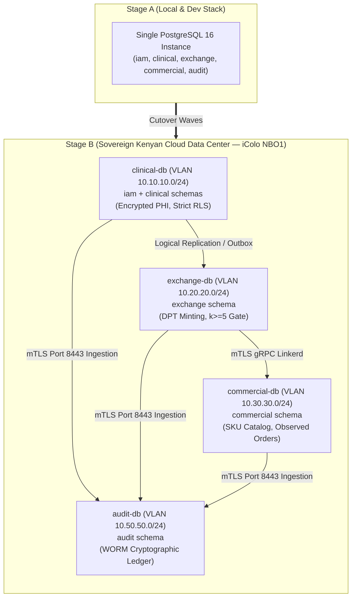

# ADR-014: Data Residency, Sovereign Kenyan Cloud & Split-by-Schema Architecture

## Metadata
- **Date:** 2026-11-10
- **Status:** Accepted (Production Architecture Cutover Specification)
- **Authors:** NUT-04 Engineering, Legal Counsel & Infrastructure Architect
- **References:** Kenya Data Protection Act 2019 (s.48-50), `Docs/Reports/CUTOVER_RUNBOOK.md`, `Docs/compliance/BREACH_RUNBOOK.md`, `Docs/compliance/dpia/DPIA-draft.md`

---

## Context
The NUT-04 platform processes sensitive personal health data (nutritional dietary prescriptions, clinical target adherence, patient-clinician communications) of Kenyan citizens:
1. **Statutory Data Localization:** Section 50 of the Kenya Data Protection Act, 2019 and Regulation 24 of the Data Protection (General) Regulations, 2021 mandate that sensitive personal data (specifically including health and medical data) must be processed through data servers or data centers located within Kenya, unless explicit cross-border transfer exemptions apply and are approved by the Office of the Data Protection Commissioner (ODPC).
2. **Multi-Jurisdiction Cloud Hazards:** Storing sensitive Kenyan patient prescriptions on US- or EU-hosted hyperscalers without explicit sovereign control introduces jurisdictional, regulatory, and contractual non-compliance.
3. **Data Protection Impact Assessment (DPIA):** Under DPA s.31, high-risk health data processing requires a comprehensive DPIA submitted to the ODPC at least 60 days prior to commercial launch (`scripts/release-gate.mjs`).

---

## Decision
We establish a **Sovereign Kenyan Cloud Deployment Architecture** physically hosted within local Kenyan carrier-neutral data centers (e.g., iColo NBO1 / Africa Data Centres NBO1, Nairobi via local infrastructure providers Servercore / Angani), partitioned via a **Split-by-Schema Isolation Model**:

1. **Physical Segregation by Schema Group:**
   - **Clinical Cluster (`clinical-db`):** Houses `iam` and `clinical` schemas containing encrypted patient records, clinician rosters, and target bundles. Network-isolated to the Clinical VLAN (`10.10.10.0/24`).
   - **Exchange Cluster (`exchange-db`):** Houses the `exchange` schema. Projects semantic constraints into Dietary Profile Tokens (DPTs), derives dual shopper aliases, and enforces the $k \ge 5$ cohort suppression gate.
   - **Commercial Cluster (`commercial-db`):** Houses the `commercial` schema. Contains public grocery product catalogs and aggregated commercial order telemetry. Contains zero patient PII or clinical target references.
   - **Audit Cluster (`audit-db`):** Dedicated, tamper-proof cluster housing the `audit` schema. Ingests audit events over mTLS from all services into the append-only WORM ledger.
2. **Statutory Release Gate (`scripts/release-gate.mjs`):**
   - CI and release tooling enforce that production deployment cannot proceed unless:
     - The DPIA document exists (`docs/compliance/dpia/DPIA-draft.md`).
     - Legal counsel sign-off is active (`LSK` registration verified).
     - Formal submission to the ODPC was completed at least 60 days prior to planned launch date.
3. **Mandatory Breach Notification Runbook:**
   - Strict adherence to Kenya DPA s.43: Any confirmed breach involving sensitive health data must be notified to the ODPC within 72 hours (`docs/compliance/BREACH_RUNBOOK.md`).

---

## Consequences & Rules

### Positive Consequences
- **100% Statutory Compliance:** Full adherence to the Kenya Data Protection Act 2019 data residency and localization requirements.
- **Minimization of Blast Radius:** A security compromise in the commercial SKU catalog cannot compromise the network-isolated clinical database.
- **Forensic Audit Integrity:** The audit cluster runs on independent infrastructure, preventing log wiping even in the event of an application cluster breach.

### Trade-offs & Operational Risks
- **Operational Complexity:** Managing 4 partitioned database clusters requires disciplined replication, network policy enforcement, and mTLS mesh monitoring.

### Strict Enforcement Rules
1. **Zero Foreign Cloud Hosting for PHI:** Clinical and patient databases must never be hosted on hyperscaler regions located outside Kenya without ODPC approval.
2. **Release Gate Enforced:** Production builds must pass `npm run release:check` verifying DPIA filing and legal counsel signatures.

