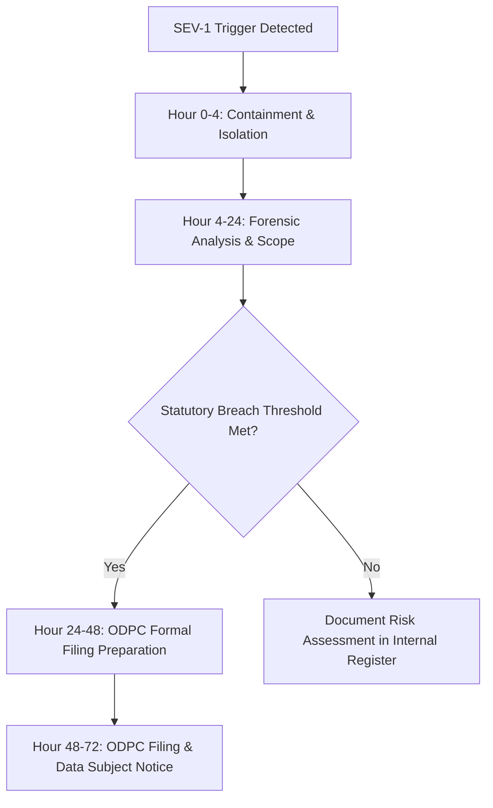

# Statutory Security Incident & Breach Notification Runbook
## NutriScore CAD Healthcare Platform — Incident Response Protocol

**Governing Law:** Kenya Data Protection Act, 2019 (s. 43); Data Protection (General) Regulations, 2021  
**Regulatory Target:** Office of the Data Protection Commissioner (ODPC), Kenya  
**Statutory Notification Deadline:** Within 72 hours of becoming aware of the breach  
**Severity Level:** SEV-1 (High-Risk Personal Data Compromise)  

---

## 1. Overview & Scope

This runbook establishes mandatory incident containment, digital forensics, evidence preservation, and statutory regulatory notification procedures for the NutriScore CAD Multi-Tenant Healthcare Backend.

Under Section 43 of the Kenya Data Protection Act 2019, any unauthorized access to, alteration of, disclosure of, or loss of personal data—specifically sensitive personal health data—triggers a mandatory statutory assessment and potential notification to the ODPC and affected data subjects within **72 hours**.

---

## 2. Automated Detection Triggers (Severity-1 Alerts)

The following four technical triggers are automatically classified as **Severity-1 Potential Data Breaches** and immediately page the Data Protection Officer (DPO), Lead Security Engineer, and On-Call Lead:

### Trigger 1: Cryptographic WORM Ledger Verifier Failure
- **Detection Mechanism:** Continuous background job `scripts/verify-audit-chain.mjs` or `audit.verify_ledger_chain()` returns `false` or detects a broken SHA-256 hash pointer.
- **Threat Model:** Direct modification of database records on disk, unauthorized deletion of audit events, or rogue administrative tampering.
- **Immediate Action:** Freeze active tenant transaction processing; dump current ledger checkpoint.

### Trigger 2: `AUTHZ_DENY` Anomaly or Anomaly Spike
- **Detection Mechanism:** Influx of `AUTHZ_DENY` audit events in `audit.worm_ledger` exceeding threshold (e.g. > 10 denials within 5 minutes for a single actor or IP, or any rejection citing `TENANT_WALL`).
- **Threat Model:** Tenant-wall traversal attempt, credential brute force, horizontal privilege escalation, or corrupted access token injection.
- **Immediate Action:** Revoke caller session token; block IP address at API Gateway.

### Trigger 3: Break-Glass Anomaly
- **Detection Mechanism:** `clinical.break_glass_access` invoked:
  - Outside registered clinical hours;
  - On a patient not currently admitted or enrolled in acute nutritional care;
  - Without supervisor review within the 24-hour mandatory window;
  - Repeated invocations by the same clinician across multiple unaffiliated patients.
- **Threat Model:** Unauthorized surveillance or exfiltration of sensitive patient records by an insider.
- **Immediate Action:** Alert clinic Medical Director; flag records for patient notification.

### Trigger 4: Plaintext PHI Canary Leak Detection
- **Detection Mechanism:** Automated CI / monitoring scan (`scripts/verify-phase6-canary.mjs`, `scripts/check-leak-proofs.mjs`, or runtime log monitor) discovers plaintext canary markers, medical diagnoses, or condition-named strings in:
  - Commercial tables (`commercial.orders`, `commercial.skus`);
  - Minted Dietary Profile Tokens (DPTs);
  - Application logs, Datadog/CloudWatch traces, or CDN access logs.
- **Threat Model:** Envelope encryption bypass, semantic projection outbox failure, or logging pipeline misconfiguration.
- **Immediate Action:** Rotate affected tenant data keys; purge log buffers; revoke active DPTs.

---

## 3. Incident Response Protocol (Hour 0 to Hour 72)



### Phase 1: Immediate Containment (Hour 0 – Hour 4)
1. **Revoke Active Sessions:**
   - Execute session revocation for suspect credentials:
     ```bash
     # Add sub/sid to denylist
     node scripts/revoke-session.mjs --sub=<SUSPECT_USER_ID> --reason="SEV-1 Breach Containment"
     ```
2. **Isolate Affected Tenant / Node:**
   - If cross-tenant traversal is suspected, disable public API ingress for the affected tenant via Kong/Envoy Gateway ClientTrafficPolicy:
     ```bash
     kubectl apply -f infra/emergency-tenant-isolation.yaml
     ```
3. **Preserve Volatile Memory & Logs:**
   - Snapshot container runtime logs, Envoy access logs, and Edge Function traces before restarting any services.

### Phase 2: Forensics & Evidence Preservation (Hour 4 – Hour 24)
1. **Verify Ledger State:**
   - Execute audit chain verification and dump signed Merkle checkpoint:
     ```bash
     node scripts/verify-audit-chain.mjs --export-checkpoint
     ```
2. **Determine Breach Scope:**
   - Run query to identify exact patients and record IDs touched during the incident window:
     ```sql
     SELECT tenant_id, actor_id, action, resource_type, resource_id, patient_ref, created_at
     FROM audit.worm_ledger
     WHERE created_at >= '<INCIDENT_START>'
     ORDER BY sequence_num ASC;
     ```
3. **Assess Data Sensitivity:**
   - Confirm whether encrypted records (`body_enc`) or plaintext derived tokens (`DPT`) were accessed.
   - If wrapped keys remained intact in `clinical.patient_keys`, records were unreadable ciphertext at rest.

### Phase 3: Statutory 72-Hour Assessment (Hour 24 – Hour 48)
Under Section 43(1) of the Kenya Data Protection Act:
- **Condition A:** Has personal data been accessed or acquired by an unauthorized person?
- **Condition B:** Does the breach present a real risk of harm to the data subjects (identity theft, discrimination, reputational damage, financial loss)?
- **Assessment Matrix:**
  - If **Health Data** in plaintext was exposed: **Mandatory Notification to ODPC and Data Subjects**.
  - If **Only AES-256-GCM Ciphertext** was extracted and keys remained secure: **Low Risk of Harm** — Document in Internal Incident Register, review with Legal Counsel.

### Phase 4: Regulatory Notification & Data Subject Notice (Hour 48 – Hour 72)
1. **Formal Filing with the ODPC:**
   - Submit statutory notification form to `complaints@odpc.go.ke` / ODPC Online Portal.
   - Form must include:
     - Nature of the breach and categories of personal data;
     - Number of data subjects and data records concerned;
     - Likely consequences of the personal data breach;
     - Technical and organisational mitigation measures taken or proposed;
     - Contact details of the Data Protection Officer (DPO).
2. **Notification to Data Subjects:**
   - Issue written notice to affected patients without undue delay in clear and plain language.
   - Advise data subjects on steps to protect against potential risks.

---

## 4. Emergency Crypto-Shredding Procedure

In the event of an active, uncontained data exfiltration targeting a specific patient's partition:
```sql
-- Irrevocably destroys wrapped data key, rendering historical PHI indecipherable
SELECT clinical.crypto_shred_patient(
  '<TENANT_ID>'::uuid,
  '<PATIENT_ID>'::uuid,
  'EMERGENCY_BREACH_CONTAINMENT'
);
```

---

## 5. Escalation Roster & Contacts

| Role | Contact Channel | Response SLA |
|---|---|---|
| Incident Commander | `ic-cad@nutriscore.test` / +254 700 000001 | < 15 minutes |
| Data Protection Officer (DPO) | `dpo@nutriscore.test` / +254 700 000002 | < 30 minutes |
| External Legal Counsel | `counsel@partnerlaw.test` | < 1 hour |
| Office of the Data Protection Commissioner (ODPC) | `incident@odpc.go.ke` / +254 20 5777000 | < 72 hours statutory |
