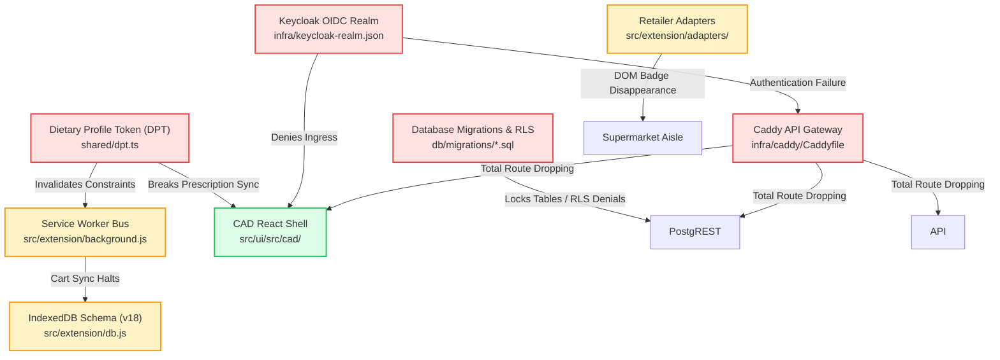

# Production Guardrails: Blast Radius & Dependency Impact Map

## Purpose & Scope
This document provides a comprehensive **Blast Radius Map** across all major functional modules of the NUT-04 Checkout Tool. It details what external integrations, background jobs, database tables, and user flows can break when changes are introduced to specific components, along with concrete containment and mitigation strategies.

---

## 1. High-Level Risk & Impact Matrix

---

## 2. Component-by-Component Blast Radius Analysis

### Module 1: Retailer DOM Adapters (`src/extension/adapters/`)
- **Primary Files:** `quickmart.js`, `naivas.js`, `carrefour.js`, `shared-ui.js`, `adapter-factory.js`.
- **Dependencies:** Retailer live HTML markup, Livewire component morphing, Vue virtual DOM, Anchor links, Shadow DOM portal.
- **Failure Modes:**
  - Retailer changes product card class names or link routing structure.
  - Livewire morph wipes injected badges without triggering `addedNodes`.
  - Product ID mismatch between card scraper and cart button (`extractProductRef`).
- **Blast Radius:**
  - Shoppers on the affected supermarket site see missing NutriScore badges or incorrect health alert popups.
  - Cart addition events fail to log, corrupting the shopping ledger.
  - *Non-Impacted:* CAD dashboard, database persistence, and other retailers remain unaffected.
- **Mitigation & Verification:** Run JSDOM adapter contract tests (`npm run test -- carrefour-naivas-adapters.test.ts`). Test against live retailer pages following the 30-minute capture protocol in `CAD_LIVE_CHROME_TESTING_GUIDE.md`.

---

### Module 2: Extension Service Worker & Message Bus (`src/extension/background.js`)
- **Primary Files:** `background.js`, `content.js`, `scanner.js`, `config.js`.
- **Dependencies:** Chrome MV3 runtime messaging (`chrome.runtime.sendMessage`), `chrome.storage.session`, `chrome.alarms`, IndexedDB.
- **Failure Modes:**
  - Unhandled promise rejection or syntax error terminates the service worker.
  - Message action payload schema diverges between content script and background worker.
  - Daily retention alarm (`ledger-retention`) fails to register.
- **Blast Radius:**
  - Complete failure of the browser extension: no product scores are returned, popup displays blank or loading spinner, cart sync halts.
  - If the retention alarm dies, IndexedDB storage grows unboundedly past 90 days.
- **Mitigation & Verification:** Automated syntax check `node --check src/extension/content.js`. Service worker regression suite (`phase4-hot-path.test.ts`, `phase3-wake-gate.test.ts`).

---

### Module 3: Dietary Profile Token (DPT) & Cryptography (`src/shared/dpt.ts`, `signer.ts`, `dpop.ts`)
- **Primary Files:** `dpt.ts`, `dpop.ts`, `signer.ts`, `claims.ts`.
- **Dependencies:** WebCrypto API, Ed25519 signature algorithm, DPoP key binding, Clinic public key distribution.
- **Failure Modes:**
  - Token minting algorithm diverges from token verification algorithm.
  - Rejection regex (`CONDITION_NAMED_PATTERNS`) accidentally rejects valid numerical keys.
  - Clock skew between server and client causes false token expiration.
- **Blast Radius:**
  - **Severe / High:** All clinician-prescribed dietary constraints fail verification across all patient extensions.
  - Extension falls back to generic healthy eating modes, dropping personalized clinical intervention.
  - If recommender fails open, unsafe food alternatives could be shown to chronic disease patients.
- **Mitigation & Verification:** DPT leak proof and claims contract suite (`npm run test -- claims-contract.test.ts`, `scripts/check-leak-proofs.mjs`).

---

### Module 4: Database Migrations & Row Level Security (`db/migrations/`, PostgreSQL 16)
- **Primary Files:** `0001_baseline.sql`, `schema.sql`, PostgreSQL triggers and RLS policies.
- **Dependencies:** PostgREST 12, PostgreSQL 16 database, Keycloak JWT claims (`app_role`, `tenant_id`).
- **Failure Modes:**
  - Exclusive table lock acquired during migration causes query timeouts on live traffic.
  - Malformed RLS policy expression denies access to legitimate clinic staff or returns empty arrays.
  - Broken statement-level trigger blocks valid inserts to `clinical.clinical_records`.
- **Blast Radius:**
  - **Critical / System-Wide:** Total CAD operational freeze. Clinicians cannot load patient rosters, prescribe targets, or view audit logs.
  - PostgREST returns HTTP 403 Forbidden or empty datasets to all API consumers.
- **Mitigation & Verification:** Automated RLS policy check `node scripts/check-rls-policies.mjs`. Verify companion rollback scripts on clean test database via `.\bin\nut.ps1 db-reset`.

---

### Module 5: Keycloak OIDC Realm & Authentication (`infra/keycloak-realm.json`, Keycloak 26)
- **Primary Files:** `infra/keycloak-realm.json`, `compose.yaml` (keycloak service).
- **Dependencies:** PostgreSQL JDBC backend, Caddy reverse proxy on `/auth/*`, Mailpit dev SMTP.
- **Failure Modes:**
  - Realm import failure due to malformed JSON or schema version mismatch in Keycloak 26.
  - Custom protocol mapper fails to inject `app_role` or `tenant_id` claims into access tokens.
  - Keycloak admin password mismatch prevents container healthcheck from passing.
- **Blast Radius:**
  - **Critical / Total Outage:** Zero users can sign in. CAD displays authentication gate failure; extension cannot execute `launchWebAuthFlow`.
- **Mitigation & Verification:** Run `.\bin\nut.ps1 up` and verify Keycloak container health check: `exec 3<>/dev/tcp/127.0.0.1/8080`. Validate token claims against `src/shared/claims.schema.json`.

---

### Module 6: Ingress API Gateway (`infra/caddy/Caddyfile`)
- **Primary Files:** `infra/caddy/Caddyfile`.
- **Dependencies:** Docker internal networking, Caddy reverse proxy engine.
- **Failure Modes:**
  - Syntax error in `Caddyfile` halts Caddy container startup.
  - Malformed route prefix stripping forwards unstripped `/api/*` to PostgREST, causing HTTP 404s.
  - Overly restrictive CSP headers block CAD script loading or Keycloak redirect origins.
- **Blast Radius:**
  - **Critical:** Ports 8080 and 8443 become unresponsive. No external traffic can reach CAD, PostgREST, or Keycloak.
- **Mitigation & Verification:** Caddy self-health probes at `http://localhost:8080/healthz`. Run gateway route tests via `docker compose exec gateway caddy validate --config /etc/caddy/Caddyfile`.

---

### Module 7: Local IndexedDB Schema (`nut04-nutriscore` v18)
- **Primary Files:** `src/extension/db.js`, `src/ui/src/app/lib/db.ts`.
- **Dependencies:** Browser IndexedDB engine (`idb` library).
- **Failure Modes:**
  - Database schema version bump without proper `onupgradeneeded` migration logic crashes client IDB connection.
  - Unhandled quota exceeded errors during large catalog syncs.
- **Blast Radius:**
  - Extension shopper popup crashes with blank white screen. Cart history and cached product grades become inaccessible.
- **Mitigation & Verification:** Vitest IndexedDB regression tests (`f04-cache-invalidation.test.ts`, `cartDiff.test.ts`).

