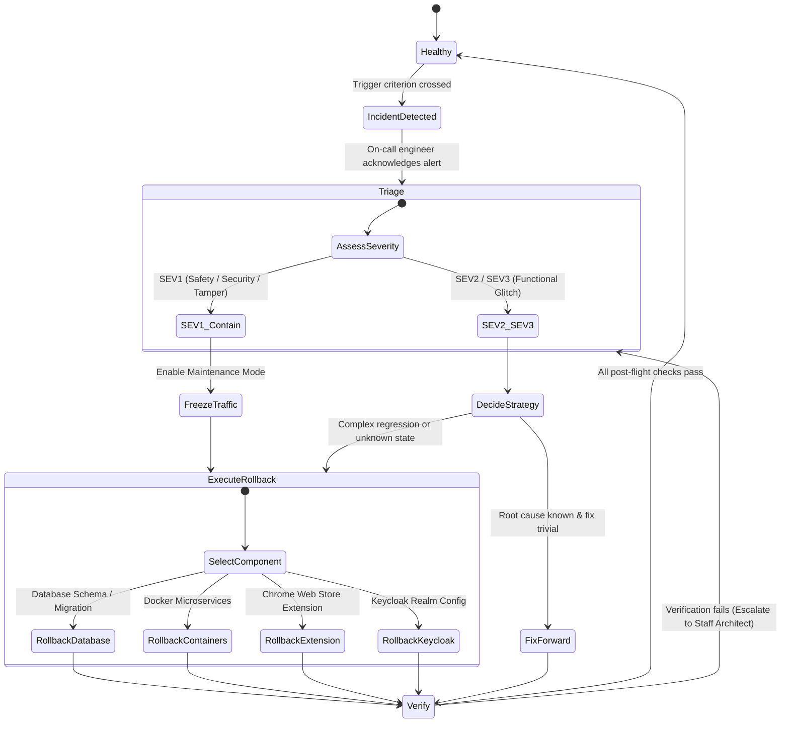

# Production Guardrails: Incident Severity & Rollback Procedures

## Purpose & Scope
This runbook provides unambiguous, step-by-step technical procedures for rolling back failing deployments, mitigating production incidents, and restoring system integrity across the **NUT-04 Checkout Tool** ecosystem. Every engineer and on-call responder must follow these exact protocols during an outage.

---

## 1. Incident Severity Classification & Escalation Matrix

| Severity | Definition & Trigger Criteria | Immediate Containment Actions | Target Mitigation SLA |
|---|---|---|---|
| **SEV1** | **Critical Healthcare Safety or Security Emergency:**<br/>- Unverified or toxic food swap recommended to chronic disease patient.<br/>- Cryptographic WORM audit chain broken or tampered with.<br/>- Tenant boundary breach (Clinic A accesses Clinic B's records).<br/>- Total Keycloak authentication outage preventing all clinical operations. | 1. Freeze gateway traffic / engage emergency maintenance mode.<br/>2. Isolate compromised tenant or revoke affected tokens.<br/>3. Notify Lead Security Architect and Medical Officer. | **< 15 Minutes** |
| **SEV2** | **Major Functional Degradation:**<br/>- Product scoring badges fail across all retailers.<br/>- CAD dashboard white-screen error on clinician login.<br/>- Database migration lock or PostgREST 500 error spike (> 5%). | 1. Roll back recent migration or container image.<br/>2. Re-deploy previous stable container version.<br/>3. Notify On-Call Platform Team. | **< 1 Hour** |
| **SEV3** | **Minor / Isolated Degradation:**<br/>- Single retailer (e.g. Carrefour) markup change breaks one adapter.<br/>- Minor chart rendering glitch in CAD billing view.<br/>- Dev Mailpit container crash. | 1. Deploy hotfix forward for retailer selector.<br/>2. File Jira bug; address in standard sprint cycle. | **< 24 Hours** |

---

## 2. Mitigation Workflow State Diagram



---

## 3. Database Migration Rollback Procedure (dbmate)

If a schema migration in `db/migrations/` introduces table locks, RLS failures, or performance regressions:

### Step 1: Execute dbmate Down via Docker
Execute the companion `.rollback.sql` migration inside the containerized environment:
```powershell
# Windows PowerShell
docker compose run --rm migrate down

# POSIX / Bash
docker compose run --rm migrate down
```
> **What This Does:** `dbmate down` reads the most recent applied migration from `schema_migrations`, locates its matching `NNNN_name.rollback.sql` companion, executes the inverse DDL inside a transaction, and decrements the migration counter.

### Step 2: Verify Schema State
Inspect the database schema and confirm that all RLS policies are active:
```powershell
docker compose exec toolchain node scripts/check-rls-policies.mjs
```

### Step 3: Restart Dependent Microservices
Restart PostgREST and the API service to clear cached schema connections:
```powershell
docker compose restart postgrest api
```

---

## 4. Docker Microservice Rollback Procedure

If a container build (API service, CAD Nginx, or Caddy) introduces regressions:

### Step 1: Check Container Health & Logs
Identify failing services:
```powershell
docker compose ps
docker compose logs -n 100 [service_name]
```

### Step 2: Revert to Last Known Good Commit
Check out the previous stable release tag:
```powershell
git checkout <PREVIOUS_STABLE_TAG>
```

### Step 3: Rebuild and Restart Services Cleanly
```powershell
# Rebuild containers using BuildKit cache
.\bin\nut.ps1 down
.\bin\nut.ps1 up -d

# Verify all 8 core services reach healthy status
docker compose ps
```
> **Expected:** `postgres` (healthy), `keycloak` (healthy), `postgrest` (running), `api` (healthy), `gateway` (healthy), `cad` (healthy), `mailpit` (healthy).

---

## 5. Chrome Extension Rollback Protocol

Chrome extension deployments cannot be rolled back directly through the Chrome Web Store because Google Chrome only accepts sequentially increasing version numbers (`1.1.1` > `1.1.0`).

### Emergency Hotfix Procedure:
1. **Locate Last Stable Release:** Identify the commit hash of the last stable extension release tag.
2. **Cherry-Pick Revert:** On the main branch, revert the faulty commit.
3. **Bump Patch Version:** In `src/extension/manifest.json` and `package.json`, increment the patch version (e.g., from `1.1.0` to `1.1.1`).
4. **Compile Artifact:**
   ```powershell
   .\bin\nut.ps1 extension
   ```
5. **Fast-Track Submission:** Submit the compiled `./dist/extension` ZIP archive to the Google Chrome Web Store Developer Dashboard, requesting an expedited security hotfix review.
6. **Kill-Switch Engagement (Server-Side):** If the faulty extension causes clinical safety risks, deactivate the active catalog release in the database:
   ```sql
   UPDATE commercial.catalog_releases SET is_current = false WHERE is_current = true;
   ```
   > **Effect:** The extension's `catalog-sync.js` fails verification and gracefully reverts to bundled offline baseline rules without executing faulty dynamic scorers.

---

## 6. Keycloak Realm Configuration Rollback

If a Keycloak configuration change locks users out or corrupts protocol mappers:

### Step 1: Re-import Canonical Realm JSON
The canonical realm definition is maintained in version control at `infra/keycloak-realm.json`.

```powershell
# Stop Keycloak container and remove corrupted auth volume if necessary
docker compose stop keycloak

# Re-launch Keycloak with forced realm import
docker compose run --rm keycloak start-dev --import-realm
```

### Step 2: Verify Token Claims Contract
Execute the automated claims verification suite:
```powershell
docker compose exec toolchain npm run test -- claims-contract.test.ts
```

---

## 7. Emergency Statutory Crypto-Shredding Procedure

When a patient exercises their statutory Right to Erasure under Kenya DPA s.40, clinical data cannot be deleted due to medical retention laws (ADR-005). The system must execute cryptographic shredding:

### Step 1: Authenticate as Authorized DPO / Super Admin in CAD
1. Log in to the Clinic Admin Dashboard (`http://localhost:8080/cad/`).
2. Navigate to **Patient Care & Consent** (`/cad/patient-linking-consent`).
3. Locate the target patient reference.

### Step 2: Execute Typed-Phrase Confirmation
1. Click **Revoke Consent & Crypto-Shred**.
2. The modal dialog requires the operator to type the exact word: `SHRED`.
3. Upon confirmation, the backend deletes the patient's individual data encryption key (`dek`) from KMS.
4. The clinical records in `clinical.clinical_records` become irreversibly undecipherable ciphertext.
5. An immutable audit record is committed to `audit.ledger` recording the erasure event.

