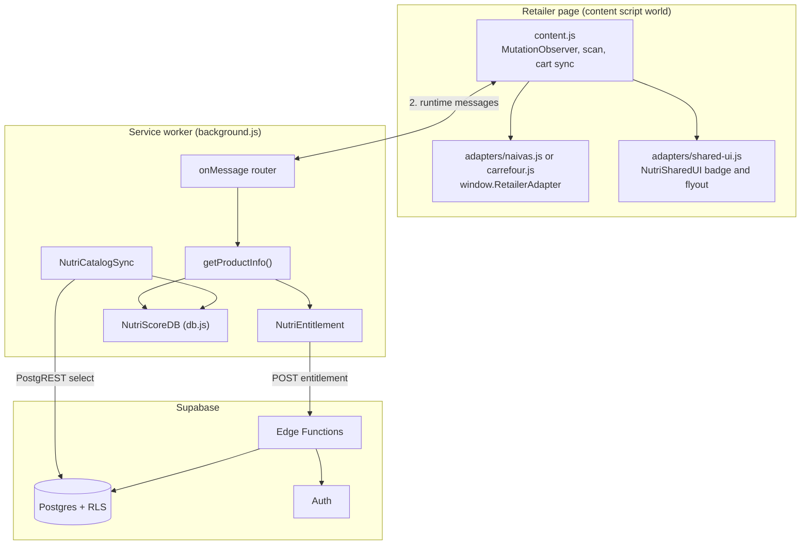

# API and Technical Reference

Reference for every programmatic entry point in NUT-04 v1.1.0: extension runtime messages, the retailer adapter contract, Supabase Edge Functions, database objects, extension modules, the catalog data schema and operator command-line tools. Verified against the source tree on 2026-10-07.

Conventions used below:

- `$SUPABASE_URL` is the project URL (ends in `.supabase.co`). Edge Functions live at `$SUPABASE_URL/functions/v1/{function-name}`.
- `$USER_JWT` is a signed-in user's Supabase access token. `$ANON_KEY` is the project's anon or publishable key.
- "Gateway JWT" means the Supabase Edge gateway's `verify_jwt` check. "In-code auth" means the function itself calls `supabase.auth.getUser()` with the bearer token.

## Contents

1. [Architecture at a glance](#1-architecture-at-a-glance)
2. [Extension runtime messages](#2-extension-runtime-messages)
3. [Retailer adapter contract](#3-retailer-adapter-contract)
4. [Edge Functions](#4-edge-functions)
5. [Database objects](#5-database-objects)
6. [Extension modules](#6-extension-modules)
7. [Catalog and record schema](#7-catalog-and-record-schema)
8. [Client storage](#8-client-storage)
9. [Operator command-line tools](#9-operator-command-line-tools)
10. [Configuration and secrets](#10-configuration-and-secrets)
11. [Legacy and unused surfaces](#11-legacy-and-unused-surfaces)

## 1. Architecture at a glance



Layering rule: the service worker is the only component that reads the catalog and computes grades. Content scripts never touch IndexedDB; extension pages (popup, dashboard, options, onboarding) import the same TypeScript database module that is compiled to `db.js` for the worker.

## 2. Extension runtime messages

Transport is `chrome.runtime.sendMessage` (to the worker) and `chrome.tabs.sendMessage` (to content scripts). Every worker handler returns `true` from `onMessage` when it responds asynchronously. Handlers that "respond with nothing" keep the channel open but never call `sendResponse`.

### 2.1 Requests handled by the service worker

| `action` | Sent by | Request fields | Response | Side effects |
|---|---|---|---|---|
| `CHECK_TIER` | UI, content | none | `{ tier: "basic" \| "premium" }` | Resolves tier from the stored entitlement token and current session |
| `REFRESH_ENTITLEMENT` | UI (after payment or sign-in) | none | `{ tier }` | Clears the 30 s tier memo, calls the `entitlement` Edge Function, adopts or clears the token |
| `OPEN_UPGRADE` | content | none | none | Opens `onboarding.html?mode=renew` in a new tab |
| `CHECK_PRODUCT_SCORE` | content | `retailer`, `payload` (see 2.2) | `{ status: "SUCCESS", data }` or `{ status: "NOT_FOUND", data: { product_name, nutriscore_grade: "UNKNOWN" }, error }` or `{ status: "ERROR", error: "Missing payload" }` | Saves price to `price_cache` when `retailer_product_id` and `price` are present |
| `CHECK_PRODUCT_SCORES_BATCH` | content | `retailer`, `payloads[]` | `{ status: "SUCCESS", results: [{ status, data, error? }] }` or `{ status: "ERROR", error }` | Same price side effect per item |
| `LOG_CART_ADD` | content | `payload` (see 2.3) | none | Resolves the product, writes a `shopping_ledger` row with `status: "in_cart"`, broadcasts `CART_UPDATED`. Skips products whose grade cannot be displayed |
| `SYNC_CART_STATE` | content | `payload: { retailer, items[] }` | `{ status: "SUCCESS" }` or `{ status: "ERROR", error }` | Persists a pending job, schedules alarm `retry-cart-sync` (30 s), runs `syncCart`, clears job and alarm on success, broadcasts `CART_UPDATED` |
| `REMOVE_CART_ITEM` | content | `payload: { retailer, productId }` | none | Calls `NutriScoreDB.removeCartItem` if defined, then broadcasts `CART_UPDATED`. **That function does not exist in this build**, so only the broadcast happens |
| `CART_CLEARED` | content | `retailer` | none | Calls `NutriScoreDB.clearCartItems` if defined (**not defined in this build**), then broadcasts `CART_UPDATED` |
| `ORDER_PLACED` | content | `retailer` | none | Calls `NutriScoreDB.markCartPurchased` if defined (**not defined in this build**), then broadcasts `CART_UPDATED` |
| `THEME_CHANGED` | popup, dashboard | `theme` | none | Relays the message to every tab with `chrome.tabs.sendMessage` |

### 2.2 Product payload (`CHECK_PRODUCT_SCORE*`)

| Field | Type | Notes |
|---|---|---|
| `product_name` | string | Visible product name |
| `name_hash` | string or null | Value of `data-original-hash` when present |
| `retailer_product_id` | string or null | `data-product-id`, `data-sku`, or an ID derived from the name |
| `url` | string or null | First anchor `href` in the card |
| `price` | number | Parsed price; `0` when absent |

Resolution order inside the worker (`resolveProductMatch`): `product_id`, `url_path_fragment`, `url`, `exact_name`, `case_insensitive_name`, `normalized_name`. `matchInfo.confidence` is `high`, `medium` or `low` accordingly.

### 2.3 Cart payloads

`LOG_CART_ADD` payload and each `SYNC_CART_STATE` item share this shape:

```json
{
  "retailer": "NAIVAS",
  "productId": "12345",
  "product_name": "Example Product 500g",
  "priceSnapshot": 189,
  "quantity": 1
}
```

`retailer` is `"NAIVAS"` or `"CARREFOUR"`. The ledger row written by `LOG_CART_ADD` adds `id` (`{retailer}-{productId}-{epoch ms}`), `name`, `addedAt`, `gradeSnapshot`, `scoringStatus`, `category`, `status`, `riskFlags` (Premium only: `diabetes`, `hypertension`, `renal`, `obesity` booleans) and `nutritionSnapshot` (`sodiumMg`, `sugarsG`, `satFatG`, `potassiumMg`).

### 2.4 Successful product response (`data`)

| Field | Meaning |
|---|---|
| `productId`, `product_name`, `retailer` | Identity |
| `nutriscore_grade` | `"A"` to `"E"` or `"UNKNOWN"` |
| `scoringStatus` | `"computed"`, `"insufficient_data"` or `"not_attempted"` |
| `plausibleFields` | `[{ field, value, unit }]`: known, physically possible nutrient values |
| `fsaCategory` | `GENERAL_FOOD`, `BEVERAGE`, `ADDED_FAT`, `CHEESE` or `RED_MEAT` variant used |
| `displayCategory` | KFCT 14-tier label, or `"Uncategorized"` |
| `isExcluded`, `canDisplayGrade` | Whether the grade is withheld |
| `algorithmVersion` | `"FSA-NPS-2023"` |
| `nutritional_profile_display` | `energy_kj`, `fat_g`, `sat_fat_g`, `carbs_g`, `sugars_g`, `fibre_g`, `protein_g`, `sodium_mg`, `potassium_mg` (numbers or `null`) |
| `confidence`, `evidenceTier`, `evidenceLevel`, `valueSpecificity`, `validationStatus` | Data-trust metadata derived from `Validation` and `NutritionProvenance` |
| `categoryPlausibilityCheck`, `energyConsistencyCheck`, `saltSodiumConsistencyCheck`, `dataQualityFlags`, `sourceReference` | Validation detail |
| `packSizeUnit` | `"g"`, `"ml"` or the stored unit |
| `matchInfo` | `{ matched, matchMethod, confidence }` |
| `activeTheme` | `general`, `diabetes`, `hypertension`, `kidney` or `obesity` |
| `tier`, `isPremium`, `upsell` | `upsell` is `true` for Basic users who selected a condition theme |
| `diseaseAssessment`, `diseaseWarnings`, `diseaseDisclaimer` | Empty unless tier is Premium and `activeTheme` is not `general` |

A grade is displayed only when the record's `ReviewState` is `ESTIMATED`, `VERIFIED` or `HIGH_CONFIDENCE`, a food category and FSA variant resolve, and at least one energy field is present. `REJECTED` and `UNVERIFIED` records are never graded.

### 2.5 Broadcasts and page queries

| `action` | Direction | Payload | Receiver behaviour |
|---|---|---|---|
| `CART_UPDATED` | worker to extension pages | none | Dashboard reloads ledger data |
| `POPUP_STATS_UPDATE` | content to extension pages | none | Popup re-queries page stats |
| `GET_PAGE_STATS` | popup to content (`chrome.tabs.sendMessage`) | none | Responds `{ count, total, retailer }`: cards with `data-nutriscore-scanned="complete"`, all scanned cards, adapter retailer code |
| `THEME_CHANGED` | worker to content | `theme` | Content script performs a full rescan |

### 2.6 Alarms

| Alarm | Schedule | Action |
|---|---|---|
| `cache-eviction` | every 24 hours | `evictStaleCacheEntries()`: removes `product_cache` entries older than 7 days |
| `retry-cart-sync` | 30 seconds after a failed or pending sync | Drains `pending_cart_syncs` through `syncCart` |

## 3. Retailer adapter contract

Each adapter file assigns `window.RetailerAdapter` and implements:

| Method | Returns | Used for |
|---|---|---|
| `getRetailerCode()` | `"NAIVAS"` or `"CARREFOUR"` | Message `retailer` field |
| `getObserveTarget()` | `Element` | Root observed by the `MutationObserver` |
| `detectProducts()` | `[{ element, name, nameHash, id, price, url }]` | Product cards on the page |
| `injectBadge(card, productResult, price)` | void | Renders the badge through `NutriSharedUI.injectBadge` |
| `extractCartState()` | cart item array (2.3 shape) | Cart sync from the visible DOM |
| `extractCartAction(node)` | cart item or `null` | Add-to-cart click handling |
| `extractRemoveAction(node)` | `{ retailer, productId, clearAll } \| null` | Remove or clear click handling |
| `detectOrderConfirmation()` | boolean | Triggers `ORDER_PLACED` once per page load |
| `fetchCartFromAPI()` (optional) | cart item array | Silent cart read on page load |

Content-script load order is fixed in `manifest.json`: `health-modes.js`, `adapters/grade-colors.js`, `adapters/shared-ui.js`, the retailer adapter, `content.js`. `npm run check:manifest` validates the ordering of the `Nutri*` globals.

Timing: product scans are debounced 300 ms after relevant DOM mutations; cart sync is debounced 1000 ms. Mutations caused by the extension's own nodes (`nutriscore-isolated-root`, `nutriscore-global-portal`) are ignored.

## 4. Edge Functions

Source: `supabase/functions/*/index.ts`. Shared helper: `_shared/plan.ts` (`getPlan(supabase, code = "premium_30d")` reads the active row from `public.plans` and throws if missing). All functions use the service role key internally.

| Function | Method | Gateway JWT | In-code auth | Purpose |
|---|---|---|---|---|
| `entitlement` | POST | required (`config.toml`) | yes | Issue a signed entitlement token |
| `payment-status` | POST | **off** (`config.toml`) | yes | Poll or finalize a payment |
| `mpesa-initiate` | POST | default (on) | yes | Start an M-Pesa STK Push |
| `paystack-initiate` | POST | default (on) | yes | Start a Paystack transaction |
| `paystack-redirect` | GET | must be off | none | Post-payment landing page |
| `mpesa-webhook` | POST | must be off | none | Daraja callback |
| `paystack-webhook` | POST | must be off | HMAC signature | Paystack event |
| `get-premium-token` | any | default | yes | Legacy; see section 11 |
| `debug-payments` | any | `true` in `config.toml`, `enabled = false` | yes | Diagnostic; never deploy |

`config.toml` configures only `payment-status`, `debug-payments` and `entitlement`. The three callback functions must be deployed with `--no-verify-jwt` (see [INSTALL.md](INSTALL.md#7-deploy-edge-functions)).

CORS: `entitlement` returns `Access-Control-Allow-Origin` from the `ALLOWED_ORIGINS` secret (comma-separated; falls back to the first entry, then `*`), methods `POST, OPTIONS`. The initiate and status functions return `Access-Control-Allow-Origin: *`.

### 4.1 `POST /entitlement`

```bash
curl -sS -X POST "$SUPABASE_URL/functions/v1/entitlement" \
  -H "Authorization: Bearer $USER_JWT" \
  -H "apikey: $ANON_KEY"
```

| Case | Status | Body |
|---|---|---|
| No active subscription | 200 | `{ "tier": "basic", "server_now": "2026-10-07T08:00:00.000Z" }` |
| Active subscription | 200 | `{ "tier": "premium", "token": "<ES256 JWT>", "premium_expires_at": "...", "server_now": "..." }` |
| Missing or invalid token | 401 | `{ "error": "Unauthorized" }` |
| Lookup failure or `ENTITLEMENT_SIGNING_KEY` unset | 500 | `{ "error": "..." }` |

Token claims: header `{ alg: "ES256", kid }` where `kid` is the private JWK's `kid` (default `entitlement-v1`); payload `{ tier: "premium", iss: "nutriscore-entitlement", sub: <user id>, iat, exp }` with `exp` equal to `premium_expires_at`.

### 4.2 `POST /mpesa-initiate`

Request body: `{ "phone": "254712345678" }`. The extension validates `07XXXXXXXX`, `01XXXXXXXX`, `2547XXXXXXXX` and `2541XXXXXXXX` and normalizes a leading `0` to `254` before calling; the function forwards the value unchanged. The amount is never read from the client: it comes from `plans.premium_30d`.

Success: 200 with the Daraja STK response (`MerchantRequestID`, `CheckoutRequestID`, `ResponseCode: "0"`, `ResponseDescription`, `CustomerMessage`). A `payments` row is inserted with `status: "pending"` and `transaction_ref = CheckoutRequestID`.

Failure: 400 `{ "error": "..." }` for a missing phone, unauthorized caller, non-zero `ResponseCode` or a failed insert.

### 4.3 `POST /paystack-initiate`

Request body: `{ "email": "user@example.com" }`. Amount (KES, in cents) comes from the plan.

Success: 200 with Paystack's `data` object (`authorization_url`, `access_code`, `reference`). A pending `payments` row is inserted with `transaction_ref = reference`. Failure: 400 `{ "error": "..." }`.

The function reads `PAYSTACK_CALLBACK_URL` but does not send it to Paystack. The post-payment redirect is whatever callback URL is configured in the Paystack dashboard; set it to the `paystack-redirect` URL.

### 4.4 `POST /payment-status`

Request body: `{ "transaction_ref": "...", "method": "mpesa" | "paystack" }`. The lookup is scoped to the caller (`transaction_ref` and `user_id`), so one user cannot read another's payment.

| Case | Status | Body |
|---|---|---|
| Payment already finalized | 200 | `{ "status": "<stored status>" }` |
| Pending, provider reports success, `grant_premium` granted | 200 | `{ "status": "completed" }` |
| Pending, provider amount or currency differs | 200 | `{ "status": "amount_mismatch" }` |
| Pending, provider reports failure | 200 | `{ "status": "failed" }` |
| Still pending | 200 | `{ "status": "pending" }` |
| Any error, including unauthorized or payment not found | 400 | `{ "error": "..." }` |

This function never returns a token. The client obtains the token by calling `REFRESH_ENTITLEMENT` (which calls `entitlement`).

### 4.5 `GET /paystack-redirect`

Query: `reference` or `trxref`. Returns 200 `text/plain` telling the user the payment is being verified and to return to the extension, with the reference echoed.

### 4.6 `POST /mpesa-webhook`

Daraja STK callback. Body: `{ "Body": { "stkCallback": { "CheckoutRequestID", "ResultCode", ... } } }`.

1. `ResultCode` other than `0`: marks the payment `failed`, returns 200 `OK`.
2. `ResultCode` `0`: obtains a Daraja token, runs `stkpushquery`, and calls `grant_premium(payment_id, null, null)` when the query result is `0` **or the query result is missing or `1036`**.
3. Otherwise marks the payment `failed`.

Always returns 200 `OK` except on exceptions (400 `{ "error": "..." }`). The callback is unauthenticated; see the trust gap in [INSTALL.md](INSTALL.md#pre-launch-checklist).

### 4.7 `POST /paystack-webhook`

Header `x-paystack-signature` must equal the HMAC-SHA512 of the raw body keyed with `PAYSTACK_SECRET_KEY`; missing header returns 401 `Missing signature`, mismatch returns 401 `Invalid signature`. Only `charge.success` is acted on: it calls `grant_premium` with `amount / 100` and the event currency. Other events return 200 `OK`.

### 4.8 Payment status values

`pending`, `completed`, `failed`, `amount_mismatch` (all stored in `payments.status`).

## 5. Database objects

Migrations in `supabase/migrations/`, applied in filename order. They are forward-only; there are no down migrations.

### 5.1 Tables

| Table | Purpose | Key columns | Access |
|---|---|---|---|
| `public.users` | Profile and billing state, 1:1 with `auth.users` | `id`, `full_name`, `email`, `dob`, `gender`, `condition`, `metric`, `notification_frequency`, `terms_accepted`, `privacy_accepted`, `consent_timestamp`, `onboarding_completed`, `health_mode`, `selected_tags`, `premium_expires_at`, `payment_received_at`, `is_premium`, `subscription_status`, `trial_started_at`, `created_at`, `updated_at` | RLS: select own row; insert and update own row on the granted profile columns only |
| `public.plans` | Server-owned price list | `code`, `price_kes`, `duration_days`, `active`; seed row `premium_30d`, 189.00 KES, 30 days | Authenticated select of active rows |
| `public.payments` | Payment ledger | `id`, `user_id`, `amount`, `plan`, `payment_method`, `transaction_ref` (unique), `status`, `provider_amount`, `granted_at`, `created_at`, `updated_at` | Select own rows; published to `supabase_realtime` |
| `public.catalog_products` | Signed catalog rows | `retailer` (`CARREFOUR` or `NAIVAS`), `product_id`, `seq`, `record` (jsonb), `record_hash`, `review_state`, `deleted`, `updated_at`; PK `(retailer, product_id)` | Authenticated select |
| `public.catalog_premium` | Precomputed condition assessments | `retailer`, `product_id`, `seq`, `assessments` (jsonb), `record_hash`, `deleted`, `updated_at` | Authenticated select only when `is_premium_active(auth.uid())` |
| `public.catalog_releases` | Signed manifests | `id`, `manifest` (jsonb), `signature`, `key_id`, `is_current` (unique where true), `created_at` | Authenticated select |
| `public.products` | Legacy pre-catalog table | see migration `20240101000000_schema.sql` | Anon access revoked; unused by the extension |

Profile columns writable by `authenticated`: `id`, `full_name`, `email`, `dob`, `gender`, `condition`, `metric`, `notification_frequency`, `terms_accepted`, `privacy_accepted`, `consent_timestamp`, `onboarding_completed`, `health_mode`, `selected_tags`. Billing columns are not writable by clients.

### 5.2 Functions and triggers

| Object | Kind | Security | Behaviour |
|---|---|---|---|
| `grant_premium(p_payment_id uuid, p_provider_amount numeric, p_provider_currency text)` | function returning `jsonb` | definer; execute only for `service_role` | Locks the payment row. Returns `not_found`, `already_granted`, `not_pending` (with `status`), `amount_mismatch` (and marks the payment `amount_mismatch`) or `granted` (with `premium_expires_at`). A grant extends from the later of now and the current expiry by the plan's `duration_days` |
| `get_my_entitlement()` | function returning `jsonb` | definer; authenticated | `{ tier, premium_expires_at, ever_premium, server_now }` |
| `is_premium_active(p_uid uuid)` | function returning boolean | definer; authenticated and `service_role` | Used by `catalog_premium` RLS |
| `enforce_billing_state()` | trigger on `users` (before insert or update) | invoker | For `authenticated` and `anon`, resets `premium_expires_at` and `payment_received_at`; derives `is_premium` and `subscription_status` (`basic`, `active` or `expired`) from `premium_expires_at` |
| `handle_new_user()` | trigger on `auth.users` (after insert) | definer | Creates the `public.users` row from `id`, `email` and `full_name` metadata |
| `set_updated_at()` | trigger on `users` | invoker | Maintains `updated_at` |
| `catalog_upsert(jsonb)`, `catalog_premium_upsert(jsonb)` | functions | definer; `service_role` | Batch upsert; bumps `seq` only when the hash changed or a tombstone is revived |
| `catalog_tombstone_missing(text, text[])`, `catalog_premium_tombstone_missing(text, text[])` | functions | definer; `service_role` | Marks rows absent from the keep list as deleted |
| `catalog_release_publish(jsonb, text, text)` | function returning bigint | definer; `service_role` | Verifies `manifest.max_seq` against the live maximum over non-deleted rows, flips `is_current`, inserts the release |

The `active_subscriptions` view also exists (from `20260924130000_protect_billing_columns.sql`).

### 5.3 Migration list

| File | Content |
|---|---|
| `20240101000000_schema.sql` | `users`, `products`, `payments`, base RLS, `pg_trgm` |
| `20240922000000_realtime.sql` | Drops and recreates the `supabase_realtime` publication, adds `payments` |
| `20260922173139_query_payments.sql` | Empty file |
| `20260922183709_fix_payments_fk.sql` | `handle_new_user` trigger and backfill of `users` from `auth.users` |
| `20260924000000_subscription_lifecycle.sql` | `payment_received_at`, `subscription_status` with CHECK (`active`, `expired`, `trialing`), expiry trigger |
| `20260924120000_user_profile_columns.sql` | Profile and consent columns, insert policy, `updated_at` trigger |
| `20260924130000_protect_billing_columns.sql` | Billing column protection trigger and `active_subscriptions` view |
| `20260927230000_consolidate_triggers.sql` | Replaces the two triggers with `trg_enforce_billing_state` |
| `20260927234500_bounded_trial.sql` | `trial_started_at` and trial expiry logic |
| `20260928000000_billing_authority.sql` | `premium_expires_at`, `plans`, `grant_premium`, entitlement helpers, column grants, new `enforce_billing_state` |
| `20260928010000_catalog_schema.sql` | Catalog tables, RLS, upsert, tombstone and publish functions |

## 6. Extension modules

Service-worker load order (`importScripts` in `background.js`): `config.js`, `supabase.js`, `db.js`, `entitlement.js`, `catalog-sync.js`, `health-modes.js`, `engine/health-flags.js`, `engine/scorers/{energy-dense,fibre-forward,protein-tradeoff,strict-density,general}.js`, `engine/context-engine.js`.

### 6.1 `NUTRI_CONFIG` (`config.js`)

| Key | Meaning |
|---|---|
| `SUPABASE_URL`, `SUPABASE_ANON_KEY` | Public project coordinates used by the worker |
| `CATALOG_PUBLIC_KEYS` | ES256 public JWKs for catalog manifests (`kid: catalog-v1`) |
| `ENTITLEMENT_PUBLIC_KEYS` | ES256 public JWKs for entitlement tokens (`kid: entitlement-v1`) |

### 6.2 `NutriEntitlement` (`entitlement.js`)

| Method | Description |
|---|---|
| `resolveTier(sessionUserId)` | Returns `{ tier }`. `basic` when there is no user, no stored token, an invalid token, or a detected clock rollback |
| `refresh()` | Fetches `/entitlement`, adopts a valid premium token, clears the token on an explicit `basic` response, updates the clock guard from `server_now`; returns the tier string |
| `verifyToken(token, expectedSub)` | `{ valid, payload }` or `{ valid: false, reason }` with reasons `malformed`, `alg_rejected`, `unknown_kid`, `bad_signature`, `wrong_iss`, `wrong_sub`, `expired`, `error:*` |
| `adopt(token)` | Verifies and stores a token |
| `clear()` | Removes the stored token |

Storage keys in `chrome.storage.local`: `nutri_entitlement` (token), `nutri_time_guard` (`{ maxLocalSeen, lastServerNow }`). Accepted algorithm: ES256 only. Expected issuer: `nutriscore-entitlement`.

### 6.3 `NutriCatalogSync` (`catalog-sync.js`)

| Method | Description |
|---|---|
| `ensureReady()` | Runs `sync()` if needed and resolves when the local catalog is usable |
| `sync()` | Reads the current `catalog_releases` row, verifies the ES256 signature against `CATALOG_PUBLIC_KEYS`, pulls `catalog_products` rows with `seq` up to `manifest.max_seq` into staging, compares the SHA-256 catalog hash to `manifest.catalog_hash`, then commits. For Premium it pulls `catalog_premium` and checks `manifest.premium_hash` |

Failure rules: unknown `key_id`, bad signature, or hash mismatch throws and leaves the previously committed catalog in place.

### 6.4 `NutriScoreDB` (`db.js`, built from `src/ui/src/app/lib/db.ts`)

| Group | Functions |
|---|---|
| Settings | `getSettings`, `saveSettings`, `DEFAULT_SETTINGS`, `purgeAll`, `clearPremium` |
| Catalog | `getCatalogMeta`, `putCatalogMeta`, `getPremiumAssessment(retailer, productId)`, `getAllProducts` |
| Resolution | `resolveProductMatch(retailer, retailerProductId, url, productName)`, `normalizeProductName` |
| Grading | `interpretProduct(record)`, `computeGradeFromProduct(record)` returning `{ grade, status, plausibleFields }`, `resolveDisplayCategory(record)` |
| Cache | `getCachedProduct`, `saveProduct`, `savePrice`, `evictStaleCacheEntries` |
| Ledger | `logCartEvent`, `getAllEntries`, `syncCart`, `deleteLedgerEntry`, `savePendingCartSync`, `getPendingCartSyncs`, `clearPendingCartSync` |
| Analytics | `resolveTimeframe(key, now)`, `calculateAnalytics(...)` returning `basketQuality`, `categoryInsights`, `nutrientTrends`, `healthAlerts` |

`Settings` shape: `diabetes`, `hypertension`, `kidney`, `obesity` (booleans), `profileName`, `primaryMetric`, `condition`, `initials`, `activeTheme`. `isPremium` is intentionally not stored in settings.

### 6.5 Engines

| File | Role |
|---|---|
| `engine/context-engine.js` | `NutritionContextEngine`: context grading groups plus health flags (`IsEnergyDense`, `IsHighSodium`, `DiabeticFriendly`, `RenalSafe`) |
| `engine/health-flags.js`, `engine/scorers/*.js` | Flag logic and per-group scorers |
| `pipeline/disease-engine.js` | `DiseaseEngine.evaluate(product, { conditions })` for diabetes, hypertension, renal and obesity rules. Publish-time only; excluded from `dist/` |

Thresholds (per 100 g unless stated): diabetes sugar above 22.5 g, carbohydrates above 60 g, energy above 400 kcal, fibre 6 g protective; hypertension sodium above 600 mg and saturated fat above 5 g; obesity energy 400 kcal, sugar 22.5 g, saturated fat 5 g. The service worker does not call these engines at run time; it reads their output from `premium_assessments`.

### 6.6 `NutriHealthModes` (`health-modes.js`)

Generated from `src/shared/health-modes.mjs`. Keys: `general`, `diabetes`, `hypertension`, `kidney` (and `obesity` where defined in the source). Each entry has `id`, `label`, `engineKey`, `chipPrefix` and a `palette` (`primary`, `accentBg`, `border`, `headerBg`, `headerText`, `headerSub`, `detail`).

## 7. Catalog and record schema

### 7.1 Release manifest

Stored in `catalog_releases.manifest` and signed with ES256 over `stableStringify(manifest)` (signature is base64url, raw `r || s`). Fields used by the client: `version`, `max_seq`, `catalog_hash`, `premium_hash`, `disclaimer`.

### 7.2 Product record (`catalog_products.record`)

| Block | Fields used by the runtime |
|---|---|
| `Identity` | `ProductID`, `ProductName`, `RetailerProductUrl` |
| `Classification` | `NutritionCategory` (KFCT 14-tier), `FSACategoryCode`, `NOVA.Level`, `NOVA.Confidence` |
| `Packaging` | `PackSizeUnit` |
| `Nutrition` | `EnergyKJ`, `EnergyKcal`, `FatG`, `SaturatedFatG`, `CarbohydratesG`, `SugarsG`, `FibreG`, `ProteinG`, `SodiumMG`, `PotassiumMG` |
| `NutritionProvenance` | `ValueSpecificity`, `EvidenceLevel` |
| `Validation` | `ReviewState`, `ConsistencyChecks`, `DataQualityFlags` |
| `Price` | Retailer price data |

`ReviewState` values: `REJECTED`, `UNVERIFIED`, `ESTIMATED`, `VERIFIED`, `HIGH_CONFIDENCE`. Any other value is treated as `UNVERIFIED` and flagged `unrecognised_review_state`.

`NutritionCategory` to FSA variant: `Beverages` to `BEVERAGE`; `Fats & Oils` to `ADDED_FAT`; Dairy, Cereals & Grains, Confectionery, Meat & Eggs and the other food tiers to `GENERAL_FOOD`. `CHEESE` and `RED_MEAT` are reachable only when a record sets `FSACategoryCode`.

### 7.3 Premium assessment (`catalog_premium.assessments`)

Object keyed by `diabetes`, `hypertension`, `renal`, `obesity`. Each value holds `diseaseAssessment` (object) and `warnings` (array). The service worker maps the Dashboard theme `kidney` to the engine key `renal` through `NutriHealthModes[theme].engineKey`.

## 8. Client storage

### 8.1 IndexedDB `nut04-nutriscore`, version 15

| Store | Key | Purpose |
|---|---|---|
| `user_settings` | out-of-line | Settings |
| `product_cache` | out-of-line | Scored product cache, 7-day eviction |
| `carrefourProducts`, `naivasProducts` | `Identity.ProductID` (indexes `by-url`, `by-name`) | Synced catalog by retailer |
| `shopping_ledger` | `id` (indexes `by-addedAt`, `by-retailer-product-status`, `by-status`) | Cart history. The row type allows `in_cart`, `purchased` and `removed`; only `in_cart` is ever written |
| `dataset_metadata` | `retailer` | Holds the catalog metadata row under key `_catalog` (`getCatalogMeta`, `putCatalogMeta`) |
| `price_cache` | out-of-line | Last seen prices |
| `pending_cart_syncs` | `id` | Retry queue for cart sync |
| `catalog_staging`, `catalog_hashes` | `key` | Sync staging and hash verification |
| `premium_assessments` | `key` | Synced Premium assessments |

Upgrade behaviour: version 6 replaced the old `shopping_history` store with `shopping_ledger`; version 13 clears `carrefourProducts`, `naivasProducts`, `product_cache` and `dataset_metadata` and creates `catalog_staging`, `catalog_hashes` and `premium_assessments`; versions 14 and 15 clear the sync stores, the product stores and `dataset_metadata` again to force a fresh sync. `shopping_ledger` and `user_settings` are never cleared by an upgrade. A browser profile that has opened version 15 cannot be opened by an older extension build (see [ROLLBACK_RUNBOOK.md](ROLLBACK_RUNBOOK.md)).

### 8.2 `chrome.storage.local` keys

`partial_onboarding`, `user_account`, `user_preferences`, `user_payment`, `onboarding_completed`, `activePaymentRef`, `activePaymentMethod`, `nutri_entitlement`, `nutriscore_is_premium`, `nutri_time_guard`, plus the Supabase session. All user-linked keys except `nutri_time_guard` are removed on sign-out.

## 9. Operator command-line tools

### 9.1 `node scripts/gen-keys.mjs`

Generates two ES256 (P-256) key pairs. Private JWKs are printed to stdout only. Public JWKs are written to `config/public-keys/catalog.jwks.json` and `config/public-keys/entitlement.jwks.json`. Copy the public keys into `NUTRI_CONFIG` in `src/extension/config.js`; the build does not inject them.

### 9.2 `node scripts/publish-catalog.mjs`

| Option | Meaning |
|---|---|
| `--carrefour PATH` | Carrefour JSON (default `src/extension/data/carrefour_products.json`) |
| `--naivas PATH` | Naivas JSON (default `src/extension/data/naivas_products.json`) |
| `--commit` | Write to Supabase; without it the run is a dry run |
| `--allow-dedupe` | Proceed when expected duplicate product IDs are found |
| `--force-count-change` | Allow a change of more than 10 percent in a retailer's product count |

Environment for `--commit`: `SUPABASE_URL`, `SUPABASE_SERVICE_ROLE_KEY`, `CATALOG_SIGNING_KEY` (private JWK as JSON). Exit codes: `0` success, `1` validation, duplicate, count-guard or hash-mismatch abort, `2` environment or configuration error. The command upserts in batches of 500, tombstones missing rows, recomputes both hashes from the database, signs the manifest and calls `catalog_release_publish`.

### 9.3 Other scripts

| Script | Purpose |
|---|---|
| `build-db.mjs` | Compile `db.ts` to `src/extension/db.js` |
| `build-sw-client.mjs` | Bundle `supabase-js` into `src/extension/supabase.js` |
| `build-ext.mjs` | Copy `src/extension` to `dist/`, excluding `.xlsx`, `data/` and `pipeline/` |
| `build-health-modes.mjs` | Generate `health-modes.js` from `src/shared/health-modes.mjs` |
| `check-manifest-globals.mjs` | Validate script ordering |
| `check_payments.mjs` | Diagnostic read of payments as an anon client (reads `VITE_SUPABASE_URL`, `VITE_SUPABASE_ANON_KEY`) |
| `check_payments_service.mjs` | Diagnostic read with the service role (reads `VITE_SUPABASE_URL`, `SUPABASE_SERVICE_ROLE_KEY`) |
| `upload_success_page.mjs` | Uploads a success page; reads `VITE_SUPABASE_URL` and `VITE_SUPABASE_SERVICE_ROLE_KEY` |
| `ingest_products.ts` | Writes to the legacy `products` table; not part of the catalog flow |

## 10. Configuration and secrets

| Name | Where | Used by |
|---|---|---|
| `VITE_SUPABASE_URL`, `VITE_SUPABASE_ANON_KEY` | `.env` (build time) | UI pages |
| `NUTRI_CONFIG.*` | `src/extension/config.js` | Service worker |
| `SUPABASE_URL`, `SUPABASE_SERVICE_ROLE_KEY` | Supplied to Edge Functions by Supabase | All functions |
| `ENTITLEMENT_SIGNING_KEY` | Supabase secret (private JWK, JSON) | `entitlement` |
| `ALLOWED_ORIGINS` | Supabase secret | `entitlement` CORS |
| `PAYSTACK_SECRET_KEY` | Supabase secret | `paystack-initiate`, `payment-status`, `paystack-webhook` |
| `PAYSTACK_CALLBACK_URL` | Supabase secret | Read by `paystack-initiate`, not sent to Paystack |
| `MPESA_CONSUMER_KEY`, `MPESA_CONSUMER_SECRET`, `MPESA_SHORTCODE`, `MPESA_PASSKEY` | Supabase secrets | `mpesa-initiate`, `mpesa-webhook`, `payment-status` |
| `MPESA_ENV` | Supabase secret; `production` selects `api.safaricom.co.ke`, anything else or unset selects the sandbox | Same functions |
| `MPESA_CALLBACK_URL` | Supabase secret | `mpesa-initiate` (the `mpesa-webhook` function URL) |
| `CATALOG_SIGNING_KEY` | Operator environment or CI secret (private JWK) | `publish-catalog.mjs` |

## 11. Legacy and unused surfaces

| Item | State |
|---|---|
| `get-premium-token` Edge Function | Called once by `dashboard.tsx`. Signs with `PREMIUM_SIGNING_KEY`, with no `kid` or `iss`, so `NutriEntitlement.verifyToken` rejects its tokens. Premium still activates because `savePremiumStatus` then triggers `REFRESH_ENTITLEMENT`, which fetches a valid token from `entitlement` |
| `verifyPremiumToken` in `db/settings.ts` | Verifies legacy tokens against a hard-coded public key that differs from the `config.js` keys |
| `debug-payments` Edge Function | Returns the 20 most recent payments of all users to any authenticated caller. Do not deploy |
| `engine/*` files in the worker | Loaded by `importScripts` but not called at run time |
| `removeCartItem`, `clearCartItems`, `markCartPurchased` | Referenced by worker handlers but defined nowhere; no code sets ledger status `purchased` or `removed` |
| `supabase/tests/*.sql` | Contain syntax errors and do not run |
| `supabase/test_sec003.sql` | One-off script from an earlier fix |
| `build.ps1` | Superseded by `npm run build`; omits the service-worker client bundle |
| `patch_datasets.cjs` | One-off dataset patch script |
| `public.products`, `scripts/ingest_products.ts` | Pre-catalog data path |
| Docs `src/ui/README.md`, `src/ui/guidelines/Guidelines.md` | Design-tool export boilerplate, not project documentation |
