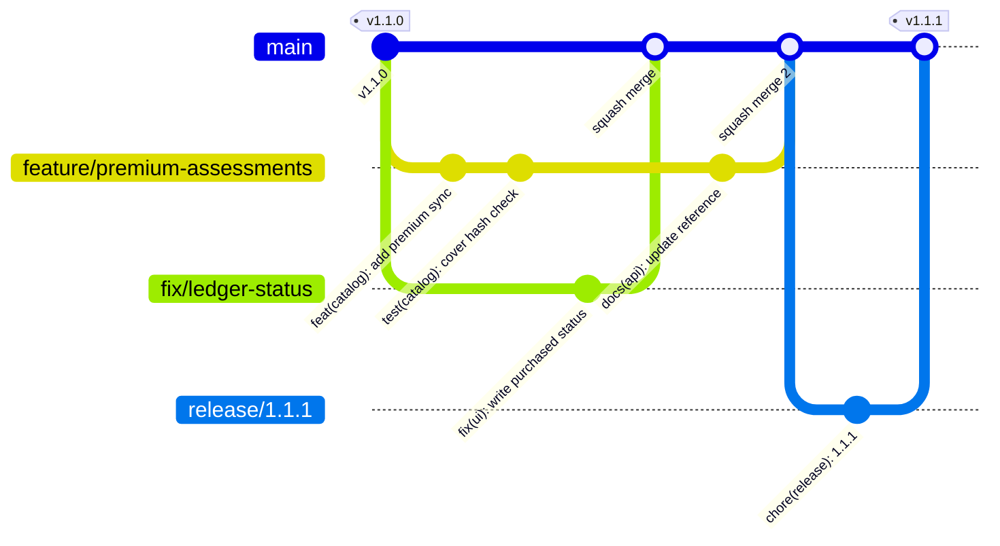
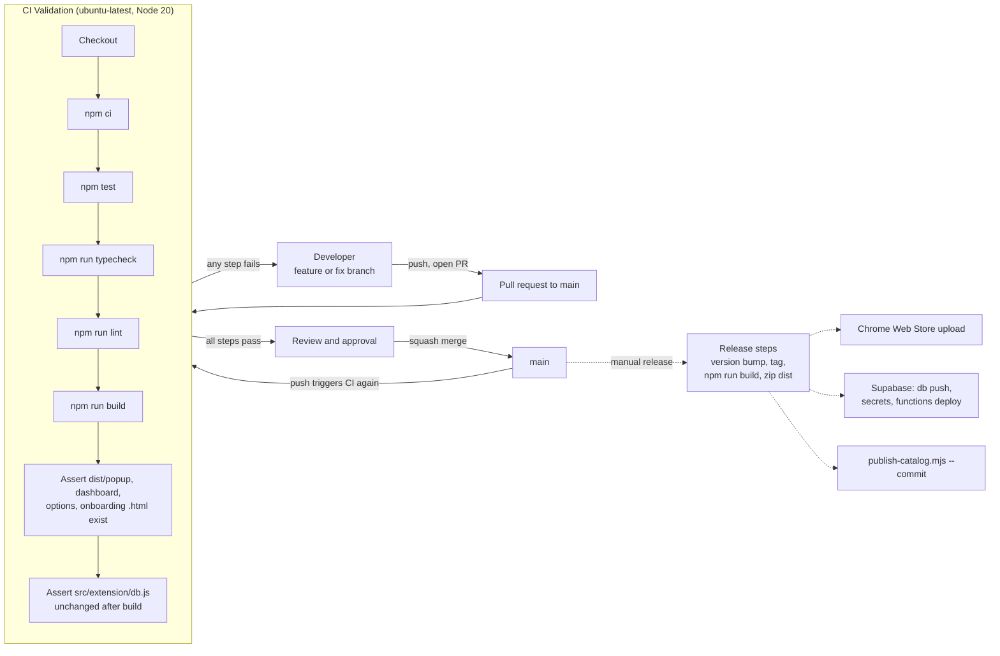

# Contributing

Developer workflow for NUT-04. This project is proprietary (see [LICENSE](LICENSE)); contributions are accepted only from people authorized by the copyright holder, and by contributing you agree the work is covered by that license.

## Contents

1. [Set up](#1-set-up)
2. [Workflow](#2-workflow)
3. [Branch naming](#3-branch-naming)
4. [Commit messages](#4-commit-messages)
5. [Quality gates](#5-quality-gates)
6. [Generated files](#6-generated-files)
7. [Code conventions](#7-code-conventions)
8. [Tests](#8-tests)
9. [Database and Edge Function changes](#9-database-and-edge-function-changes)
10. [Pull requests](#10-pull-requests)
11. [CI/CD pipeline](#11-cicd-pipeline)
12. [Releasing](#12-releasing)

## 1. Set up

Requirements: Node.js 20 or newer, npm, Git, Chrome 110 or newer. Details are in [INSTALL.md](INSTALL.md#1-topology-and-requirements).

```bash
npm ci
cp .env.example .env
npm run build
```

`npm ci` runs `prepare`, which sets `git config core.hooksPath .githooks` so the pre-commit hook is active. It only works inside a Git checkout.

Fill the two `VITE_` variables in `.env` with your own development Supabase project. Never use the production project for development, and never put a service role key in `.env`.

Load `dist/` as an unpacked extension (`chrome://extensions`, Developer mode, Load unpacked) and reload it after each build.

## 2. Workflow

The project is trunk-based: `main` is always releasable and every change reaches it through a pull request.



1. Update `main` and branch from it.
2. Make small, focused commits.
3. Run the quality gates (section 5) locally.
4. Push and open a pull request into `main`. CI must be green.
5. A reviewer approves; merge with **squash and merge** so each change is one conventional commit on `main`.
6. Delete the branch.

## 3. Branch naming

Pattern: `type/short-kebab-description`, optionally followed by a ticket or defect ID.

| Prefix | Use | Example |
|---|---|---|
| `feature/` | New behaviour | `feature/catalog-delta-sync` |
| `fix/` | Defect fix | `fix/onboarding-finish-crash` |
| `docs/` | Documentation only | `docs/api-reference-update` |
| `refactor/` | No behaviour change | `refactor/db-module-split` |
| `test/` | Tests only | `test/entitlement-clock-guard` |
| `chore/` | Tooling, dependencies, config | `chore/eslint-config` |
| `hotfix/` | Urgent production fix, branched from the released tag | `hotfix/rollback-v1.1.0` |
| `release/` | Release preparation | `release/1.1.1` |

Use lowercase letters, digits and hyphens only.

## 4. Commit messages

Format: [Conventional Commits](https://www.conventionalcommits.org/).

```text
type(scope): imperative summary of up to 72 characters

Optional body explaining what changed and why, wrapped at 80 columns.

Optional footers: Refs: D-31, BREAKING CHANGE: description
```

| Type | Use |
|---|---|
| `feat` | New user-visible capability |
| `fix` | Defect fix |
| `docs` | Documentation |
| `refactor` | Code change without behaviour change |
| `perf` | Performance improvement |
| `test` | Tests |
| `build` | Build scripts, Vite, dependencies |
| `ci` | Workflow changes |
| `chore` | Anything else that does not touch shipped behaviour |

Scopes in use: `extension`, `adapters`, `engine`, `ui`, `catalog`, `billing`, `entitlement`, `supabase`, `functions`, `ci`, `docs`.

Breaking changes (database schema, message contract, IndexedDB version, signing keys, public configuration) use `!` after the scope and a `BREAKING CHANGE:` footer, for example `feat(catalog)!: change manifest hash input`. These entries feed the **Breaking Changes** section of [CHANGELOG.md](CHANGELOG.md).

## 5. Quality gates

Run before every push. CI runs the first five.

| Gate | Command | Requirement |
|---|---|---|
| Tests | `npm test` | All pass |
| Typecheck | `npm run typecheck` | Do not add errors. The tree currently has 31 pre-existing errors listed in [README.md](README.md#release-status); any file you touch should leave its error count lower or equal |
| Lint | `npm run lint` | Zero errors. Warnings are allowed, but do not add new ones in code you write |
| Build | `npm run build` | Succeeds |
| Generated file freshness | `git status --porcelain src/extension/db.js` | Empty after a build |
| Manifest globals | `npm run check:manifest` | Passes. CI does not run it; run it whenever you add or reorder a script in `manifest.json` or `importScripts` |
| Extension syntax | `find src/extension -name '*.js' -not -path '*/data/*' -print0 \| xargs -0 -n1 node --check` | No output. CI does not run it; the extension's classic scripts are not compiled, so a syntax error otherwise reaches users unnoticed |

Lint scope is defined in `eslint.config.js`: TypeScript and React rules for `src/ui`, classic-script rules for `src/extension` (cross-file globals are checked by `check:manifest`, not `no-undef`), Node rules for `scripts/`, and Deno-oriented TypeScript rules for `supabase/functions`. Generated files (`db.js`, `supabase.js`, `health-modes.js`) and `dist/` are ignored.

## 6. Generated files

Three extension files are generated and committed. Edit the source, never the output.

| Generated file | Source | Command |
|---|---|---|
| `src/extension/db.js` | `src/ui/src/app/lib/db.ts` and `src/ui/src/app/lib/db/*.ts` | `npm run build:db` |
| `src/extension/supabase.js` | `@supabase/supabase-js` | `node scripts/build-sw-client.mjs` (part of `build:ext`) |
| `src/extension/health-modes.js` | `src/shared/health-modes.mjs` | `node scripts/build-health-modes.mjs` (not part of `npm run build`) |

The pre-commit hook rebuilds `db.js` only when `src/ui/src/app/lib/db.ts` is staged. Edits to files under `src/ui/src/app/lib/db/` do not trigger it, so run `npm run build:db` yourself after changing them and commit the result; CI fails on a stale `db.js`.

## 7. Code conventions

**Extension runtime (`src/extension`)**

- Files are classic scripts that share globals (`NutriScoreDB`, `NutriEntitlement`, `NutriCatalogSync`, `NutriSharedUI`, `RetailerAdapter`). Do not use ES module syntax. Load order is defined in `manifest.json` (content scripts) and `importScripts` in `background.js`; keep `check:manifest` passing.
- Register `chrome.runtime`, `chrome.alarms` and other listeners synchronously at the top level of `background.js`, so a cold service-worker start still receives events.
- No remote code, no `eval`, no inline scripts. The extension relies on the default MV3 content security policy.
- Escape any dynamic text placed into HTML with `escapeHTML` before using `innerHTML`.
- Adapter selectors belong inside the retailer adapter file. Add new retailers by implementing the contract in [API_REFERENCE.md, section 3](API_REFERENCE.md#3-retailer-adapter-contract) and adding the host to `host_permissions` and `content_scripts`.
- Persist data in IndexedDB through `db.ts`. Do not use `localStorage` for data the service worker needs; it cannot see it.

**UI (`src/ui`)**

- TypeScript and React syntax, built with Preact through the aliases in `vite.config.ts`.
- Call the service worker through `chrome.runtime.sendMessage` using the actions in the message contract; do not import worker-only code.
- Do not place premium decisions in the UI. The authority is the signed entitlement token verified by the worker.

**Data and scoring**

- Never substitute `0` for a missing nutrient. A missing required field yields `insufficient_data`, not a grade.
- Do not weaken thresholds without a documented clinical source and a test.

**Secrets**

- Only public values (Supabase URL, anon or publishable key, public JWKs) may appear in the client. Service role keys, private JWKs and provider secrets live in Supabase secrets or CI secrets.

## 8. Tests

- Framework: Vitest. Files live in `src/ui/src/app/__tests__/` and are matched by `npm test`.
- Name regression tests after the defect or feature (`d11-blank-root.test.ts`, `entitlement.test.ts`). Every bug fix needs a test that fails without the fix.
- `src/ui/src/app/__tests__/setup.ts` pins the timezone to UTC and the default locale to `en-US` for the test run so date-bucketed snapshots are reproducible. The suite passes in any timezone and locale.
- Update snapshots only when behaviour changed on purpose: `npx vitest run src/ui/src/app/__tests__ -u`, then review the diff.
- Test the worker-side logic through the compiled `db.js` or the TypeScript modules; do not add tests that need a live Supabase project.

## 9. Database and Edge Function changes

Database:

- Add a new file in `supabase/migrations/` named `YYYYMMDDHHMMSS_short_description.sql`. Never edit a migration that has been applied anywhere.
- Migrations are forward-only. Include in the pull request description how the change would be reversed ([ROLLBACK_RUNBOOK.md, section 4.6](ROLLBACK_RUNBOOK.md#46-database)).
- Test against a scratch database: with Docker available, `supabase db reset` rebuilds a local stack from the migrations. Exercise the new objects, including the row-level security policies as the `authenticated` and `anon` roles.
- Any constraint, trigger or grant change that touches `public.users` must be tested by inserting a new row into `auth.users` (this fires `handle_new_user`) and by updating billing columns as the `authenticated` role.

Edge Functions:

- Keep functions in `supabase/functions/<name>/index.ts`; shared code in `_shared/`.
- Authenticate users inside the function with `supabase.auth.getUser`. Functions called by payment providers must be deployed with `--no-verify-jwt` and must verify the provider's signature or confirm the payment with the provider.
- Never trust an amount, plan or currency sent by the client. The price comes from `public.plans`; premium is granted only through `grant_premium`.
- New secrets must be added to the table in [API_REFERENCE.md, section 10](API_REFERENCE.md#10-configuration-and-secrets) and to [INSTALL.md, step 6](INSTALL.md#6-set-secrets).

## 10. Pull requests

A pull request description states what changed and why, how it was tested, and whether it changes the message contract, database schema, IndexedDB version, public keys or permissions. Reviewers check:

- The quality gates in section 5 pass.
- Generated files are regenerated, not hand-edited.
- No secret or private key is added, and no new host permission or extension permission is added without a reason in the description.
- Documentation is updated in the same pull request: [API_REFERENCE.md](API_REFERENCE.md) for contract changes, [INSTALL.md](INSTALL.md) for configuration changes, [CHANGELOG.md](CHANGELOG.md) for anything user-visible.

## 11. CI/CD pipeline

The repository contains continuous integration only (`.github/workflows/ci.yml`, workflow name `CI Validation`). It runs on every push and pull request to `main`, on `ubuntu-latest` with Node 20. There is no automated deployment; releases are manual (section 12).



Solid arrows are automated or required; dashed arrows are manual steps documented in [INSTALL.md](INSTALL.md).

Known pipeline gaps: the Typecheck step fails until the open type errors are resolved; CI does not run `check:manifest` or the extension syntax check; the `db.js` freshness assertion does not cover the other two generated files; and CI has no database or Edge Function tests (the SQL files in `supabase/tests/` are not runnable).

## 12. Releasing

1. Create `release/x.y.z` from `main`.
2. Set `version` in `src/extension/manifest.json` and `package.json` to the same value.
3. Move the **Unreleased** entries in [CHANGELOG.md](CHANGELOG.md) under a new version heading with the date.
4. Run every gate in section 5, then `npm run build`.
5. Apply new migrations with `supabase db push`, deploy changed functions and secrets, and publish the catalog if its data changed, following [INSTALL.md](INSTALL.md).
6. Merge to `main`, tag `vx.y.z`, build from the tag, zip `dist/` and upload to the Chrome Web Store.
7. Run the verification steps in [INSTALL.md, section 12](INSTALL.md#12-verification) against production.

If a release fails, follow [ROLLBACK_RUNBOOK.md](ROLLBACK_RUNBOOK.md).
