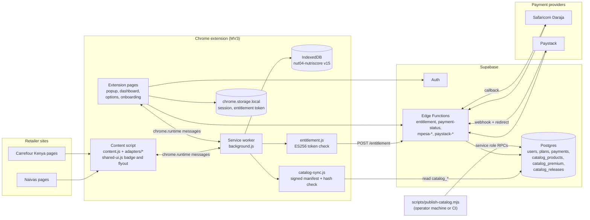
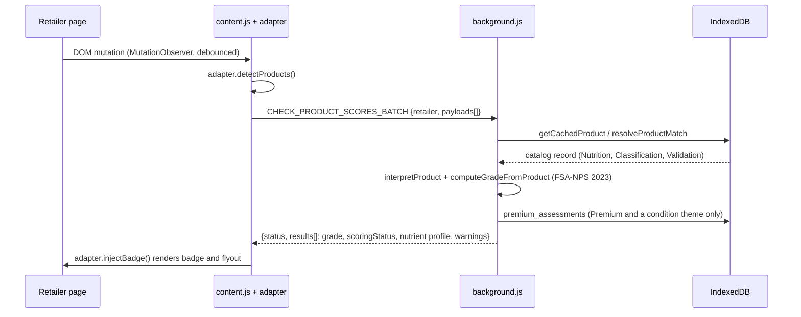

# NutriScore Checkout Tool (Kenya)

A Manifest V3 Chrome extension that shows a Nutri-Score style grade (A to E), nutrient detail and condition-aware dietary warnings on Kenyan online grocery sites while people shop. It targets Naivas and Carrefour Kenya and is built under project code NUT-04 (JHUB Africa / AfyaVentures).

| | |
|---|---|
| Extension version | `1.1.0` (`src/extension/manifest.json`) |
| Platform | Chrome 110 or newer, Manifest V3 |
| Scoring basis | FSA-NPS 2023 algorithm; KFCT-based 14-tier food categories; NOVA 1 to 4 |
| Supported retailers | Naivas (`naivas.online`, `naivas.co.ke`), Carrefour Kenya (`carrefour.ke`, `carrefourkenya.com`) |
| Backend | Supabase (Postgres, Auth, Edge Functions) |
| Payments | M-Pesa STK Push (Safaricom Daraja) and Paystack; Premium is 189 KES per 30 days |
| Documentation date | 2026-10-07 |

## Contents

1. [Release status](#release-status)
2. [How it works](#how-it-works)
3. [Features](#features)
4. [Quick start (development)](#quick-start-development)
5. [Prerequisites](#prerequisites)
6. [Project structure](#project-structure)
7. [npm scripts](#npm-scripts)
8. [Documentation map](#documentation-map)
9. [License](#license)

## Release status

Verified on 2026-10-07 against this source tree, on Linux with Node 22, after the four prerequisite fixes listed under **Unreleased** in [CHANGELOG.md](CHANGELOG.md) (content script syntax error, ESLint flat config, `types` in `tsconfig.json`, deterministic test setup and refreshed snapshot).

| Check | Command | Result |
|---|---|---|
| Unit tests | `npm test` | 209 of 209 pass in every timezone and locale tried |
| Lint | `npm run lint` | 0 errors, 87 warnings |
| Build | `npm run build` | Passes; `dist/` contains the four HTML pages and the extension files |
| Manifest globals | `npm run check:manifest` | Passes |
| Typecheck | `npm run typecheck` | **Fails: 31 errors**, so the CI Typecheck step is red |

Backend verified on 2026-10-07 by applying all 11 migrations in order to an empty PostgreSQL 16 database with stubbed Supabase roles and `auth` schema, then exercising the billing functions directly:

| Check | Result |
|---|---|
| All 11 migrations apply in filename order | Pass |
| New sign-up (insert into `auth.users`, which fires `handle_new_user`) | **Fails** until the `subscription_status` constraint is replaced (see item 1 below) |
| `grant_premium`: first grant, repeat grant, renewal stacking, wrong amount | Pass after the constraint fix: `granted`, `already_granted`, expiry extended by 30 days, `amount_mismatch` |
| Authenticated role writing `premium_expires_at` | Blocked (`permission denied for table users`) |
| `supabase/tests/*.sql` | **Not runnable**: syntax errors from doubled quotes inside `DO $$` blocks |

The tree is **not release-ready**. Open items, in priority order:

1. **New sign-ups fail on a database built from the shipped migrations.** `20260924000000_subscription_lifecycle.sql` creates `users_subscription_status_check` allowing only `active`, `expired`, `trialing`. `20260928000000_billing_authority.sql` makes `basic` the default and has `enforce_billing_state` write `basic`, but never replaces the constraint, so the `handle_new_user` insert is rejected. The exact remediation SQL is in [INSTALL.md, step 4](INSTALL.md#4-apply-database-migrations).
2. **First-time onboarding cannot finish.** In `src/ui/src/app/components/OnboardingWizard.tsx`, `finishOnboarding` calls `getPrimaryCondition()`, which is not defined anywhere, and redeclares `condition` and `metric` with `const` inside the function, so the earlier reads at lines 423 to 431 hit the temporal dead zone. A new user's profile upsert is written, then the function throws. This is the source of 7 of the 31 type errors (TS2300, TS2304 and five TS2448).
3. **The remaining 24 type errors** are in `services/storage.ts`, `options/Options.tsx`, `popup.tsx`, `db/settings.ts` and `db.ts` (stale `importDatasets` re-export, `CatalogMeta` versus `DatasetMetadata` mismatch, missing `isIncomplete` prop, untyped modules).
4. **M-Pesa webhook trust gap.** `mpesa-webhook` calls `grant_premium` when Safaricom's confirmation query returns no `ResultCode` or code `1036`, and the callback itself carries no authentication. See [INSTALL.md, Pre-launch checklist](INSTALL.md#pre-launch-checklist).
5. **`debug-payments` Edge Function** returns the 20 most recent payments of all users to any signed-in caller. It is disabled only in the local `config.toml`; it must not be deployed.
6. **Production payment configuration** is not the default: `MPESA_ENV` falls back to `sandbox`.
7. **Ledger never records purchases or removals.** The worker handlers for `REMOVE_CART_ITEM`, `CART_CLEARED` and `ORDER_PLACED` call `NutriScoreDB` functions that are not defined, and nothing writes status `purchased` or `removed`.
8. **Catalog publishing fails after any product removal.** `publish-catalog.mjs` sets `manifest.max_seq` from the highest `seq` including tombstoned rows, but `catalog_release_publish` compares it with the highest `seq` among non-deleted rows. After `catalog_tombstone_missing` marks even one row deleted, the call raises `manifest max_seq N does not match current catalog max_seq M` (reproduced on PostgreSQL 16). The first publish into an empty catalog is unaffected.
9. **Catalog data inputs** (`carrefour_products.json`, `naivas_products.json`) are not in the repository; they are supplied to `publish-catalog.mjs` at publish time.

## How it works

The extension is a thin client. It ships no product dataset. After the user signs in, the service worker downloads a signed catalog from Supabase, verifies it, stores it in IndexedDB and scores products entirely on the device. Health-condition assessments for Premium are computed ahead of time by the publisher and synced as a separate table.



Product scoring path (one product card on a retailer page):



Two engines exist and they do different jobs:

- **Grade engine** (`src/ui/src/app/lib/db/grading.ts`, compiled into `db.js`): FSA-NPS 2023 grade A to E, run in the service worker for every product.
- **Condition engine** (`src/extension/engine/*` and `src/extension/pipeline/disease-engine.js`): produces the Premium diabetes, hypertension, renal and obesity assessments. It runs offline inside `scripts/publish-catalog.mjs`; the service worker loads the engine files but reads the precomputed result from `premium_assessments`.

## Features

| Capability | Basic (free account) | Premium |
|---|---|---|
| Account required (email and password, or Google) | Yes | Yes |
| Grade A to E badge and nutrient flyout on Naivas and Carrefour | Yes | Yes |
| Grade withheld when data is insufficient (`scoringStatus`) | Yes | Yes |
| Health-condition theme and condition warnings from precomputed assessments | Upgrade prompt | Yes |
| Shopping ledger: cart tracking (items are recorded as `in_cart`; purchase and removal status transitions are not implemented) | Yes | Yes |
| Popup button to the analytics dashboard | Upgrade prompt | Yes |
| Self-serve "Delete all your data" in Options and Dashboard | Yes | Yes |

Entitlement is verified on the device from a server-signed ES256 token whose expiry equals `premium_expires_at`. A payment adds 30 days and stacks on an unexpired subscription.

## Quick start (development)

From the repository root:

```bash
npm ci
cp .env.example .env
```

Edit `.env` and set the two variables below to your Supabase project's public values (Dashboard, Settings, API). Never put a service role key in this file.

| Variable | Value |
|---|---|
| `VITE_SUPABASE_URL` | The project URL, which ends in `.supabase.co` |
| `VITE_SUPABASE_ANON_KEY` | The anon or publishable key |

Build and load the extension:

```bash
npm run build
```

1. Open `chrome://extensions`.
2. Turn on **Developer mode**.
3. Choose **Load unpacked** and select the `dist/` folder.
4. Open the extension, complete sign-up, then browse a Naivas or Carrefour Kenya category page.

The service worker reads its backend settings from `src/extension/config.js`, not from `.env`; both must point at the same Supabase project. See [INSTALL.md](INSTALL.md) for the full production procedure, including the Supabase backend, secrets, keys and catalog publishing.

UI-only development server (pages render outside Chrome and have no `chrome.*` APIs):

```bash
npm run dev
```

## Prerequisites

| Requirement | Version | Notes |
|---|---|---|
| Node.js | 20 or newer | CI runs Node 20; verified locally on Node 22 |
| npm | 10 or newer | Lockfile is `package-lock.json` |
| Git | any recent | `npm ci` runs `prepare`, which sets `core.hooksPath`; it fails outside a Git checkout |
| Google Chrome | 110 or newer | Required by `minimum_chrome_version` |
| Supabase CLI | current | Only for backend deployment |
| A Supabase project | | Postgres 17 is the local default in `supabase/config.toml` |

## Project structure

```text
.
├── .github/workflows/ci.yml        CI: test, typecheck, lint, build, HTML assert, db.js freshness
├── .githooks/pre-commit            Rebuilds and stages db.js when db.ts changes
├── config/public-keys/             Public JWKs: catalog.jwks.json, entitlement.jwks.json
├── scripts/
│   ├── build-db.mjs                db.ts (and imports) -> src/extension/db.js
│   ├── build-sw-client.mjs         supabase-js -> src/extension/supabase.js (service worker bundle)
│   ├── build-ext.mjs               Copies src/extension -> dist (skips data/ and pipeline/)
│   ├── build-health-modes.mjs      src/shared/health-modes.mjs -> src/extension/health-modes.js
│   ├── check-manifest-globals.mjs  Verifies content-script and importScripts ordering
│   ├── gen-keys.mjs                Generates ES256 key pairs
│   ├── publish-catalog.mjs         Validates, signs and publishes the catalog
│   └── check_payments*.mjs, upload_success_page.mjs, ingest_products.ts   Operator utilities
├── src/
│   ├── extension/                  The shipped extension
│   │   ├── manifest.json, config.js, background.js, content.js
│   │   ├── entitlement.js, catalog-sync.js
│   │   ├── db.js, supabase.js, health-modes.js     (generated, committed)
│   │   ├── adapters/               naivas.js, carrefour.js, shared-ui.js, grade-colors.js
│   │   ├── engine/                 context-engine.js, health-flags.js, scorers/*
│   │   ├── pipeline/               disease-engine.js (publish-time only, not shipped)
│   │   └── icons/
│   ├── shared/                     canonical.mjs, health-modes.mjs (Node and browser)
│   └── ui/                         Vite project for popup, dashboard, options, onboarding
│       └── src/{app,options,services,styles}, popup.tsx, dashboard.tsx, options.tsx, onboarding.tsx
├── supabase/
│   ├── config.toml
│   ├── migrations/                 11 SQL files (one is empty)
│   ├── functions/                  9 Edge Functions plus _shared/plan.ts
│   └── tests/                      billing_authority.sql, catalog_rls.sql (see INSTALL.md)
├── eslint.config.js, tsconfig.json, vite.config.ts, postcss.config.mjs
├── LICENSE, README.md, CONTRIBUTING.md, CHANGELOG.md
├── INSTALL.md, ROLLBACK_RUNBOOK.md, API_REFERENCE.md
└── docs/                           Index and archive of superseded documents
```

Generated and ignored: `dist/`, `node_modules/`, `.env`. The generated `src/extension/db.js` and `supabase.js` are committed on purpose; CI fails if `db.js` is stale.

## npm scripts

| Script | Purpose |
|---|---|
| `npm run build` | `build:db`, then `build:ui` (Vite, empties `dist/`), then `build:ext` |
| `npm run build:db` | Regenerate `src/extension/db.js` from `db.ts` |
| `npm run build:ui` | Vite build of the four HTML pages into `dist/` |
| `npm run build:ext` | Bundle the service-worker Supabase client, then copy the extension into `dist/` |
| `npm run check:manifest` | Verify script ordering globals |
| `npm test` / `npm run test:watch` | Vitest, `src/ui/src/app/__tests__` |
| `npm run typecheck` | `tsc --noEmit` |
| `npm run lint` | `eslint .` |
| `npm run dev` | Vite dev server |

`build-health-modes.mjs` is not part of `npm run build`. Run `node scripts/build-health-modes.mjs` after editing `src/shared/health-modes.mjs` and commit the regenerated `src/extension/health-modes.js`.

## Documentation map

| Document | Audience | Contents |
|---|---|---|
| [INSTALL.md](INSTALL.md) | Operators | Requirements, Supabase setup, secrets, keys, catalog publishing, build, verification, pre-launch checklist |
| [CONTRIBUTING.md](CONTRIBUTING.md) | Developers | Workflow, branches, commits, linting and testing, CI pipeline |
| [CHANGELOG.md](CHANGELOG.md) | Everyone | Features, fixes and breaking changes |
| [ROLLBACK_RUNBOOK.md](ROLLBACK_RUNBOOK.md) | Infrastructure | Failure signals, rollback commands, database state reversal |
| [API_REFERENCE.md](API_REFERENCE.md) | Developers | Message contract, Edge Functions, database objects, extension modules, data schemas |
| [docs/README.md](docs/README.md) | Everyone | Index; archived product and academic documents |

## License

All rights reserved. See [LICENSE](LICENSE). Copyright (c) 2026 NUT-04 Project Contributors.
