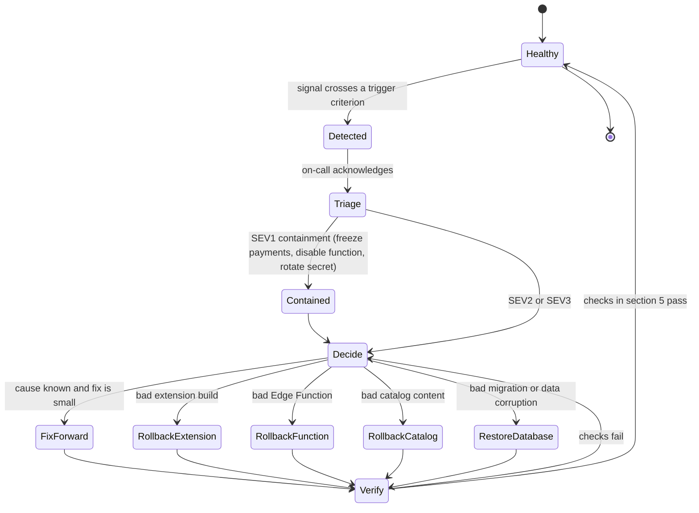
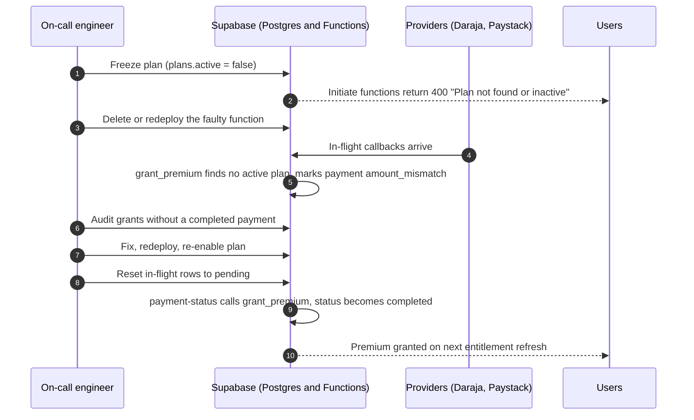

# Rollback Runbook

Operational recovery procedures for NUT-04 v1.1.0 for infrastructure and on-call teams: how to recognize a failing release, which component to roll back, the exact commands, and how to reverse database state. Commands marked "tested" were executed on PostgreSQL 16 on 2026-10-07 against a database built from the shipped migrations. Extension-store and Supabase CLI steps follow documented product behaviour and were not executed here.

## Contents

1. [Rollback characteristics by component](#1-rollback-characteristics-by-component)
2. [Failure signals and trigger criteria](#2-failure-signals-and-trigger-criteria)
3. [Mitigation workflow](#3-mitigation-workflow)
4. [Procedures](#4-procedures)
5. [Post-rollback verification](#5-post-rollback-verification)
6. [Roles and escalation](#6-roles-and-escalation)

Shell variables used below: `SUPABASE_PROJECT_REF`, `SUPABASE_URL`, `ANON_KEY`, `DATABASE_URL`, `SUPABASE_SERVICE_ROLE_KEY`, `CATALOG_SIGNING_KEY`, `ENTITLEMENT_SIGNING_KEY` (defined in [INSTALL.md, section 1.4](INSTALL.md#14-shell-variables-used-in-this-guide)), plus the incident-specific variables `PREVIOUS_TAG` (Git tag of the last good release), `PREVIOUS_RELEASE_ID` (`catalog_releases.id` of the last good catalog), `AFFECTED_USER_ID` (a `public.users.id` found by the audit query) and `REALTIME_TABLES` (space-separated, schema-qualified names of tables that were published to Realtime before migration `20240922000000`). Export each one before using it.

## 1. Rollback characteristics by component

| Component | Can it be rolled back? | Mechanism | Time to effect | Main hazard |
|---|---|---|---|---|
| Extension build | Not directly. The store only accepts a higher version number | Rebuild the last good tag, raise `version`, upload; or unpublish | Store review time, then Chrome's update cycle | IndexedDB version 15 cannot be opened by a build that requests a lower version (section 4.1) |
| Edge Functions | Yes | Redeploy previous source, or delete the function | Seconds | Deleting `entitlement` stops new Premium activations and renewals |
| Secrets and keys | Yes, with ordering rules | `supabase secrets set` and `unset`; key rotation sequence | Seconds for secrets; store cycle for public keys | Rotating the entitlement key before clients trust the new public key logs Premium users out of Premium |
| Database schema | Forward-only | Backup restore or compensating SQL | Minutes | Billing columns cannot be reversed without losing expiry data |
| Catalog content | Yes, by republishing | `publish-catalog.mjs` with the previous inputs | Minutes plus client sync | Flipping `is_current` alone does not restore content (section 4.5) |
| Payments | Stop and recover | Plan freeze, function removal, status reset | Seconds | In-flight payments become `amount_mismatch` during a freeze (section 4.4) |

## 2. Failure signals and trigger criteria

The criteria below are the initial thresholds adopted by this runbook. Tune them against real traffic after launch.

### 2.1 Signals

| Signal | Where to read it | Healthy | Query or check |
|---|---|---|---|
| Sign-up failures | Supabase Auth logs; text `Database error saving new user` | none | Log search |
| Entitlement function errors | Edge Function logs for `entitlement` | 5xx rate under 1 percent | Logs |
| Stale pending payments | Postgres | 0 | `SELECT count(*) FROM public.payments WHERE status = 'pending' AND created_at < now() - interval '15 minutes';` |
| Payment outcome mix, 24 h | Postgres | `completed` dominates | `SELECT status, count(*) FROM public.payments WHERE created_at > now() - interval '24 hours' GROUP BY status ORDER BY status;` |
| Amount mismatches, 24 h | Postgres | 0 | `SELECT count(*) FROM public.payments WHERE status = 'amount_mismatch' AND updated_at > now() - interval '24 hours';` |
| Premium without a completed payment | Postgres | 0 | `SELECT count(*) FROM public.users u WHERE u.premium_expires_at > now() AND NOT EXISTS (SELECT 1 FROM public.payments p WHERE p.user_id = u.id AND p.status = 'completed');` |
| Active Premium users | Postgres | tracks sales | `SELECT count(*) FROM public.users WHERE premium_expires_at > now();` |
| Current catalog release | Postgres | one row, recent | `SELECT id, created_at, now() - created_at AS age FROM public.catalog_releases WHERE is_current;` |
| Client sync errors | Support reports; service worker console lines `Catalog manifest signature invalid`, `Catalog hash mismatch`, `Unknown catalog key_id` | none | Reproduce with a test profile |
| Badge rendering | Test profile on both retailers | Badges appear | Manual |

All queries above ran without error on the shipped schema.

### 2.2 Severity and decision

| Severity | Trigger | Decision |
|---|---|---|
| SEV1 | Premium granted without a completed payment (any); mass forged or unexplained grants; secret or signing key exposure; every new sign-up failing; payments charged but never granted for more than 15 minutes | Contain first: section 4.4 (freeze payments) and, for key exposure, section 4.3. Then diagnose |
| SEV2 | Extension release breaks badges or onboarding for all users; catalog hash or signature failures reported by multiple users; `entitlement` 5xx above 5 percent for 10 minutes | Roll back the failing component (sections 4.1, 4.2, 4.5) |
| SEV3 | Single retailer's markup change breaks one adapter; isolated payment stuck in `pending` | Fix forward; use `payment-status` to settle the payment |

## 3. Mitigation workflow



Containment sequence for a payment incident (SEV1):



## 4. Procedures

### 4.1 Extension

The Chrome Web Store does not let you re-upload an older version number. Roll back by shipping the last good source under a new, higher version.

1. Check out the last good tag and create a branch from it:

   ```bash
   git fetch --tags
   git checkout -b hotfix/rollback-$PREVIOUS_TAG $PREVIOUS_TAG
   ```

2. Raise `version` in `src/extension/manifest.json` above the broken release (for example `1.1.1` after a broken `1.1.0`).
3. **Keep the IndexedDB version at or above the one users already have.** The extension stores data in `nut04-nutriscore` at version 15 (`DB_VERSION` in `src/ui/src/app/lib/db/shared.ts`). A build that requests a lower version fails to open the database with a `VersionError`. If the tag you are rolling back to has a lower `DB_VERSION`, set it to 15 in the hotfix branch, or instruct affected users to remove the extension's site data. Do not lower the number.
4. Build and package:

   ```bash
   npm ci
   npm run build
   cd dist && zip -r ../nutriscore-rollback.zip . && cd ..
   ```

5. Upload the zip in the Chrome Web Store dashboard.
6. To stop further installs while you wait for review, unpublish the listing in the dashboard.

Local mitigation for one affected profile: remove and reinstall the extension, or clear its data from `chrome://extensions`, then sign in again. The catalog re-downloads on first run.

### 4.2 Edge Functions

Redeploy the previous source of one function:

```bash
git fetch --tags
git checkout $PREVIOUS_TAG -- supabase/functions/entitlement
supabase functions deploy entitlement
git checkout HEAD -- supabase/functions/entitlement
```

Use the same `--no-verify-jwt` flags as the install guide for `mpesa-webhook`, `paystack-webhook` and `paystack-redirect`.

Take a function offline:

```bash
supabase functions delete mpesa-initiate
```

Effects of removing each function:

| Function removed | Effect |
|---|---|
| `mpesa-initiate`, `paystack-initiate` | New payments of that type cannot start |
| `mpesa-webhook`, `paystack-webhook` | Providers cannot confirm; `payment-status` polling still settles Paystack and M-Pesa payments the user's client polls |
| `payment-status` | Clients cannot poll; webhook-confirmed payments still grant |
| `entitlement` | Premium tokens cannot be issued or refreshed. Devices keep a stored token until its `exp` (a failed refresh does not revoke it), then fall back to Basic; new subscribers stay on Basic |

Restore a function the same way you deployed it.

### 4.3 Secrets and keys

Restore or change a secret:

```bash
supabase secrets set MPESA_ENV="sandbox"
supabase secrets unset PAYSTACK_SECRET_KEY
```

Secrets take effect on the next function invocation; no redeploy is required.

**Entitlement signing key exposure.** An attacker holding the private key can mint Premium tokens. Rotate in this order so no legitimate user is downgraded:

1. Run `node scripts/gen-keys.mjs`. Keep only the new entitlement private key and give it a new `kid` (for example `entitlement-v2`).
2. Add the new public JWK to `NUTRI_CONFIG.ENTITLEMENT_PUBLIC_KEYS` **alongside** the old one in `src/extension/config.js`, bump `version` and ship the extension (section 4.1 mechanics).
3. When most clients have updated, set the new private key:

   ```bash
   supabase secrets set ENTITLEMENT_SIGNING_KEY="$ENTITLEMENT_SIGNING_KEY"
   ```

4. In a following extension release, remove the old public key. Tokens signed with the old key then fail verification (`unknown_kid`) and the user falls back to Basic until the next refresh.

The token's own `exp` equals the subscription expiry, so a leaked token cannot outlive the subscription it was minted for, but a leaked private key can mint new ones until step 4 ships.

**Catalog signing key exposure.** Same sequence with `CATALOG_PUBLIC_KEYS` and `CATALOG_SIGNING_KEY`, then publish a new release signed with the new key (section 4.5).

### 4.4 Payments: freeze, audit, recover

Everything in this section was executed on a migrated PostgreSQL 16 database.

**Freeze.** Deactivating the plan stops new charges, because both initiate functions read the active plan and fail without it:

```bash
psql "$DATABASE_URL" -c "UPDATE public.plans SET active = false WHERE code = 'premium_30d';"
```

Caution: while the plan is inactive, `grant_premium` cannot find it, so any in-flight payment that completes is marked `amount_mismatch` instead of being granted.

**Audit.** Look for grants without a completed payment (should be zero):

```bash
psql "$DATABASE_URL" -c "SELECT u.id, u.premium_expires_at FROM public.users u WHERE u.premium_expires_at > now() AND NOT EXISTS (SELECT 1 FROM public.payments p WHERE p.user_id = u.id AND p.status = 'completed');"
```

Revoke a fraudulent grant. The billing trigger lets only the service role change the expiry, so run this with a service-role or owner connection:

```bash
psql "$DATABASE_URL" -v uid="$AFFECTED_USER_ID" <<'SQL'
UPDATE public.users SET premium_expires_at = NULL, payment_received_at = NULL WHERE id = :'uid';
SELECT is_premium, subscription_status, premium_expires_at FROM public.users WHERE id = :'uid';
SQL
```

Tested: the trigger recomputes `is_premium` to `false` and `subscription_status` to `basic`. The user's device drops to Basic at the next entitlement refresh, and at the latest when the stored token expires.

**Recover.** After the fix is deployed, re-enable the plan and return the in-flight rows to `pending` so `payment-status` can settle them:

```bash
psql "$DATABASE_URL" <<'SQL'
UPDATE public.plans SET active = true WHERE code = 'premium_30d';
UPDATE public.payments
   SET status = 'pending', updated_at = now()
 WHERE status = 'amount_mismatch'
   AND provider_amount IS NULL
   AND updated_at >= now() - interval '6 hours';
SQL
```

Adjust the interval to the length of the freeze. Rows with a non-null `provider_amount` are genuine provider-side mismatches; investigate them individually and do not reset them. Clients polling `payment-status` (or a repeat provider callback) then call `grant_premium`, which returned `granted` for a recovered row in testing.

### 4.5 Catalog

Roll back catalog content by republishing the previous inputs. This creates a new release with new sequence numbers, which clients accept normally:

```bash
export SUPABASE_URL SUPABASE_SERVICE_ROLE_KEY CATALOG_SIGNING_KEY
node scripts/publish-catalog.mjs --carrefour ./previous/carrefour_products.json --naivas ./previous/naivas_products.json --commit
```

Keep the inputs of every released catalog; the repository does not contain them. Known defect: a publish that removes products fails with `manifest max_seq N does not match current catalog max_seq M` (see [INSTALL.md, Troubleshooting](INSTALL.md#14-troubleshooting)). If the rollback removes products, resolve that defect first.

Emergency stop. To make clients stop syncing a release you have decided is bad, point `is_current` at the last good release (tested):

```bash
psql "$DATABASE_URL" -v prev="$PREVIOUS_RELEASE_ID" <<'SQL'
UPDATE public.catalog_releases SET is_current = false WHERE is_current;
UPDATE public.catalog_releases SET is_current = true WHERE id = :prev;
SELECT id, manifest->>'version' AS version, is_current FROM public.catalog_releases ORDER BY id;
SQL
```

This does not restore content. Clients download rows at their current state and compare the hash with the old manifest; because row content changed after that release, the hash does not match and the client keeps its last good catalog. Always follow the flip with a republish of the previous inputs.

Clients protect themselves: an invalid signature, unknown `key_id` or hash mismatch throws and leaves the previously committed catalog in IndexedDB untouched.

### 4.6 Database

Migrations are forward-only. Choose one of two recoveries.

**Restore from backup.** Take a dump before every migration push:

```bash
pg_dump "$DATABASE_URL" --schema=public --format=custom --file=pre-migration.dump
```

Restore into the project through the Supabase dashboard's backup or point-in-time recovery (availability depends on your plan), or `pg_restore` into a replacement database. A restore also discards every payment and profile written after the backup, so combine it with the audit queries in section 4.4.

**Compensating SQL for the catalog migration** (`20260928010000_catalog_schema.sql`). Tested:

```bash
psql "$DATABASE_URL" <<'SQL'
BEGIN;
DROP FUNCTION IF EXISTS public.catalog_release_publish(jsonb, text, text);
DROP FUNCTION IF EXISTS public.catalog_premium_tombstone_missing(text, text[]);
DROP FUNCTION IF EXISTS public.catalog_tombstone_missing(text, text[]);
DROP FUNCTION IF EXISTS public.catalog_premium_upsert(jsonb);
DROP FUNCTION IF EXISTS public.catalog_upsert(jsonb);
DROP TABLE IF EXISTS public.catalog_releases, public.catalog_premium, public.catalog_products;
DROP SEQUENCE IF EXISTS public.catalog_seq;
CREATE POLICY "Products are publicly readable" ON public.products FOR SELECT USING (true);
GRANT SELECT ON public.products TO anon;
COMMIT;
SQL
```

Afterwards mark the migration as reverted so a later `db push` re-applies it:

```bash
supabase migration repair --status reverted 20260928010000
```

Dropping the catalog removes every grade in the extension: devices keep their local catalog until the next sync, which then fails. Use this only to undo a faulty schema, then re-apply and republish.

**Billing migration** (`20260928000000_billing_authority.sql`). Do not reverse it with SQL. It converts `trialing` rows, changes column grants, replaces the billing trigger and introduces `grant_premium`; the original expiry model cannot be reconstructed from the new columns. Restore from backup, or freeze payments (section 4.4) and fix forward.

**Realtime publication** (`20240922000000_realtime.sql`). The migration drops and recreates `supabase_realtime`. If other tables were published before the migration, re-add them:

```bash
for t in $REALTIME_TABLES; do
  psql "$DATABASE_URL" -c "ALTER PUBLICATION supabase_realtime ADD TABLE $t;"
done
```

## 5. Post-rollback verification

Repeat the relevant checks from [INSTALL.md, section 12](INSTALL.md#12-verification):

| Rolled back | Verify |
|---|---|
| Extension | Load the new build on a clean Chrome profile; sign in; open a Naivas category page and confirm badges; confirm the popup counts |
| Edge Function | `curl` the function (12.2 and 12.4); confirm expected status codes; check function logs for errors over 10 minutes |
| Secrets or keys | Run the entitlement check with a Premium test account; confirm `tier: "premium"` and a token |
| Payments | Run the audit query (zero rows); confirm `plans.active = true`; confirm no `pending` row older than 15 minutes |
| Catalog | Run the current-release query; on a test profile with cleared extension data, confirm the service worker logs `Catalog synced and ready.` |
| Database | Run the 12.1 query set; confirm RLS flags and the plan row |

Close the incident only when the signals in section 2.1 are back in their healthy range.

## 6. Roles and escalation

| Role | Responsibility | Escalate to |
|---|---|---|
| On-call engineer | Acknowledge, contain, choose the component to roll back | Release owner for SEV1 and SEV2 |
| Release owner | Authorize store actions (unpublish, emergency upload) and key rotation | Project lead |
| Payments owner | Liaison with Safaricom and Paystack; reconcile `payments` against provider reports | Project lead |
| Project lead | Decide on user communication and on re-enabling payments | n/a |

Record, for every incident: the trigger signal and time, the containment taken, the component rolled back, the verification results, and any user whose entitlement was changed manually.
