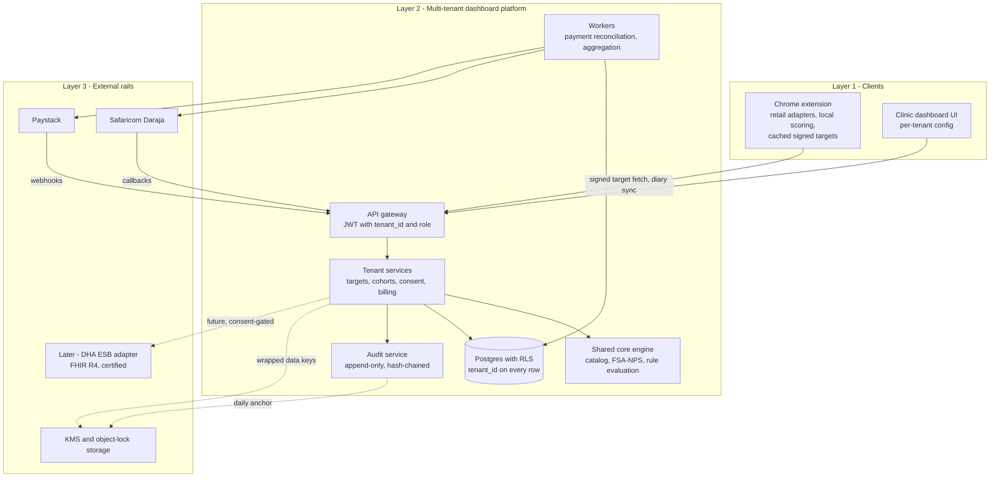

# NutriScore Admin Dashboard: Multi-Tenant Architecture and Compliance Blueprint

Oct 22, 2026 · @Kibet Kiprono Alex

NutriScore moves from a browser-to-SHR integration to a multi-tenant administrative dashboard: each clinic is the data controller, NutriScore is its processor, and the national HIE link becomes a later adapter on the same staging layer.

## 1. Executive summary and value proposition

Moving to a tenant-scoped admin dashboard removes v1’s hardest technical blocker (no national lane for patient-generated data), but not its hardest legal one: the platform now holds more health data, so it must be built as each clinic’s processor from day one.

**What changes from v1.** The browser extension no longer talks to national APIs; it talks only to NutriScore’s own gateway. The dashboard becomes the single source of truth for targets, cohorts, consent state, payments and audit. The national link shrinks to one optional adapter behind the dashboard, built when DHA publishes a lane for patient-generated data (see the v1 tab, section 6).

**Why one dashboard beats fragmented clients and providers**

| Capability | Fragmented (apps and clinics apart) | Central multi-tenant dashboard |
| --- | --- | --- |
| Policy enforcement | Each extension holds its own rules. Your audits already found two divergent copies of the threshold logic and a seeded remote config (400 mg sodium, 10 g sugar) that disagrees with the engine (600 mg, 22.5 g) | One versioned, signed rule set per tenant; each client reports which version it applied |
| Cohort and population view | A single household, no denominator, no pattern across patients | Tenant cohorts for diabetes, hypertension and renal disease, with small-cell suppression |
| Data quality | Every client carries its own catalog snapshot; 54% of records are UNVERIFIED | One curated catalog with review states; a correction reaches every client at the next sync |
| Consent and audit | Scattered across devices and clinic paperwork | One consent ledger and one append-only audit trail |
| HIE readiness | Nothing staged; N clients to map | Clean, FHIR-mappable staging records; one gateway to certify and onboard |

**What the pivot does not fix**

1. **DPA s.46 still applies, now centrally.** Make each tenant the data controller and NutriScore its processor under a written agreement; register with the ODPC; complete a DPIA. A commercial tenant must never see patient-level data.
2. **Commercial stakeholders get aggregates only.** HIM Reg 24 makes disclosing personal health data for market research an offence, and DPA s.37 restricts commercial use of personal data (confirm with counsel). Give payers, retailers and wellness brands de-identified cohort statistics with small-cell suppression, and sell software, not data.
3. **Staying outside the HIE may not avoid certification.** HIM Reg 37(1) bars health facilities from using an uncertified digital health solution to provide healthcare services. If a clinic manages patient nutrition through the dashboard, DHA may treat it as one. Ask DHA early (question 1, section 7).
4. **Super Administrator and DHA officer are different jobs.** A regulator should not hold operator keys. Section 3 splits them.
5. **Two data classes do not exist in the build yet:** user-confirmed consumption diaries and clinician-entered lab values. Both are new scope with their own consent and quality rules (sections 5 and 6).

## 2. Multi-tenant architectural blueprint

The dashboard is Layer 2: it sits between the clients (Layer 1) and everything external or national (Layer 3), and every request is tenant-scoped before it touches data.

&#91;embedded content: layered architecture · 3 layers, 13 links\]

Clients only ever call the gateway. The dashboard layer alone holds tenant data, payment logic and the future FHIR staging link, while Daraja, Paystack and key storage sit behind adapters and callbacks enter through the gateway before workers act on them.

| Layer | Components | Rule that holds it together |
| --- | --- | --- |
| 1. Clients | Chrome extension (retail adapters, local scoring, cached signed targets); clinic dashboard UI | Holds no clinical control logic and no national credentials; it only verifies and applies signed targets |
| 2. Dashboard platform | API gateway with JWT claims (tenant\_id, role); tenant services (targets, cohorts, consent, billing); shared core engine; audit service; reconciliation workers; Postgres with row-level security | Every query carries tenant\_id; the shared engine is stateless and tenant-agnostic |
| 3. External rails | Safaricom Daraja; Paystack; key management and object-lock storage; later, a certified DHA ESB adapter (FHIR R4) | Outbound only through adapters; inbound callbacks are verified before they are trusted |

### Tenancy and isolation rules

1. **Tenant key.** Every tenant-owned table has tenant\_id (uuid, not null, indexed). Primary keys are composite (tenant\_id, id), and foreign keys include tenant\_id so a child row can never point at another tenant’s parent.
2. **Deny by default.** Row-level security on every tenant table, with a policy matching tenant\_id to the caller’s JWT claim. The service role is confined to background workers. A CI check fails the build if any table with tenant\_id lacks a policy.
3. **Pool first, silo on demand.** Clinics and wellness centres share the pooled database. A large hospital network can be moved to its own database on the same code path, chosen from a tenant registry, if its procurement or residency rules demand it.
4. **Per-tenant encryption.** Patient-level columns are encrypted with a tenant data key wrapped by a key-management service. The Super Administrator can rotate keys but cannot decrypt without a logged, two-person break-glass. Destroying a tenant’s key crypto-shreds its data.
5. **Cache and storage.** Every cache key and storage path is prefixed with the tenant id; no cache entry holds data from two tenants.
6. **Shared versus tenant-owned.** Shared and read-only to tenants: the product catalog, the KFCT reference and the scoring engine. Tenant-owned: overlays (rule overrides, terminology, cohorts, branding). An override never edits shared data.
7. **Tenant configuration profile.** A versioned tenant\_config record holds language defaults (English or Kiswahili), local product-name aliases, unit conventions, the default rule pack (for example a diabetes clinic or a renal unit), dashboard views and retention settings.
8. **No cross-tenant joins.** Platform-wide metrics come only from a dedicated job, running under its own role, that reads de-identified aggregates and enforces a minimum cohort size.

### Mermaid source (for your repository docs)



## 3. RBAC and access management

Seven roles keep clinical authority, operator authority and oversight apart, so no single role can both change a patient’s target and edit the log that records the change.

### 3.1 Role matrix

| Role | Scope | Can | Cannot |
| --- | --- | --- | --- |
| Platform Super Administrator (NutriScore operator) | Platform | Create, suspend and configure tenants; rotate keys; publish the platform safety envelope after Clinical Safety Board sign-off; run billing operations | Read patient-level data (logged two-person break-glass only); set patient targets; touch the audit log |
| Compliance Auditor (internal DPO, or a DHA or ODPC reviewer as an external guest) | Platform, read-only | Read audit logs, consent ledger, DPIA register and tenant reports, on a time-boxed, logged credential | Change any record |
| Tenant Administrator (clinic manager or IT) | One tenant | Invite and remove users, edit tenant\_config, manage the subscription | See patient-level data; set targets |
| Writing Clinician (attending physician, or a licensed dietitian where tenant policy allows) | One tenant | Create, edit, suspend and revoke patient targets, risk models and goals; approve rule overrides; manage patient consent links | Edit the audit log; exceed the platform safety envelope |
| Viewing Dietician or Nutrition Assistant | One tenant, read-only | View intake trends, shopping timelines, compliance summaries and cohort reports; raise a change request to a Writing Clinician | Modify target values or hazard thresholds |
| Commercial Stakeholder (payer, programme sponsor) | One tenant, aggregates only | See de-identified cohort statistics above the minimum cohort size | See any patient-level row; export patient data; use it for marketing |
| Patient | Own data | View, export and delete own data; grant and revoke clinician links and consents | See other patients’ data |

**Local practice note.** Dietitians registered with the Kenya Nutritionists and Dieticians Institute often write nutrition prescriptions in practice. Treat this as a per-tenant policy: a dietitian may draft a target, but a Writing Clinician must co-sign it, and co-signing is mandatory for renal and paediatric rules.

**Licence verification.** A Writing Clinician account is activated only after the licence number is checked with the relevant regulator (KMPDC for doctors, KNDI for dietitians), first by tenant attestation plus a manual platform check, later through the national Health Worker Registry if DHA grants access. Store licence number and expiry; suspend write rights automatically on expiry.

**Baseline controls.** Multi-factor authentication for every non-patient role, least privilege, session timeouts, and a quarterly access review by each Tenant Administrator, recorded in the audit log. These mirror HIM Reg 12 even though the platform is not yet inside the national System.

### 3.2 Permission by action

| Action | Super Admin | Auditor | Tenant Admin | Writing Clinician | Viewing Dietician | Commercial | Patient |
| --- | --- | --- | --- | --- | --- | --- | --- |
| Create or edit patient target | No | No | No | Yes | Draft only | No | No |
| Suspend or revoke target | No | No | No | Yes | No | No | Revoke own link |
| Edit platform safety envelope | Yes, with board sign-off | No | No | No | No | No | No |
| View patient-level timeline | Break-glass only | No | No | Yes, own patients | Yes, own patients | No | Own |
| View tenant cohort report | No | Yes | Yes | Yes | Yes | De-identified only | No |
| Manage users and billing | Platform level | No | Yes | No | No | No | No |
| Read audit log | Own actions | Yes | Own tenant, summary | Own actions | No | No | Own access history |

### 3.3 Audit log protocol

Every state change and every patient-level read appends one row. Rows are never updated or deleted.

| Field | Content |
| --- | --- |
| event\_id, tenant\_id, seq | Time-ordered unique id; tenant; gap-free per-tenant sequence number |
| occurred\_at | Server UTC timestamp, never client-supplied |
| actor\_id, actor\_role, role\_scope | Who acted, in which role, at which scope (platform, tenant or patient); licence reference for clinicians |
| session\_id, source | Session and a truncated or hashed network address (an IP address is personal data) |
| action, mutation\_type | Verb such as target.update; one of create, update, suspend, revoke, read, export, break\_glass |
| resource\_type, resource\_id, subject\_ref | What changed and the pseudonymous patient reference |
| before\_snapshot, after\_snapshot, diff | Full JSON before and after, encrypted under the patient’s data key |
| reason | Mandatory free text or coded reason for any clinical change |
| prev\_hash, row\_hash | row\_hash = SHA-256 of prev\_hash plus the canonical row; chains each tenant’s log |

**Integrity rules.**

1. Database roles hold INSERT and SELECT only on the log; a trigger rejects any UPDATE or DELETE.
2. A job verifies each tenant’s hash chain nightly and alerts on any break.
3. A signed head hash is written daily to write-once (object-lock) storage, so even an operator with database access cannot rewrite history unnoticed.
4. The Compliance Auditor reviews the logs quarterly and signs off; the sign-off is itself logged.
5. Retain for 20 years (the period HIM Reg 12(c)(ii) sets for the national System). On a patient erasure request, destroy that patient’s key: the snapshots become unreadable while the chain stays intact.

## 4. Local payment and Daraja resiliency matrix

Treat every Daraja or Paystack callback as an untrusted hint: money counts only after an authenticated query confirms it, the amount matches a server-side invoice, and it is applied exactly once.

### 4.1 Which rail for which flow

| Flow | Rail | Pattern | Correlation key |
| --- | --- | --- | --- |
| Clinic admin pays interactively | Daraja M-Pesa Express (STK Push) | Server creates the attempt, calls STK Push, waits for callback, confirms by query | CheckoutRequestID; invoice number in AccountReference |
| Hospital pays by paybill | Daraja C2B | Register validation and confirmation URLs; match the payment by bill reference | BillRefNumber equal to the tenant invoice reference; unmatched payments go to a suspense queue |
| NutriScore settles a partner or vendor | Daraja B2B (outbound, only if you have such payouts) | Request with result and timeout URLs; reconcile asynchronously | ConversationID and OriginatorConversationID |
| Cards and recurring plans | Paystack | Initialise with a unique reference; act on webhooks; confirm by verify call | Reference; subscription code |

### 4.2 STK Push callback processing

A callback carries Body.stkCallback with MerchantRequestID, CheckoutRequestID, ResultCode and ResultDesc. On success it also carries CallbackMetadata items for Amount, MpesaReceiptNumber, TransactionDate and PhoneNumber; on failure the metadata is absent.

1. **Create the attempt first.** Before calling Daraja, insert a payment\_attempt row (tenant\_id, invoice\_id, expected amount, phone, status PENDING). The amount comes from the server-side invoice, never from the browser. Store MerchantRequestID and CheckoutRequestID from the Daraja response.
2. **Acknowledge fast, decide later.** The callback endpoint stores the raw payload append-only, enqueues it, and returns HTTP 200 with an accepted body. It never activates anything.
3. **Validate in a worker.** Confirm the CheckoutRequestID belongs to a pending attempt; check the source address against Safaricom’s published ranges as defence in depth (callbacks are not signed); then call the STK Push Query endpoint with the CheckoutRequestID. Normalise ResultCode with String(), because callbacks send a number and the query returns a string.
4. **Match and activate once.** Activate only if the query says ResultCode 0, the callback Amount equals the invoice amount, and the MpesaReceiptNumber is new. Unique constraints on CheckoutRequestID and MpesaReceiptNumber make duplicate callbacks harmless.
5. **One transaction.** In a single database transaction set the attempt to SUCCEEDED, the invoice to PAID, the subscription to ACTIVE with a new period end, write the audit row, and issue a signed entitlement with an expiry.

**Which polling API.** For a pending STK Push, poll the STK Push Query endpoint (it takes the CheckoutRequestID). The Transaction Status API needs a receipt number plus initiator credentials and answers asynchronously, so use it only to reconcile C2B or B2B payments where you already hold the receipt.

### 4.3 Failure routing

| Signal | Meaning | Automatic action | Tenant state | Alert |
| --- | --- | --- | --- | --- |
| ResultCode 0 | Paid | Verify by query, then activate | ACTIVE | Receipt to tenant admin |
| ResultCode 1 | Insufficient balance | Mark attempt FAILED\_FUNDS; do not retry blindly; offer card via Paystack, a C2B paybill payment, or a retry after top-up | New tenant: stays PENDING\_ACTIVATION. Renewal: PAST\_DUE grace begins | Admin panel flags the failed clinic subscription; email and SMS to tenant admin |
| ResultCode 1032 | User cancelled the prompt | Mark FAILED\_CANCELLED; roll back any activation flag set optimistically; start the re-engagement loop | Same as above; grace clock continues for renewals | In-dashboard banner with a fresh Pay button; one reminder, then at most a capped number of re-prompts per day |
| ResultCode 1037 | No response within the prompt window, or phone unreachable | Query first to confirm; then FAILED\_TIMEOUT and offer a retry | Unchanged | Banner and reminder |
| ResultCode 2001 | Wrong PIN | FAILED\_PIN; allow retry; after three in a row suggest another channel | Unchanged | Banner |
| No callback after about 90 seconds | Silent failure or lost callback | Reconciliation worker polls STK Push Query with backoff (for example +90 s, +3 min, +10 min, +30 min, +2 h); a still-processing reply counts as pending | PENDING\_UNCONFIRMED until resolved | Escalate to manual review if still unresolved after the last poll |
| Duplicate callback | Safaricom retry | Ignore (unique constraints) | Unchanged | None |
| Amount mismatch or unknown CheckoutRequestID | Tampering or misrouting | Hold, quarantine payload, never activate | Unchanged | Immediate alert to Platform Super Administrator |
| C2B payment with unknown bill reference | Typing error | Park in suspense, match manually | Unchanged | Daily suspense report |

The ResultCode meanings (1, 1032, 1037, 2001) match what Daraja integrators document; confirm them against the current Daraja portal before go-live, because that portal is the authority.

**Never lock access before reconciliation ends.** Suspension may follow only a concluded non-payment, never an unresolved attempt.

### 4.4 Billing lifecycle

| State | Entered when | Dashboard behaviour | Client behaviour |
| --- | --- | --- | --- |
| PENDING\_ACTIVATION | Tenant created, or first payment not yet confirmed | Setup and billing only | Nothing issued |
| ACTIVE | Payment confirmed | Full function for each role | Targets sync normally |
| PAST\_DUE (grace) | Renewal failed or unpaid at period end | Full function with a visible banner; grace length set by platform policy (a proposed default is 7 days, configurable) | Unchanged |
| SUSPENDED | Grace ended with no confirmed payment | Read-only: no new targets or users; data export allowed | Last signed targets stay in force until each expires, then built-in defaults apply with a notice. Active clinical targets are never silently dropped |
| CANCELLED | Tenant ends the subscription | Export window, then retention policy | Targets revoked cleanly and patients told |

### 4.5 Paystack

1. Initialise with a unique reference (invoice id plus attempt number); amounts go in the smallest currency unit, in KES.
2. Verify every webhook: compute HMAC-SHA512 of the raw request body with the secret key and compare with the x-paystack-signature header using a constant-time comparison. Return 200 immediately and process asynchronously.
3. On charge.success, call the transaction verify endpoint, check amount and currency against the invoice, then activate once, keyed by reference.
4. On charge.failed or a failed invoice payment, move the tenant to PAST\_DUE. On subscription.not\_renew or subscription.disable, cancel at period end.
5. Confirm event names against current Paystack documentation when you build.

## 5. Variable management framework

Every number an administrator can change is a typed, versioned, bounded record; nothing is free text, and nothing is evaluated until it passes the validators below.

### 5.1 Coded nutrient targets

**Target record (one schema for platform, tenant, cohort and patient scope)**

| Field | Type | Rule |
| --- | --- | --- |
| target\_id, tenant\_id, version, supersedes | uuid, uuid, integer, uuid | A change creates a new version; the old one is kept |
| scope, subject\_ref | platform, tenant, cohort or patient; pseudonymous reference | Patient scope requires an active clinician link |
| nutrient\_code | enum from the dictionary below | No free-text nutrients |
| unit | mg, g, kcal or kJ | Must match the nutrient (whitelist) |
| basis | per\_100g, per\_100ml, per\_serving, per\_item, per\_cart or per\_day | Allowed bases are fixed per nutrient |
| comparator, value, value\_max | lt, lte, gt, gte or between; number; number | Value greater than zero; value\_max only for between |
| severity | info, caution or critical | Critical only from a clinician or an approved platform rule |
| valid\_from, valid\_to | date | valid\_to is mandatory at patient scope, with a maximum duration set by policy |
| status | draft, pending\_cosign, active, suspended, revoked, expired | Only active targets are signed and distributed |
| set\_by, cosigned\_by, evidence\_ref, reason | actor ids; guideline or note reference; text | Reason is mandatory |

**Validation order (a failure stops the save and writes a rejected-change audit row)**

1. Schema and types.
2. Unit whitelist for the nutrient.
3. Allowed basis for the nutrient.
4. Platform safety envelope: a value outside it is rejected, not warned.
5. Cross-field consistency (salt and sodium, sugars within carbohydrate, saturated fat within total fat).
6. Conflict check: the same subject, nutrient and basis with overlapping dates supersedes the earlier record rather than stacking.
7. Role check.
8. Co-signature where the pathway demands it.
9. Audit write.
10. Publish a signed bundle.

**Nutrient dictionary**

| Nutrient | Code | Unit | Plausible label range per 100 g or 100 ml | Rule |
| --- | --- | --- | --- | --- |
| Energy | ENERGY\_KCAL, ENERGY\_KJ | kcal, kJ | 0 to 900 kcal; 0 to 3,800 kJ | kJ = kcal × 4.184; flag a mismatch beyond 8% |
| Total fat | FAT\_G | g | 0 to 100 | Saturated fat must not exceed it |
| Saturated fat | SATFAT\_G | g | 0 to 100 | At most total fat |
| Carbohydrates | CARB\_G | g | 0 to 100 | Sugars must not exceed it |
| Sugars | SUGARS\_G | g | 0 to 100 | At most carbohydrates |
| Fibre | FIBRE\_G | g | 0 to 100 | Protective nutrient in the grade |
| Protein | PROTEIN\_G | g | 0 to 100 | Kidney rules use it |
| Sodium | SODIUM\_MG | mg | 0 to 40,000 | Sodium mg = salt g × 400 |
| Salt | SALT\_G | g | derived | Salt g = sodium mg × 2.5 ÷ 1,000; store one, derive the other |

A missing value is null, never zero. Potassium, phosphorus, serving size and trans fat are not in the current schema, so renal packs and per-serving contribution stay disabled until those fields exist (priority in section 8).

### 5.2 Category-aware grading rules

The A to E grade is a property of the product and never changes per patient. Patient rules add flags on top (energy dense, high sodium, diabetic friendly, renal safe); they never rewrite the grade. A tenant cannot re-categorise a product locally: it files a catalog correction that platform curators review.

| KFCT category | FSA group | Special handling | Open gap |
| --- | --- | --- | --- |
| Vegetables, Fruit, Legumes | General food | Fruit, vegetable and legume points; raw produce uses KFCT values; absent labels never penalise | None |
| Meat and Eggs | General food; red meat only when coded | Red-meat cap applies only where FSACategoryCode is set | Code unset in both datasets, so the red-meat path is dead |
| Dairy | General food; cheese only when coded | Milk and yoghurt stay general; cheese needs its own group | Cheese path dead for the same reason |
| Fats and Oils | Added fat | Scored on the added-fat scale | None |
| Cereals and Grains, Starchy Roots | General food | Whole-grain fibre points; separate sweet and white potato | None |
| Nuts and Seeds | General food | Energy density shown as a portion note; a tenant overlay cannot lift the grade | Serving size field missing |
| Fish and Seafood | General food | Canned in brine triggers the sodium overlay | None |
| Condiments and Spices, Mixed Dishes | General food | Judge by realistic serving, not per 100 g; stock cubes and salt are critical for hypertension | Serving size field missing; mixed dishes carry lower confidence |
| Confectionery | General food | Sugar flags for diabetes and obesity | None |
| Beverages | Beverage | Per 100 ml; density conversion for pack weights | Sweetener penalty (+4 points) not implemented |

A record is graded only when two gates pass: trust (review state ESTIMATED or better) and computability (energy, sugars, saturated fat and sodium or salt all present). Otherwise the label is Not rated, or Limited nutrition info when only some fields exist.

### 5.3 Medically accurate alert thresholds by chronic pathway

The defaults below are the per-100 g rules already in your engine. Patient-level targets are clinician decisions, and the platform enforces only an envelope around them.

| Pathway | Default product flags (per 100 g or 100 ml) | Patient targets a Writing Clinician may set | Guardrails |
| --- | --- | --- | --- |
| Diabetes | Sugar above 22.5 g; carbohydrate above 60 g; energy above 400 kcal; fibre at or above 6 g is protective | Daily sugar and carbohydrate caps; per-meal carbohydrate | Cap values for insulin users are clinician-only; no medication advice anywhere |
| Hypertension | Sodium above 600 mg; saturated fat above 5 g | Daily sodium cap (for example under 2,000 mg) | Envelope on minimum and maximum sodium |
| Kidney disease | Sodium above 600 mg; potassium above 200 mg; protein above 15 g | Potassium, phosphorus, protein and fluid limits by CKD stage | Co-signature mandatory; severity critical; needs the missing potassium and phosphorus fields |
| Obesity | Energy above 400 kcal; sugar above 22.5 g; saturated fat above 5 g | Daily energy target | Rule exists in the engine but is not yet wired to profiles |

The safety envelope (permitted minimum and maximum per nutrient, pathway and age band) is a clinical decision for the Clinical Safety Board, so this report does not invent numbers for it. Severity “critical”, such as a severe restriction flag for a renal patient, comes only from a clinician or a board-approved platform rule.

## 6. Cross-modal synchronization and real-time strategy

The extension, the clinic dashboard and the cache stay consistent through one rule: clients pull signed, versioned bundles, and nothing a client holds can change what another client sees.

### 6.1 Retail client: pulling rules without exposing admin logic

1. **Separate surfaces.** The client API lives on its own route prefix with its own JWT audience. No admin endpoint is reachable with a patient token, and row-level security limits a patient to their own bundle.
2. **Signed bundle.** One compact document holds the patient-scope targets, the tenant overlay rules, the platform default-rule version, issued\_at, valid\_to, a bundle\_version and a key id, signed with ES256. It carries no diagnosis and no clinician identity beyond a label such as “Set by your care team”.
3. **Verify before use.** The extension pins the platform public keys, checks the signature and expiry, and rejects any bundle whose version is lower than the one it holds (rollback protection).
4. **Cheap fetches.** A conditional request with the bundle version as ETag returns 304 when nothing changed. Fetches run from chrome.alarms, at browser start and after sign-in, never from timers inside the service worker.
5. **Cache.** The current and previous bundles sit in IndexedDB beside the catalog, so the sleeping and waking service worker always reads the same data.
6. **Diary and cart uploads.** Entries are queued locally with client-generated ids and uploaded in idempotent batches. The server recomputes every total from the catalog; it never trusts a client-calculated figure.

### 6.2 Offline and failure behaviour

| Situation | Extension behaviour | Dashboard shows |
| --- | --- | --- |
| Offline, bundle still valid | Apply the cached bundle; show an “as of” time; queue uploads | Patient last synced at the recorded time |
| Offline past valid\_to | Fall back to platform defaults with a notice that care-team targets expired; never go silent, never keep enforcing an expired clinical target | Sync overdue flag on the patient |
| Target revoked while offline | Applies at the next sync; the worst-case delay equals the bundle lifetime | Revocation pending until the patient’s next sync |
| Signature fails or version rolls back | Reject; keep the previous bundle; report an integrity event on the next sync | Integrity alert to the Compliance Auditor |
| Retail page changes and the adapter finds no product or no nutrition | Fail closed to Not rated, never zero; send an anonymous selector-failure counter | Adapter health panel for the platform team |

Bundle lifetime is a safety setting. A proposed starting point is a shorter lifetime for bundles that carry critical-severity targets than for the rest, tuned with the Clinical Safety Board.

### 6.3 Onboarding and clinical dashboards

- **Tenant onboarding:** Platform Super Administrator creates the tenant, Tenant Administrator is invited, each Writing Clinician is licence-verified, a default rule pack is chosen, the subscription is paid, then patients are linked by code or QR.
- **Trend views:** weekly nutrient totals against the active target, the coverage ratio and the review-tier mix, so a data gap is never read as a good week.
- **Patient flight path:** a time-phased plan in which each phase is a target version with a start date, an end date and a review checkpoint (for example a stepped sodium reduction). Each phase change is audited and distributed through the next bundle.
- **Consent states:** NOT\_REQUESTED, PENDING, ACTIVE, PAUSED, REVOKED, EXPIRED, with consent scoped separately for the purchase timeline, the diary and de-identified aggregates. Revocation stops patient-level visibility for the clinician at the next sync and is logged.
- **Live updates:** the clinic dashboard uses a realtime channel for new data; the extension relies on polling, because inbound push to a Manifest V3 extension is not dependable.

### 6.4 Data quality and provenance layer

Six provenance classes are never merged into one number: LAB\_VERIFIED (clinician-entered measurements such as HbA1c, blood pressure or eGFR, used for clinical context only), LABEL\_DIRECT (nutrition panel from the pack or retailer page), REFERENCE\_DB (KFCT or an international composition table), DERIVED (pack-variant, category reference or unit conversion), USER\_CONFIRMED (a quantity the patient confirms eating) and APP\_ESTIMATE (an aggregate). An aggregate carries the weakest class it contains plus its coverage ratio.

```latex
v_{100} = v_{serving} \times \frac{100}{serving\ size}
N_{item} = \frac{v_{100}}{100} \times q
q_{g} = q_{ml} \times \rho
E_{week} = \sum_{i \in scored} N_i
E_{person,day} = \frac{E_{week}}{7 \times household\ size}
coverage = \frac{scored\ items}{all\ items}
```

Here v is a label value, q the quantity eaten or bought in grams, and rho the density (1.0 g/ml unless a density is on file). The household-size division is an assumption the patient declares, so its output is an APP\_ESTIMATE.

**Rules**

1. A missing label value stays null; never substitute zero. An item missing any required field is counted as unscored.
2. Check energy against macros with the Atwater factors (4 kcal per g protein, 4 per g carbohydrate, 9 per g fat) and against kJ at 4.184 per kcal; flag a gap beyond 8%.
3. Confirmed quantities need a unit and a plausibility bound (for example, a quantity many times the pack size is flagged for confirmation).
4. Every derived value stores its source record ids and the formula version, so a clinician can trace a figure back to a label or reference.
5. Laboratory values are entered by clinicians, kept in the tenant’s encrypted schema, and never used to grade products.

## 7. Compliance, governance and clinical safety matrix

The design is lawful only if each clinic stays the data controller and NutriScore stays its processor; everything below follows from that. Sources: Data Protection Act 2019 (DPA), the ODPC Guidance Note on the Processing of Health Data (December 2023), and the 2025 Digital Health regulations (HIM Reg, DE Reg). Confirm DPA section numbers with counsel.

### 7.1 Legal and governance matrix

Priority: **P1** blocks any launch with real patient data; **P2** needed before the first paying tenant; **P3** needed by general availability.

| # | Requirement | Source | Design response | Pri |
| --- | --- | --- | --- | --- |
| 1 | Health data is processed only by or under the responsibility of a health care provider (or a person bound by professional secrecy) | DPA s.46; ODPC health note | Tenant clinic is controller; NutriScore is processor under a written data processing agreement; the processor acts only on the controller’s instructions. Get a legal opinion on this model | P1 |
| 2 | Mandatory ODPC registration; a Data Protection Officer | DPA; Registration Regulations 2021; ODPC health note | Register NutriScore as processor (and as controller for its own account and billing data); appoint a DPO; each tenant registers as controller | P1 |
| 3 | Data protection impact assessment | DPA s.31; ODPC DPIA note; HIM Reg 38(3)(f) | Complete before launch: sensitive data, new technology, systematic monitoring of purchases. Submit to the ODPC where required | P1 |
| 4 | Lawful basis and consent that is free, informed, specific, unambiguous, revocable and recorded | DPA; ODPC health note | Separate opt-ins for account, diary, clinician link and aggregates; verifiable consent ledger. Medical consent is not data-protection consent, so keep them distinct in the UI | P1 |
| 5 | No commercial use, no marketing from sensitive data, no market-research disclosure | DPA s.37 and General Regulations 2021; ODPC health note; HIM Reg 24 | Commercial Stakeholder role sees de-identified aggregates above a minimum cohort size only; no advertising SDKs; no resale; contractual ban on re-identification | P1 |
| 6 | Certification of a digital health solution used to provide healthcare services | HIM Regs 36 to 44 | Get DHA’s written position on whether the dashboard counts when a facility uses it for patient nutrition. Budget the path: application KES 20,000, mHealth testing KES 50,000 (innovator testing capped at KES 10,000), two-year validity | P1 |
| 7 | Security by design and by default | DPA s.41; HIM Reg 12 | Tenant isolation, per-tenant keys, MFA, least privilege, hash-chained audit, encrypted backups (sections 2 and 3); close the open audit findings first | P2 |
| 8 | Breach notification | DPA; ODPC health note; HIM Reg 11 | Processor tells the controller without delay; controller notifies the ODPC within 72 hours and affected people in writing; if certified, also DHA within 48 hours (Form HMIS 1) with a 72-hour follow-up. Maintain an incident runbook | P2 |
| 9 | Storage in Kenya unless safeguards or explicit consent apply | DPA ss.48 to 50; ODPC health note | Confirm the hosting region; sign processing agreements with every sub-processor; keep patient data out of payment systems (Daraja and Paystack see only the payer and amount) | P2 |
| 10 | Data subject rights: access, correction, erasure, portability, objection | DPA s.26; ODPC health note (its examples: access in 7 days, correction in 14, portability in 30) | Self-service export and delete for patients; tenant tooling to action requests; processor SLA shorter than the controller’s | P2 |
| 11 | Right to human intervention over automated decisions | ODPC health note | Targets come from clinicians, alerts are informational and never block a cart, and patients can contact the care team; document this design | P2 |
| 12 | Storage limitation with justified retention | ODPC health note | Per-tenant retention schedule; no just-in-case retention; offboarding export then deletion; crypto-shredding reconciles erasure with the 20-year audit design | P2 |
| 13 | Accuracy of health data | DPA accuracy principle; HIM Reg 43(1)(c) | Quality gates and provenance (section 6.4); Not rated rather than guessed | P2 |
| 14 | Privacy notice with required contents | ODPC health note | Categories, purposes, retention, recipients, security, rights and DPO contact, in plain language in both client and dashboard | P3 |
| 15 | Children’s data | DPA s.33; HIM Reg 25(b) | Age gate on date of birth; guardian consent and guardian-held links for under-18s | P3 |
| 16 | Later HIE onboarding | DE Regs 5 and 6 | Staging records stay FHIR-mappable; onboarding needs a compliance certificate, ODPC proof and a DPIA, so build the adapter only after DHA confirms a lane for patient-generated data | P3 |

### 7.2 Clinical safety hazard log

| Hazard | Cause | Control | Where |
| --- | --- | --- | --- |
| Target applied to the wrong patient | Mistyped or reused link | Single-use, short-lived link code; clinician confirms two identifiers; patient confirms in the app | 6.3 |
| Stale target enforced, or silently dropped | Offline device; payment lock | Bundle expiry, “as of” time, fall back to defaults with a notice; suspension never drops active targets | 4.4, 6.2 |
| Target entered wrongly (wrong unit or digit) | Human error | Unit whitelist, safety envelope, preview of what the patient will see, co-signature for renal and paediatric rules | 5.1 |
| Missing nutrient treated as zero | Parsing or schema gap | Null semantics, two-gate grading, tests for omitted fields | 5.2, 8 |
| Product mis-graded | Wrong category or incomplete record | Category table, catalog correction queue, Not rated fallback, 20-product reference test | 5.2, 8 |
| Clinician reads an estimate as measured intake | Mixed data classes | Provenance labels, coverage ratio, laboratory values kept apart | 6.4 |
| Unauthorised target change | Account misuse | MFA, role limits, hash-chained audit, alert on out-of-hours changes | 3 |
| Patient treats an alert as medical advice | Wording | Informational wording, route to the care team, no dosing or medication content | 6.3 |

### 7.3 Settle these first

1. DHA’s written position on certification for a facility-used dashboard that is not connected to the national System.
2. Counsel’s or the ODPC’s view that a processor-under-clinic model satisfies DPA s.46 for a commercial vendor.
3. The hosting region and sub-processor list for the database, email and SMS.
4. Who sits on the Clinical Safety Board, since it owns the safety envelope and default rule packs.

## 8. Prioritised remediation plan and mandatory testing scenarios

Build in this order: legal foundations, then security, then tenancy, then money, then rules and sync, then clinical views; each phase ends at a gate that must pass before the next begins. Items marked “audit” come from your earlier security and architecture audits; recheck which are already closed.

### 8.1 Phased plan

| Phase | Work | Exit gate |
| --- | --- | --- |
| 0. Legal foundations | Legal opinion on the processor-under-clinic model; ODPC registration and DPO; DPIA; data processing agreement template; DHA written position on certification; hosting region and sub-processor list | Counsel and DPO sign-off; DPIA complete |
| 1. Security baseline | Server-side entitlement instead of a client-trusted premium flag (audit); fix the billing-column trigger that never fires (audit); server-verified payment amounts (audit); remove or lock the unauthenticated debug payments function (audit); production and sandbox switch for Daraja (audit); constant-time webhook signature check and tight CORS (audit); retire the duplicate threshold logic and the diverging remote config in favour of one rule source (audit); escape retailer ids before building regular expressions (audit) | No critical or high audit finding open; SAST clean |
| 2. Tenancy core | Tenant registry, tenant\_id and RLS on every table, CI policy check, per-tenant keys, hash-chained audit log, RBAC with MFA, licence verification, break-glass | Cross-tenant and RBAC tests (T10 to T15) pass |
| 3. Payments | Attempt table, callback intake, STK Push Query reconciliation worker, C2B suspense queue, Paystack hardening, subscription states with fail-safe suspension | Payment tests (T1 to T9) pass in sandbox, then a low-value production run |
| 4. Rules and sync | Target schema and validators, signed bundles, extension verification and cache, offline fallbacks; schema fields for potassium, phosphorus, serving size and trans fat; red-meat and cheese coding; fibre ceiling and sweetener penalty; the 20-product accuracy suite | Sync and data tests (T16 to T25) pass; exact agreement on the 20-product reference set |
| 5. Clinical views and pilot | Trend and cohort views with small-cell suppression, consent management, Clinical Safety Board in place; pilot with one clinic as controller | Pilot review by the Clinical Safety Board and DPO; hazard log reviewed |
| 6. HIE adapter (conditional) | FHIR mapping and ESB onboarding, per the v1 tab, once DHA confirms a lane for patient-generated data | DHA certification and onboarding complete |

### 8.2 Mandatory test scenarios

| ID | Scenario | Expected result |
| --- | --- | --- |
| T1 | STK Push cancelled by the user (ResultCode 1032) | Attempt FAILED\_CANCELLED; no activation; optimistic flags rolled back; re-engagement banner; re-prompts capped per day |
| T2 | Insufficient funds (ResultCode 1) | FAILED\_FUNDS; admin panel alert; a renewal enters PAST\_DUE grace, a new tenant stays PENDING\_ACTIVATION |
| T3 | Timeout (1037) or no callback at all | Reconciliation worker queries STK Push Query with backoff and resolves the attempt; no lock while unresolved |
| T4 | Duplicate success callback | One activation, one receipt, one audit row |
| T5 | Callback amount differs from the invoice | Held and quarantined; alert; no activation |
| T6 | Forged callback for an unknown CheckoutRequestID | Quarantined; the query shows no payment; no activation |
| T7 | Paystack webhook with a bad signature, and a valid replay | Bad one rejected; replay applied once |
| T8 | Grace period ends unpaid | SUSPENDED read-only; patient bundles keep working until they expire, then defaults with a notice |
| T9 | STK Push Query answers that the request is still processing | Stays pending; retried; never marked failed |
| T10 | Request with a tampered tenant\_id or JWT claim | Zero rows returned; attempt logged |
| T11 | New table added without RLS | CI build fails |
| T12 | Viewing Dietician calls the target-edit API directly | 403; rejected-change audit row |
| T13 | Commercial Stakeholder asks for patient-level data, or a cohort below the minimum size | 403; small cohort suppressed |
| T14 | UPDATE or DELETE on the audit log, or an offline edit of a row | Database rejects the first; nightly chain check flags the second |
| T15 | Break-glass access | Needs two approvers; logged; time-limited |
| T16 | Device offline past valid\_to | Platform defaults plus an expiry notice; never silent |
| T17 | Forged or rolled-back bundle | Rejected; previous bundle kept; integrity event reported |
| T18 | Target revoked, device comes online | Removed at the next sync; “as of” time shown until then |
| T19 | Retailer page structure changes | Not rated, no crash, selector-failure counter rises, alert fires; checked with saved page fixtures and a scheduled canary on the live pages |
| T20 | Sodium (or any required field) omitted | No grade; Limited nutrition info; never zero; unscored count rises |
| T21 | Only salt is populated | Sodium derived at 400 mg per g of salt; confidence marked as derived |
| T22 | Per-serving label and a beverage in ml | Converted to per-100 g with the serving size and density; marked estimated |
| T23 | Energy disagrees with macros or kJ by more than 8% | Flagged; not scored as verified |
| T24 | 20-product reference set from the official scoring workbook | Exact grade agreement on every product |
| T25 | Renal pack while potassium is missing from the schema | Rule disabled with a visible explanation; never silently passes |
| T26 | Consent revoked | Clinician loses patient-level view at the next sync; change logged |
| T27 | Erasure request | Export offered, then key destroyed; audit chain still verifies |
