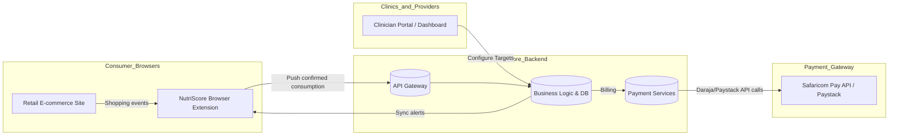

# NutriScore Kenya Administrative Dashboard — Technical Blueprint (Multi-tenant Architecture)

## 1. Executive Summary

NutriScore is shifting from a fragmented retail extension model to a **centralized multi-tenant Administrative Dashboard**. This dashboard becomes the “single source of truth,” securely aggregating patient shopping and dietary data under clinical supervision.  It offers significant advantages over an independent app model:

- **Unified Policy Enforcement:** Nutritional thresholds and alert rules (e.g. daily sodium or sugar limits) are configured once by administrators or clinicians and pushed consistently to all users. This prevents disparate client-side logic and ensures that every patient’s alerts follow the same clinical guidelines.
- **Population Health Analytics:** By collecting and storing data at the tenant (hospital/clinic) level, NutriScore enables cohort monitoring. Clinicians and public-health officials can detect patterns (for example, rising hypertension risk in a diabetic cohort) and adjust guidelines or interventions accordingly. An aggregated view across thousands of patients can yield insights into noncommunicable disease trends that isolated extensions cannot deliver.
- **Interoperability-Ready Platform:** This dashboard acts as an abstraction layer for future integration with Kenya’s digital health exchange. Business logic and data staging occur on the backend rather than in user browsers, simplifying eventual ESB/HIE onboarding. Once the national nutrition-education APIs mature, the dashboard can be certified and connected to the national infrastructure under controlled conditions.

This multi-tenant, SaaS-style design is more robust and maintainable. Each hospital or provider (tenant) gets isolated data storage and a customizable view, but all use the same core engine. Such an architecture reduces costs and simplifies updates compared to duplicating code in every client app. It also enforces data privacy: each tenant’s patient data is segregated so that no facility can see another’s records.  Overall, the centralized admin approach delivers better security, consistent rule enforcement, and richer analytics than a web-only, device-centered approach.

## 2. Multi-Tenant Architectural Blueprint

### 2.1 High-Level Layers

1. **Client (Retail Browser / Extension)**: The user’s browser extension still identifies products on e-commerce sites and collects purchase/consumption entries. However, it no longer communicates directly with national health APIs. Instead, it sends user-confirmed nutritional data securely to the NutriScore Backend API (layer 2).
2. **NutriScore Backend (Multi-Tenant Dashboard)**: A cloud-hosted platform offering tenant-keyed data services. It includes:
   - **API Gateway** (with OAuth2 client credentials for each tenant).
   - **Tenant Data Stores**: Each tenant (hospital or clinic) has a logically separate schema or database (tenant_id) to ensure isolation.
   - **Business Logic & Processing Engine**: Calculates nutrient intake, applies dietary rules, and generates alerts centrally.
   - **RBAC & Audit Layer**: Enforces user roles and logs all operations (see Section 3).
   - **Payment Module**: Handles clinic subscription billing via Safaricom Daraja and Paystack (see Section 4).
3. **Integration Boundary / Future HIE Integration**: A secure interface (currently dormant) for exchanging authorized health data with national infrastructure. When needed, an onboarded channel can push approved nutrition observations into the Shared Health Record under a provider’s authority. 

In this architecture, the admin dashboard is the orchestrator. Consumer data flows from retail sites into this centralized backend, and clinician inputs (e.g. new targets) flow back out to patient devices through it. Eventually, the dashboard can act as a certified digital-health system on the ESB, but for now it manages all data internally.

### 2.2 Data Flow and API Endpoints

A simplified data flow is shown below (mermaid flowchart):



Key integration points:
- **Retail → Extension**: No change. The Chrome extension scrapes product IDs and nutrition facts.
- **Extension → Backend (Tenant API)**: A secured RESTful API endpoint (`POST /api/v1/consumption`) on the NutriScore backend receives user entries. OAuth2 with a tenant-specific credential is used (the extension relays the user's session and tenant token).
- **Backend ↔ Clinician Portal**: Providers log into a tenant-specific admin portal. They can view patient cohorts, configure macro/micro nutrient targets, and analyze compliance trends. All these actions call internal APIs authenticated as provider roles.
- **Backend → Consumer (Target Sync)**: When a clinician sets a nutrient target, the backend marks it in the tenant database and issues a push notification or an updated config endpoint. The extension periodically polls (or uses WebSocket/Push) to get the latest target for the authenticated patient.
- **Backend → Payment Gateways**: A series of internal endpoints handle billing (see Section 4). For example, `POST /subscriptions/{tenant_id}/pay` initiates an M-Pesa STK push or Paystack payment, then listens for callbacks.

### 2.3 Security and Networking

- **Authentication/Authorization**: All API calls use OAuth 2.0 bearer tokens. Each tenant is a separate OAuth client. Clinicians and admin staff have roles that map to scopes. The extension uses a device token tied to the patient’s account.
- **Encryption**: TLS 1.3 is enforced on all traffic (API and database connections). Sensitive data (patient identifiers, salt values) are encrypted at rest.
- **Tenant Isolation**: Logical separation (separate schemas or partition keys) ensures Tenant A’s data cannot leak into Tenant B’s space.  Access control lists and database permissions enforce isolation at runtime.
- **National ESB**: When active, a dedicated service account and mTLS certificate (managed by DHA) would be used for pushing bundles into the Shared Health Record. Until then, the integration boundary remains offline for patient data.

Overall, the architecture places NutriScore’s backend as layer 2 middleware. The Shared Health Record (and other national registries) become potential layer 3 services only once the system is certified and the relevant APIs are formally supported. This staged approach adheres to Kenya’s interoperability framework while keeping NutriScore’s development decoupled from incomplete national APIs.

## 3. RBAC & Access Management Framework

NutriScore’s admin portal enforces strict role-based access control and audit logging to protect patient data and comply with regulations. The roles and permissions are defined as follows:

| **Role**                   | **Purpose / Capabilities**                                                                                              |
|----------------------------|-------------------------------------------------------------------------------------------------------------------------|
| **Super Administrator**    | - Oversees multi-tenant infrastructure (system-level).<br>- Onboards new tenant organizations and manages tenant keys.<br>- Sets global parameters (e.g. default nutrient rules, encryption keys, audit retention policy).<br>- Access to view all audit logs and tenant statistics. |
| **Tenant Administrator**   | - Manages a single tenant (hospital or clinic).<br>- Invites users, assigns roles within that tenant.<br>- Configures facility-specific defaults (e.g. local dietary guidelines, integrations).<br>- Cannot see other tenants’ data. |
| **Attending Physician / Clinician** | - Authorized to create, update, suspend and revoke **patient-specific nutrition targets or goals**. <br>- Can view and annotate individual patient nutritional histories and compliance reports. <br>- Cannot change system-wide or other patients’ data. |
| **Dietician / Nutrition Assistant** | - Read-only access within the patient nutrition domain.<br>- Can view patient dietary logs, consumption trends, and flagged warnings. <br>- Can prepare educational materials and general cohort reports. <br>- Cannot modify targets or patient medical settings. |
| **Auditor / Compliance Officer** | - Read-only access to activity logs and data exports for compliance review.<br>- Cannot alter data or configuration.<br>- Ensures privacy and data standards are adhered to. |

Each action (view, create, update, delete) is scoped by role. For instance, only the “Clinician” role can call the API endpoint to set a patient’s daily sugar limit; a Dietician role calling the same API would get a “forbidden” response. This enforces least-privilege access. 

The system also maintains a rigorous **immutable audit log**. Each log entry records: user identity (with role), tenant ID, timestamp, resource affected (e.g. Observation, Target, Patient record), action type (CREATE, UPDATE, DELETE, READ), and critical data snapshots before/after change. For example:

```
{
  "timestamp": "2026-10-22T08:35:41Z",
  "user": "clerktech75",
  "role": "Attending Physician",
  "tenant": "KenyattaNationalHospital",
  "action": "UPDATE",
  "resource": "NutritionTarget",
  "resource_id": "target-12345",
  "before": { "sodium_limit": 2500 },
  "after":  { "sodium_limit": 2000 },
  "description": "Lowered daily sodium target for hypertension management"
}
```

These audit entries are tamper-evident and retained per Kenya’s record-keeping rules. They provide accountability and enable tracing of “who changed what, and when,” which helps meet compliance expectations.  The combination of RBAC and audit logging ensures only authorized personnel affect clinical data and that any misuse can be detected and remedied.

## 4. Local Payment & Daraja Resiliency

The Administrative Dashboard includes a built-in billing engine to support clinic subscription fees via Kenya’s popular payment channels. Integration covers Safaricom’s Daraja (M-Pesa) APIs and Paystack (for credit card or other mobile money). Key elements include:

- **Payment Initiation:** The dashboard triggers a Safaricom STK Push or Paystack Checkout when a clinic subscribes or renews. Each request stores a unique transaction reference (e.g. Daraja’s `CheckoutRequestID`).
- **Daraja Callback Handling:** Safaricom responds via HTTPS callbacks to a webhook endpoint. The payload has the structure:
  ```
  {
    "Body": {
      "stkCallback": {
        "MerchantRequestID": "...",
        "CheckoutRequestID": "...",
        "ResultCode": <numeric>,
        "ResultDesc": "...",
        "CallbackMetadata": {
          "Item": [
            {"Name": "Amount", "Value": 100.00},
            {"Name": "MpesaReceiptNumber", "Value": "ABCDE12345"},
            {"Name": "TransactionDate", "Value": 20261022120000},
            {"Name": "PhoneNumber", "Value": 2547XXXXXXX}
          ]
        }
      }
    }
  }
  ```
  The `ResultCode` indicates success or error. A code of `0` means success; the `MpesaReceiptNumber` is the payment ID. Codes like `1032` or `1037` signify failures (`1032` often means insufficient funds, `1037` user cancellation).

- **Error Routing:** The system recognizes major failure codes:
  - **User Cancellation (e.g. 1037):** Transaction was cancelled by the user. The backend rolls back any provisional subscription state and marks the tenant in a “payment needed” status. It may notify admins to retry payment.
  - **Insufficient Funds (e.g. 1032):** The customer lacked funds. The tenant is placed into a controlled “grace period”: services remain active for a short term but with alerts to administrators. The dashboard periodically retries charging or prompts reconciliation.
  - **System Error (e.g. 1):** Treat similar to failed – log the error, flag for manual review, and prevent service activation until resolved.

- **Timeouts and Polling:** If no callback is received (network issues, silent failure), a background job uses the Safaricom *Transaction Status API* to query the payment’s final state. This API requires sending the original `CheckoutRequestID` and returns a JSON result (with `ResultCode:0` on success). Polling ensures that transient failures don’t leave payments in limbo.

- **Paystack Integration:** For card or off-net payments, NutriScore creates a Paystack transaction using its REST API. The Paystack JavaScript SDK or redirect flow is used on the admin site to collect payment. Paystack then sends webhook events (e.g. `charge.success`, `charge.failed`). The dashboard verifies webhook signatures, matches the transaction reference, and updates the subscription status. If a payment is pending (no webhook), the dashboard can call Paystack’s “verify transaction” endpoint to confirm success. Payment failures trigger similar rollback logic as above.

- **Resiliency and Idempotency:** All payment steps are idempotent. Unique transaction IDs prevent double-processing. If a webhook indicates failure, the system ensures any partial state (like activated subscription) is reverted. Every payment attempt and result is logged in a financial audit trail, along with the webhook payload (or fetched status).

This integrated billing layer ensures clinics can pay and manage subscriptions without leaving the platform. Structured error handling and retries ensure robustness against common Daraja pitfalls.

## 5. Variable Management Framework

Administrators control the core dietary parameters and validation rules in the dashboard. These variables are defined precisely to avoid ambiguity and ensure safe clinical usage:

- **Macronutrient & Micronutrient Targets:** The dashboard stores global default limits and patient-specific overrides for key nutrients. For example:
  - **Energy:** Kilocalories per day (kcal). 
  - **Sugars:** Grams per day (g).
  - **Saturated Fat:** Grams per day (g).
  - **Total Fat, Carbohydrates, Fibre, Protein:** Grams per day.
  - **Sodium:** Milligrams per day (mg).
  - **Salt:** Grams per day (g). (Note: 1 g salt ≈ 390 mg sodium.)
  
  Each target has a numeric value, unit, measurement period (e.g. per day), and comparison operator (e.g. `<`, `<=`). For instance, a hypertension guideline might set a sodium threshold of 2,000 mg (with operator “≤”) for daily intake.

- **Category-Aware Nutrition Rules:** The dashboard can incorporate food classification logic. For example, foods might be tiered into categories (e.g. a 14-level Kenyan Fresh Produce Quality schema or by processing level). Admins can assign adjustments or annotations based on category. For instance, a high-tier health category might allow a 10% higher sugar threshold for that food type. These rule sets are user-defined: NutriScore applies them so the extension can present context-aware feedback. 

- **Medical Alert Thresholds:** For chronic conditions, the dashboard defines specialized rules. Examples:
  - **Renal Disease:** Severe sodium restriction (e.g. daily sodium < 1,500 mg) and possibly protein limits.
  - **Diabetes:** Lowered added-sugar cap (e.g. < 30 g/day) and glycemic carbohydrate guidelines.
  - **Cardiovascular Risk:** Tighter saturated fat limits (e.g. < 20 g/day) or cholesterol intake caps.
  
  Each condition-specific rule triggers an alert if the patient’s intake exceeds the clinician’s set target. Clinicians can activate multiple risk profiles for a patient. The system ensures these rules use standardized terminologies and units (following Kenya Core FHIR unit conventions), to avoid unit mismatches and ensure uniform interpretation.

All these variables are managed via structured tables and forms in the admin UI. They are validated for plausibility (e.g. “2000 mg” is numeric, “<” is an allowed operator). The intent is to prevent, for example, confusing a per-100g label value with a daily total.  By centralizing these definitions, NutriScore guarantees that every device uses the same authoritative values and logic.

## 6. Cross-Modal Synchronization & Real-Time Strategy

The system synchronizes data seamlessly across three interaction modes:

- **Retail/Client Side (Browser Extension):**  
  - The extension loads the latest dietary targets from the dashboard’s API at login or periodically.  It only receives the patient’s applicable targets and general threshold rules, not other patients’ data or raw clinical records.  
  - When a user shops, the extension records selected products and asks for consumption amounts. It sends only confirmed consumption events (not full cart histories) to the backend.  
  - The extension uses cached rules when offline. It timestamps target updates so it can flag stale rules if, say, a new doctor’s order hasn’t synced yet.

- **Tenant Onboarding & Clinical Dashboard:**  
  - Healthcare staff interact with a rich UI showing dashboards and charts.  The dashboard aggregates patient nutrition histories and highlights those exceeding limits.  
  - Clinicians configure targets and see logs of patient compliance. The UI dynamically reflects changes (e.g. a revised target immediately triggers a notice in the patient alert log).  
  - Consent and data-sharing status for each patient is visible; providers can see whether a patient has authorized dashboard data collection.

- **Data Quality & Provenance Layer:**  
  - All numeric conversions (e.g. per-100g to actual intake) are performed on the backend. The system tags each nutrient value with its source (label-derived, user-entered, or estimated).  
  - If a product is missing data (e.g. unknown salt content), the backend marks that nutrient as “not available” rather than guessing. The UI will then indicate “Data unavailable” instead of showing a misleading value.  
  - The provenance (method of calculation, product ID, dataset version) is stored with each observation. When clinicians view a patient’s nutrition timeline, they see tooltips like “Obtained from patient’s grocery log on 2026-10-21 – data estimated from product label.”  

These measures ensure transparency: clinicians know exactly what they’re seeing. An “estimated total sodium of 2,000 mg” won’t appear as a lab result – it will be clearly labeled as a patient-reported estimate. 

**Offline Behavior:** The extension supports offline use. It always stores the last-known valid target locally. If offline, it still computes and warns on nutrient totals using these cached targets. The UI explicitly notes “Offline mode – targets may be out-of-date” if it hasn’t synced in some time. Once connectivity resumes, it fetches any updates from the dashboard. This ensures continuity of care without confusing patients about stale data.

**Asynchronous Sync:** Data submission (user intake logs) happens asynchronously. The extension sends new entries to the backend API and confirms receipt. If submission fails (e.g. network drop), the extension queues the data and retries. Similarly, target updates push from the backend to clients either via push notification (if supported) or when the extension polls. Unique transaction IDs and version numbers prevent overwriting a newer target with an older one.

Together, these cross-modal strategies keep NutriScore’s data consistent and reliable across user devices and clinical interfaces.

## 7. Compliance, Governance & Clinical Safety

NutriScore’s admin architecture must comply with Kenyan law and best practices for health data:

- **Health Data Processing & Legal Basis:** The Data Protection Act, 2019 treats personal health information as *sensitive*. Importantly, Section 46 forbids processing personal health data **except by or under a healthcare provider’s responsibility**. NutriScore is a commercial entity, so it must channel patient data through authorized clinical contexts. In practice, this means each patient’s connection to NutriScore must be mediated by their healthcare provider (tenant). The dashboard effectively acts under the provider’s authority, satisfying the Act’s requirement that only clinicians or those bound by professional confidentiality handle health data.
- **Explicit Consent & Purpose:** Separate consents are needed for each purpose: (a) collecting shopping data, (b) storing nutrition history, (c) sharing summaries with providers, and (d) receiving clinical targets. The platform tracks consent status and honors withdrawals. This aligns with Data Protection Act demands and the Digital Health Act’s emphasis on informed consent.
- **Data Minimization:** Only clinically relevant nutrition summaries (e.g. daily totals) are submitted to the clinical database. Full shopping histories, prices or store data are kept locally and not shared. This fulfills the minimization principle. All shared fields are justified by medical use (for example, carbohydrates total for diabetes management).
- **Security Safeguards:** In transit, all APIs use strong TLS; at rest, tenant databases are encrypted. Administrative access requires MFA. The system follows Kenya Core FHIR IG conventions: role-based scopes, audit trails, and provenance fields on clinical observations. Access logs and transaction logs are retained per DHA guidelines.
- **Cross-Border Data:** If any data (like backups or analytics processing) goes outside Kenya, the ODPC’s cross-border rules apply. NutriScore should verify contracts and, if needed, anonymize or restrict such transfers.
- **Regulatory Alignment:** While not yet a fully accredited e-health solution, NutriScore should prepare for DHA certification by adopting the 2025 Data Exchange regulations as a model. The business should register as a health-data controller for these functions and undergo a DPIA (required for high-risk health processing). The Lawyer Africa analysis of the 2025 regulations emphasizes that any entity exchanging health data must implement strict audit, security, and consent controls. NutriScore’s centralized logging and role controls directly support those requirements.
- **Clinical Safety:** All numeric computations are double-checked (e.g. salt versus sodium conversion). The application never treats an estimated or incomplete value as exact. Warnings are clearly phrased (“estimated daily sodium”) to prevent misinterpretation by a doctor or patient. The system disallows impossible thresholds (e.g. negative grams) and validates that a clinician-set target fits medical sense (e.g. daily calories not 50k).
- **Governance Checks:** Features are in place for data subject rights: patients (or caregivers) can request their data export or correction. Each tenant is responsible for responding in coordination with NutriScore’s data team. Retention policies are documented (e.g. audit logs held per regulation, clinical data archived according to national law).

In summary, NutriScore’s design embraces Kenya’s data protection framework. By running the service under hospital tenancy and enforcing DHA-grade consent and security rules, the platform can align commercial operations with the legal treatment of health information.

## 8. Remediation Plan & Mandatory Testing

### Priority Tasks

1. **Legal and Onboarding Setup (Critical Gate)** – Finalize the data-processing model. Register NutriScore as a Digital Health data processor under a provider’s license, or partner with a certified health IT firm. Complete a Data Protection Impact Assessment. Define the certification pathway with DHA for multi-tenant solutions. *Exit when:* Legal counsel signs off and DHA confirms the integration approach.

2. **Data Model & Multi-Tenant Foundation** – Design tenant-keyed database schemas and FHIR-compatible nutrition summary profiles. Define all macro/micro nutrient fields, units (UCUM), and code systems. Build the core backend services (APIs, computation engine) under multi-tenant constraints. Validate encryption and isolation. *Exit when:* UAT testers demonstrate that Tenant A cannot see Tenant B’s data and that nutrient fields validate correctly.

3. **RBAC & Admin UI Development** – Implement authentication (OAuth 2.0 with scopes) and the role matrix. Build the admin portal interfaces for clinicians, dieticians, and admins to manage patients and targets. Integrate audit logging. *Exit when:* Role-based permissions are enforced end-to-end (tested via user accounts), and audit logs record actions with complete detail.

4. **Payment Integration & Resiliency** – Code the Daraja and Paystack payment modules. Develop robust webhook handlers and status polling. Simulate failures (user cancel, insufficient funds, timeouts) and ensure correct fallback states. *Exit when:* Test transactions cover success and all error cases; subscription states update properly in each scenario.

5. **Data Sync & Offline Support** – Complete the extension-client data exchange flow. Ensure the extension can operate offline with cached targets. Build reconciliation logic (pending submission queues). *Exit when:* Offline extension behavior works, and stale-target indicators appear appropriately.

6. **Governance & Safety Checks** – Finalize consent workflows in the UI, implement retention schedules, and lock down security settings. Conduct threat modeling and security tests. *Exit when:* Security audit passes, DPIA is approved, and operational manuals (incident response, access requests) are documented.

### Mandatory Testing Scenarios

| **Test Scenario**                                     | **Expected Outcome**                                                                                                                                         |
|-------------------------------------------------------|--------------------------------------------------------------------------------------------------------------------------------------------------------------|
| **No consumption entered (purchase only)**            | Submission yields no intake Observation. The system does *not* assume the purchase was consumed.                                                             |
| **Partial consumption from label data**               | Given label (per-100g) values and user portion, intake is correctly computed (e.g. 60g of 12g/100g sugar → 7.2g). Unit conversions (ml↔g) are accurate. |
| **Missing nutrient value**                            | If a nutrient (e.g. sodium) is missing from the product record, the intake is marked "unknown" instead of zero, and a log note is created.                   |
| **Ambiguous patient identity**                        | If the client-record linkage (tenant+patient ID) fails, the ingestion API rejects the data and flags for resolution.                                        |
| **Consent revoked mid-study**                         | After a patient withdraws consent, no further data is shared; historical data remains but is flagged.                                                         |
| **Clinic STK Payment: success (ResultCode 0)**        | Dashboard marks subscription active and records receipt ID; no retry.                                                                                         |
| **STK Payment: user cancel (ResultCode 1037)**        | Subscription activation is rolled back; tenant moved to 'payment required' with alert.                                                                       |
| **STK Payment: insufficient funds (ResultCode 1032)** | Tenant enters grace period state; alert admin panel; auto-retry logic engages (or waits for manual retry).                                                    |
| **STK Payment: no callback (timeout)**                | The transaction status API returns success later; subscription is activated. If still pending beyond threshold, admin is notified of timeout.               |
| **Clinician revises target**                          | The new target replaces the old one (version increment). The patient’s device receives only the latest active version.                                        |
| **Target revoked or expired**                         | The extension clears the alert; any future alerts use only the active target (none if revoked).                                                              |
| **Extension offline use**                             | Last synced target is used for warnings. UI indicates “Offline mode – data may be outdated.” Data logs queue for submission upon reconnection.               |
| **Retail page DOM changes**                           | Product detection may fail gracefully (no nutrition sent) without corrupting existing data.                                                                  |
| **User data access request**                          | The system can export or delete a patient’s data within legal timeframes. Correction of erroneous entries is allowed with audit trail.                        |

Each test must trace back to requirements. For example, payment failures are tested against Daraja codes. These scenarios ensure the architecture is reliable, compliant, and safe for clinical use.

---

**Sources:** Kenya’s digital health and data protection policies, Safaricom Daraja developer documents, and multi-tenant SaaS architecture best practices informed this blueprint.