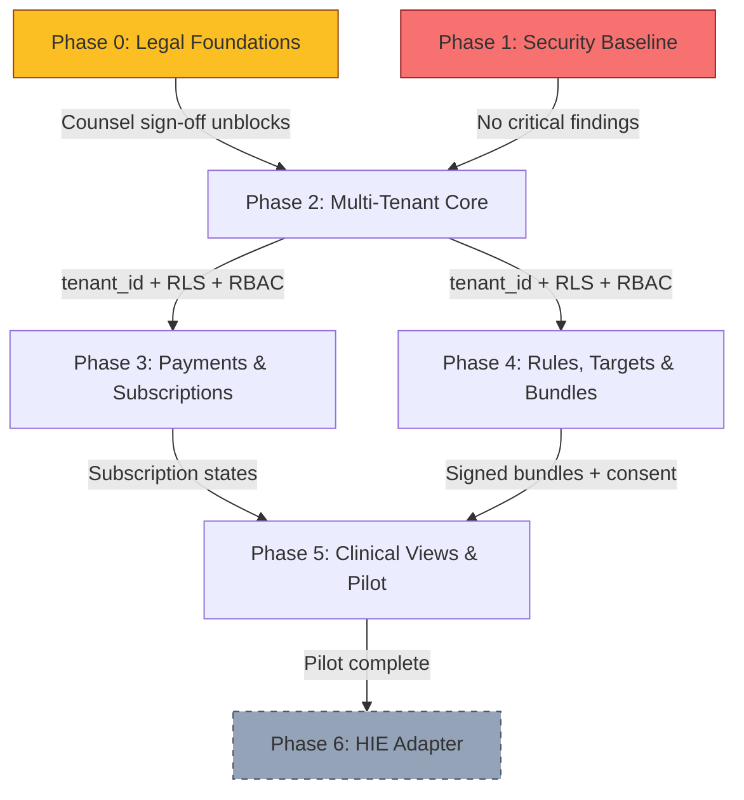
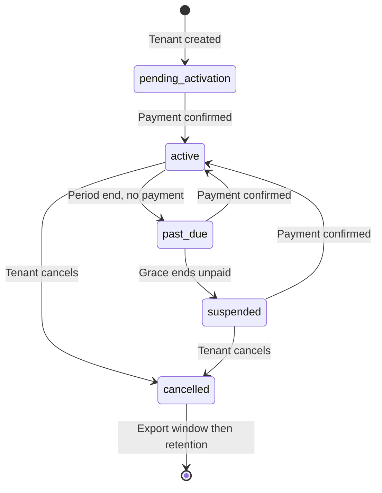

# Clinic Admin Dashboard (CAD) — Implementation Plan

> **Repository:** NUT-04 Checkout Tool
> **Date:** 2026-10-26
> **Status:** PLAN — read-only; no code changes made
> **Naming:** The new multi-tenant admin product is the **Clinic Admin Dashboard (CAD)**. The existing patient-facing analytics surface is the **Shopper Dashboard**.

---

## Table of Contents

1. [Current-State Inventory](#1-current-state-inventory)
2. [Delta Analysis: What Exists vs. What CAD Needs](#2-delta-analysis)
3. [Dependency Graph](#3-dependency-graph)
4. [Phase 0 — Legal & Governance Foundations (Non-Engineering Gate)](#4-phase-0--legal--governance-foundations)
5. [Phase 1 — Security Baseline & Audit Remediation](#5-phase-1--security-baseline--audit-remediation)
6. [Phase 2 — Multi-Tenant Core](#6-phase-2--multi-tenant-core)
7. [Phase 3 — Payments & Subscription Lifecycle](#7-phase-3--payments--subscription-lifecycle)
8. [Phase 4 — Rules Engine, Targets & Signed Bundles](#8-phase-4--rules-engine-targets--signed-bundles)
9. [Phase 5 — Clinical Views, Consent & Pilot](#9-phase-5--clinical-views-consent--pilot)
10. [Phase 6 — HIE Adapter (Conditional)](#10-phase-6--hie-adapter-conditional)
11. [Cross-Cutting Concerns](#11-cross-cutting-concerns)
12. [Risk Register](#12-risk-register)
13. [Mandatory Test Scenarios (Traceability Matrix)](#13-mandatory-test-scenarios)
14. [Open Questions for People Outside Engineering](#14-open-questions)

---

## 1. Current-State Inventory

### 1.1 Extension (Layer 1 — Client)

| Asset | Path | Role | CAD-Relevant Notes |
|---|---|---|---|
| Manifest V3 | `src/extension/manifest.json` | MV3 config; permissions: `alarms`, `storage`, `identity`; host permissions for Naivas, Carrefour, Quickmart | Host permissions are hard-coded. CAD requires dynamic host registration via `optional_host_permissions` + `chrome.scripting.registerContentScripts()` per the `retailers` table (F-13). |
| Service Worker | `src/extension/background.js` (659 lines) | Alarm-driven catalog sync, message routing, tier resolution, entitlement refresh | Catalog sync currently pulls from `catalog_products` / `catalog_premium` with `seq`-based pagination. CAD adds a signed **target bundle** fetch path alongside the existing catalog sync. |
| IndexedDB Layer | `src/extension/db.js` (1314 lines, compiled from `db.ts`) | Schema v17; stores: `shopping_ledger`, `user_settings`, `product_cache`, `pending_cart_syncs`, `dataset_metadata`, `catalog_staging`, `premium_assessments`, per-retailer product stores, `price_cache` | CAD adds new IDB stores for `target_bundles` (current + previous signed bundle) and `diary_queue` (offline consumption entries). Schema version bump required. |
| Entitlement | `src/extension/entitlement.js` (259 lines) | ES256 JWT verifier; clock-rollback guard; `resolveTier()`, `refresh()`, `adopt()` | Solid foundation. CAD reuses this for patient-tier verification. The `ENTITLEMENT_PUBLIC_KEYS` in `config.js` needs a second key set for target-bundle signatures. |
| Context Engine | `src/extension/engine/context-engine.js` (232 lines) | FSA-NPS scoring with category-group dispatch; 5 scorer modules | Stateless, tenant-agnostic — perfect for CAD's shared core engine. No changes needed to the scoring logic itself. |
| Health Flags | `src/extension/engine/health-flags.js` (110 lines) | `IsEnergyDense`, `IsHighSodium`, `DiabeticFriendly`, `RenalSafe` predicates | `RenalSafe` is partially disabled: potassium and phosphorus fields missing from the schema. CAD Phase 4 adds those fields. |
| Shared UI | `src/extension/adapters/shared-ui.js` (494 lines) | Badge injection, flyout rendering, global shadow portal, alternatives accordion | Contains duplicate threshold logic (SMELL from audit). CAD Phase 1 retires this in favour of engine-only thresholds. |
| Config | `src/extension/config.js` | `NUTRI_CONFIG`: Supabase URL/anon key, catalog + entitlement public keys | Public keys only. CAD adds `TARGET_PUBLIC_KEYS` for signed bundle verification. |
| Retailer Adapters | `adapters/naivas.js`, `adapters/carrefour.js`, `adapters/quickmart.js` | DOM selectors per retailer | Currently hard-coded. CAD's `retailers.adapter_spec` (jsonb) enables declarative selectors — but the adapter runtime still needs imperative JS. Phase 2 builds a thin adapter loader that reads `adapter_spec` for selectors and falls back to the bundled adapter. |

### 1.2 Shopper Dashboard UI (Layer 1 — Client)

| Asset | Path | Notes |
|---|---|---|
| Dashboard | `src/ui/src/app/components/Dashboard.tsx` (43 KB) | Patient-facing analytics: grade distribution, nutrient trends, category insights, health alerts. Premium-gated. |
| Onboarding | `src/ui/src/app/components/OnboardingWizard.tsx` (60 KB) | 4-step wizard: auth → health condition → consent → tier selection |
| Popup | `src/ui/src/app/components/Popup.tsx` | Extension popup entry point |

> **Key point:** The CAD is a *separate web application*, not an extension page. It is built as a standalone React (or Vite) app served from a subdomain (e.g. `admin.nutriscore.co.ke`), authenticated via Supabase Auth with custom claims (`tenant_id`, `role`). The existing Shopper Dashboard remains unchanged in the extension.

### 1.3 Supabase Backend (Layer 2)

#### Tables (19 migrations applied)

| Table | Migration | CAD-Relevant State |
|---|---|---|
| `users` | `20240101`, `20260924*`, `20260928` | Has `is_premium`, `premium_expires_at`, `subscription_status`, `payment_received_at`, onboarding columns. **No `tenant_id` yet.** |
| `products` | `20240101` | Legacy product table; RLS tightened (anon SELECT revoked by `20260928010000`). |
| `payments` | `20240101`, `20260928` | `plan` FK to `plans`; `provider_amount`, `granted_at`. **No `tenant_id` yet.** |
| `plans` | `20260928` | Single plan: `premium_30d` at KES 189. RLS: authenticated SELECT only. |
| `catalog_products` | `20260928010000` | `(retailer, product_id)` PK; `seq`-based sync; `record` jsonb; `record_hash`; tombstones. FK to `retailers`. |
| `catalog_premium` | `20260928010000` | Premium assessments; same sync pattern; RLS gated by `is_premium_active()`. |
| `catalog_releases` | `20260928010000` | Signed manifest with `is_current` unique constraint. |
| `retailers` | `20261011000003` | ✅ **Already exists.** `id`, `display_name`, `hosts[]`, `adapter_spec` jsonb, `enabled`, `rollout_pct`. Rows: NAIVAS, CARREFOUR, QUICKMART. |
| `rate_buckets` | `20261011000004` | UNLOGGED token bucket for rate-limiting. `rate_limit_take()` RPC. |

#### Key Functions

| Function | Purpose | CAD Impact |
|---|---|---|
| `grant_premium()` | Idempotent premium activation; amount-checked, stacking | Needs `tenant_id` parameter for tenant-scoped billing. |
| `is_premium_active()` | Stable helper checking `premium_expires_at > now()` | Remains useful; CAD adds a tenant-scoped variant. |
| `get_my_entitlement()` | Returns tier + expiry as JSONB | Extend with tenant claims. |
| `enforce_billing_state()` | SECURITY INVOKER trigger; protects billing columns from client writes | Keep as-is; audit fix already applied. |
| `catalog_upsert()`, `catalog_premium_upsert()`, `catalog_tombstone_missing()`, `catalog_release_publish()` | Service-role-only catalog write helpers | Tenant-agnostic (catalog is shared). No change needed. |
| `rate_limit_take()` | Token bucket | Reuse for CAD API rate-limiting. |

#### Edge Functions

| Function | Path | CAD Impact |
|---|---|---|
| `entitlement` | `supabase/functions/entitlement/index.ts` | Signs ES256 JWT for premium users. Extend to include `tenant_id` claim. |
| `mpesa-initiate` | `supabase/functions/mpesa-initiate/index.ts` | STK Push; reads `plans` table. Needs tenant-scoped invoicing. |
| `mpesa-webhook` | `supabase/functions/mpesa-webhook/index.ts` | Calls `grant_premium()`. Needs tenant context from the payment row. |
| `paystack-webhook` | `supabase/functions/paystack-webhook/index.ts` | HMAC-SHA512 verification; calls `grant_premium()`. Same tenant extension. |
| `paystack-initiate`, `paystack-redirect`, `payment-status` | Various | Complement the payment flow. |
| `_shared/cors.ts` | `supabase/functions/_shared/cors.ts` | Origin allowlist from `ALLOWED_ORIGINS` env var. CAD subdomain must be added. |
| `_shared/plan.ts` | Reads `plans` table | Reusable. |

### 1.4 Build & CI

| Asset | Notes |
|---|---|
| `build.ps1` | esbuild `db.ts` → `db.js` (IIFE); Vite build UI; assemble `dist/` |
| `package.json` | Scripts: `build:db`, `build:ext`, `build:ui`, `ci`, `test`, `typecheck`, `lint` |
| `.github/workflows/ci.yml` | Runs: npm test → typecheck → lint → build → assert HTML files → verify `db.js` freshness |
| `.github/workflows/ci-cd.yml` (14 KB) | Full CI/CD pipeline |

---

## 2. Delta Analysis

### What Exists vs. What CAD Needs

| # | Capability | Current State | CAD Requirement | Gap Size |
|---|---|---|---|---|
| 1 | **Tenancy** | No `tenant_id` anywhere. Single-tenant. | Every tenant-owned table has `tenant_id uuid NOT NULL`; composite PKs; RLS policies matching JWT claim. | **Full build** |
| 2 | **RBAC** | Binary: `is_premium` / basic. No roles. | 7 roles (Super Admin → Patient) with permission matrix. | **Full build** |
| 3 | **Audit Log** | None. | Append-only, hash-chained, encrypted snapshots, 20-year retention. | **Full build** |
| 4 | **Tenant Billing** | Individual user pays KES 189/30 days. `payments` + `plans` + `grant_premium()`. | Clinic subscription with `PENDING_ACTIVATION` → `ACTIVE` → `PAST_DUE` → `SUSPENDED` → `CANCELLED` lifecycle. | **Major refactor** |
| 5 | **Nutrient Targets** | Hard-coded thresholds in `context-engine.js` (`MEDICAL_THRESHOLDS`). Duplicate in `shared-ui.js`. Remote config disagrees (400 mg sodium vs. 600 mg). | Typed, versioned, bounded target records at platform/tenant/cohort/patient scope. Signed bundles distributed to clients. | **Full build** |
| 6 | **Catalog** | ✅ `catalog_products`, `catalog_premium`, `catalog_releases` with signed manifests. | Shared, read-only to tenants. Tenant correction queue. | **Minor addition** |
| 7 | **Retailers Registry** | ✅ `retailers` table with `hosts[]`, `adapter_spec`, `rollout_pct`. | Data-driven retailer management. | **Wire to extension** |
| 8 | **Consent Ledger** | Basic `terms_accepted`, `privacy_accepted` in `users`. | Granular consent: purchase timeline, diary, clinician link, de-identified aggregates. Scoped states: `NOT_REQUESTED` → `ACTIVE` → `REVOKED`. | **Full build** |
| 9 | **Patient–Clinician Link** | None. | Single-use short-lived link codes; clinician confirms two identifiers; patient confirms in app. | **Full build** |
| 10 | **Clinical Views** | Shopper Dashboard (patient-facing): grade distribution, nutrient trends, category insights. | Clinician views: cohort trends, patient flight paths, compliance summaries, small-cell suppression. | **Full build** (separate app) |
| 11 | **Diary / Consumption** | `shopping_ledger` tracks cart events with `in_cart` / `purchased` status. | User-confirmed consumption diary with portions, provenance tagging, server-side recomputation. | **Major extension** |
| 12 | **Data Quality** | `review_state` on `catalog_products`; two-gate grading in `db.js`. | Six provenance classes; coverage ratios; Atwater cross-checks. | **Moderate build** |
| 13 | **Encryption** | Supabase default encryption at rest. No per-tenant keys. | Per-tenant data key wrapped by KMS; crypto-shredding on tenant offboarding. | **Full build** |
| 14 | **MFA** | None. | Mandatory for every non-patient role. | **Configuration** |
| 15 | **Missing Schema Fields** | No potassium, phosphorus, serving_size, trans_fat in catalog records. | Required for renal packs, per-serving calculations, sweetener penalty. | **Schema addition** |
| 16 | **Rate Limiting** | ✅ `rate_limit_take()` token bucket exists. | Reuse for CAD API endpoints. | **Already done** |
| 17 | **Payment Reconciliation** | Webhook processes inline; no background worker. | Acknowledge fast, decide later pattern; STK Push Query polling with backoff. | **Major refactor** |
| 18 | **CAD Web App** | None. | Separate Vite + React app at `admin.nutriscore.co.ke`. | **Full build** |

---

## 3. Dependency Graph



**Phase 0** and **Phase 1** run in parallel. Phase 0 is non-engineering (legal/governance). Phase 1 is engineering (audit remediation). Both must complete before Phase 2 begins.

**Phase 3** and **Phase 4** can run in parallel once Phase 2 exits.

**Phase 6** is conditional on DHA confirming a lane for patient-generated data.

---

## 4. Phase 0 — Legal & Governance Foundations

> **Owner:** Legal counsel, DPO, founder
> **Duration:** 4–8 weeks (parallel with Phase 1)
> **Exit Gate:** Counsel and DPO sign-off; DPIA complete; DHA position in writing

### 4.1 Deliverables

| # | Deliverable | Dependency | Notes |
|---|---|---|---|
| 0.1 | Legal opinion on processor-under-clinic model (DPA s.46) | External counsel | Does a commercial vendor satisfy s.46 as a processor under a clinic's responsibility? |
| 0.2 | ODPC registration | Counsel | Register NutriScore as processor; each tenant registers as controller. |
| 0.3 | Appoint a Data Protection Officer | Board decision | Required by DPA for sensitive data processing. |
| 0.4 | Data Protection Impact Assessment (DPIA) | 0.1, 0.2 | Sensitive data + new technology + systematic monitoring of purchases = mandatory DPIA (DPA s.31). |
| 0.5 | Data Processing Agreement template | 0.1 | Executed between NutriScore (processor) and each clinic (controller). |
| 0.6 | DHA written position on certification | DHA engagement | Does HIM Reg 37(1) apply when a facility uses the dashboard for patient nutrition? Budget: KES 20,000 application + KES 50,000 testing. |
| 0.7 | Hosting region & sub-processor audit | Ops | Confirm Supabase region (DPA ss.48–50); list all sub-processors (Supabase, Safaricom, Paystack, email/SMS provider). |
| 0.8 | Clinical Safety Board charter | Founder + clinical advisors | Defines who owns the safety envelope and default rule packs. |

### 4.2 What Is Blocked

| Blocked Item | Unblocked By |
|---|---|
| Any patient data in the CAD (dev/staging with synthetic data is fine) | 0.1, 0.3, 0.4 |
| First paying tenant | 0.5, 0.6 |
| Renal/paediatric target co-signature policy | 0.8 |

---

## 5. Phase 1 — Security Baseline & Audit Remediation

> **Owner:** Engineering
> **Duration:** 2–3 sprints
> **Exit Gate:** No critical or high audit finding open; SAST clean; existing CI passes
> **Can start immediately** — does not depend on Phase 0.

### 5.1 Audit Findings to Close

| ID | Finding | Current State | Fix | Effort |
|---|---|---|---|---|
| SEC-003 | Billing-column trigger used `SECURITY DEFINER`, causing the guard to never fire for `authenticated` role | **Fixed** in `20260928000000_billing_authority.sql` — trigger is now `SECURITY INVOKER` with `enforce_billing_state()` | ✅ Verify in test; no code change needed | — |
| SEC-011 | Column privileges on `users` | **Fixed** in `20260928` — `REVOKE INSERT, UPDATE` then `GRANT` only safe columns | ✅ Verify | — |
| SMELL-001 | Duplicate threshold logic in `shared-ui.js` beside the engine | `shared-ui.js` contains inline thresholds; `context-engine.js` has `MEDICAL_THRESHOLDS` | Remove thresholds from `shared-ui.js`; all flyout rendering reads from the engine result | S |
| SMELL-002 | Remote config thresholds (400 mg sodium, 10 g sugar) disagree with engine (600 mg, 22.5 g) | Remote config seeded via Supabase; engine hard-codes different values | Retire remote config thresholds; engine is the single source of truth. Add a `rule_version` field so future CAD targets can override cleanly | M |
| F-18 | Paystack webhook signature verification | **Fixed** — constant-time comparison in `paystack-webhook/index.ts` lines 15–28 | ✅ Already done | — |
| CORS | CORS origin allowlist | **Fixed** — `_shared/cors.ts` checks `ALLOWED_ORIGINS` env var | ✅ Already done. Add CAD subdomain to the env var when deploying | — |
| D-06 | Transient failures must not wipe premium token | **Fixed** in `entitlement.js` — definitive-only revocation | ✅ Verify | — |
| F-13 | Retailers are code, not data | **Partially fixed** — `retailers` table exists; hard-coded `CHECK` constraints dropped; FK added | Wire extension to read `retailers` table and register content scripts dynamically (see Phase 2) | M |
| NEW-1 | Escape retailer IDs before building RegExp | `db.js` line 870: `escapeRegExp` is present but only for Carrefour URL matching | Audit all RegExp construction paths for injection | S |
| NEW-2 | Server-verified payment amounts | **Fixed** — `mpesa-initiate` reads `plans.price_kes`; `grant_premium()` checks `amount IS DISTINCT FROM price_kes` | ✅ Verify | — |

### 5.2 CI Hardening

| Task | Description | Effort |
|---|---|---|
| Add RLS policy CI check | A script that queries `pg_catalog` for tables with a `tenant_id` column but no RLS policy. Fails the build. | M |
| Add secret-scan gate | `check-no-secrets-tracked.mjs` already exists in the `ci` script. Verify it catches the Supabase anon key in `config.js` (it's a publishable key, so it's fine, but the check should be explicit about the allow-list). | S |
| Edge function type-check | Add `deno check` for all edge functions to CI. Currently not checked. | S |

---

## 6. Phase 2 — Multi-Tenant Core

> **Depends on:** Phase 0 (counsel sign-off) + Phase 1 (no critical findings)
> **Duration:** 3–4 sprints
> **Exit Gate:** Cross-tenant isolation tests (T10–T15) pass; RBAC enforced end-to-end

### 6.1 Database: Tenant Tables & RLS

#### New Tables

```sql
-- Tenants registry (the organizational unit — a clinic or hospital)
CREATE TABLE public.tenants (
  id            uuid PRIMARY KEY DEFAULT gen_random_uuid(),
  name          text NOT NULL,
  slug          text UNIQUE NOT NULL CHECK (slug ~ '^[a-z0-9-]{3,48}$'),
  status        text NOT NULL DEFAULT 'pending_activation'
                  CHECK (status IN (
                    'pending_activation','active','past_due',
                    'suspended','cancelled'
                  )),
  config        jsonb NOT NULL DEFAULT '{}',
  config_version int NOT NULL DEFAULT 1,
  created_at    timestamptz NOT NULL DEFAULT now(),
  updated_at    timestamptz NOT NULL DEFAULT now()
);

-- Tenant memberships (maps users to tenants with roles)
CREATE TABLE public.tenant_members (
  tenant_id     uuid NOT NULL REFERENCES public.tenants(id),
  user_id       uuid NOT NULL REFERENCES auth.users(id),
  role          text NOT NULL CHECK (role IN (
    'super_admin','compliance_auditor','tenant_admin',
    'writing_clinician','viewing_dietician',
    'commercial_stakeholder','patient'
  )),
  licence_number text,
  licence_expiry date,
  licence_verified boolean NOT NULL DEFAULT false,
  status        text NOT NULL DEFAULT 'active'
                  CHECK (status IN ('active','suspended','revoked')),
  created_at    timestamptz NOT NULL DEFAULT now(),
  PRIMARY KEY (tenant_id, user_id)
);

-- Audit log (append-only, hash-chained)
CREATE TABLE public.audit_log (
  event_id      uuid PRIMARY KEY DEFAULT gen_random_uuid(),
  tenant_id     uuid NOT NULL REFERENCES public.tenants(id),
  seq           bigint NOT NULL,
  occurred_at   timestamptz NOT NULL DEFAULT clock_timestamp(),
  actor_id      uuid NOT NULL,
  actor_role    text NOT NULL,
  session_id    text,
  action        text NOT NULL,
  mutation_type text NOT NULL CHECK (mutation_type IN (
    'create','update','suspend','revoke',
    'read','export','break_glass'
  )),
  resource_type text NOT NULL,
  resource_id   text,
  subject_ref   text,
  before_snapshot bytea,
  after_snapshot  bytea,
  reason        text NOT NULL,
  prev_hash     text,
  row_hash      text NOT NULL,
  UNIQUE (tenant_id, seq)
);
```

**Audit log integrity:**
- A trigger rejects any `UPDATE` or `DELETE` on `audit_log`.
- `row_hash = SHA-256(prev_hash || canonical_row)` chains each tenant's log.
- A nightly job verifies each tenant's hash chain and alerts on breaks.
- A signed head hash is written daily to write-once (object-lock) storage.

#### Column Additions to Existing Tables

| Table | Addition | Notes |
|---|---|---|
| `users` | `tenant_id uuid REFERENCES tenants(id)` | Nullable initially for migration; NOT NULL enforced after backfill. Platform-level users (super_admin) have a special platform tenant. |
| `payments` | `tenant_id uuid REFERENCES tenants(id)` | Same migration strategy. |

#### RLS Policies

Every table with `tenant_id` gets a policy:

```sql
CREATE POLICY tenant_isolation ON public.<table>
  FOR ALL TO authenticated
  USING (tenant_id = (auth.jwt() ->> 'tenant_id')::uuid)
  WITH CHECK (tenant_id = (auth.jwt() ->> 'tenant_id')::uuid);
```

### 6.2 JWT Custom Claims

Supabase Auth hook (or `on_auth_token_created` function) injects into `app_metadata`:

```json
{
  "tenant_id": "<uuid>",
  "role": "writing_clinician",
  "licence_verified": true
}
```

Both the extension and CAD read these claims.

### 6.3 RBAC Middleware

| Layer | Implementation |
|---|---|
| Edge Functions | Shared `_shared/rbac.ts` module. Reads `role` from JWT claims. Exports `requireRole(req, ...allowedRoles)` that returns 403 if the caller's role is not in the list. |
| Postgres (RLS) | Policies use `auth.jwt() ->> 'role'` for fine-grained row access. E.g., `commercial_stakeholder` can only read from aggregated views. |
| CAD Frontend | React context with `useRole()` hook; route guards; conditional UI rendering. |

### 6.4 MFA Enforcement

Configure Supabase Auth to require MFA for all roles except `patient`. Enforced via a check in the `tenant_members` insert flow and a middleware guard on CAD API routes.

### 6.5 Extension: Dynamic Retailer Registration

Currently, `manifest.json` hard-codes `host_permissions` and `content_scripts` for three retailers. CAD requires:

1. Move retailer hosts to `optional_host_permissions` in the manifest.
2. On service worker boot, fetch `retailers` table (enabled rows), request permission for new hosts via `chrome.permissions.request()`, and register content scripts via `chrome.scripting.registerContentScripts()`.
3. Fall back to bundled adapters for the three existing retailers; use `adapter_spec` jsonb for selector overrides.

> **Note:** Adding a new host permission triggers Chrome's "new permissions" re-approval flow for the user. This is unavoidable but decoupled from DB schema changes (the goal of F-13).

### 6.6 CAD Web Application Scaffold

| Decision | Recommendation |
|---|---|
| Framework | Vite + React (matches existing UI stack; shared component library) |
| Auth | Supabase Auth with redirect flow; MFA enforced |
| Hosting | Separate subdomain: `admin.nutriscore.co.ke` |
| Routing | React Router with role-based route guards |
| State | React Query for server state; React Context for auth/tenant |

**Phase 2 pages:**
- Login / MFA
- Tenant switcher (for super_admin)
- Tenant settings (config, branding)
- User management (invite, role assignment, licence verification)
- Audit log viewer (read-only)

---

## 7. Phase 3 — Payments & Subscription Lifecycle

> **Depends on:** Phase 2 (tenant_id exists)
> **Duration:** 2–3 sprints
> **Exit Gate:** Payment tests T1–T9 pass in sandbox, then a low-value production run

### 7.1 New Tables

```sql
-- Tenant subscriptions (replaces per-user premium for clinics)
CREATE TABLE public.subscriptions (
  id            uuid PRIMARY KEY DEFAULT gen_random_uuid(),
  tenant_id     uuid NOT NULL REFERENCES public.tenants(id),
  plan          text NOT NULL REFERENCES public.plans(code),
  status        text NOT NULL DEFAULT 'pending_activation'
                  CHECK (status IN (
                    'pending_activation','active','past_due',
                    'suspended','cancelled'
                  )),
  current_period_start timestamptz,
  current_period_end   timestamptz,
  grace_ends_at        timestamptz,
  created_at    timestamptz NOT NULL DEFAULT now(),
  updated_at    timestamptz NOT NULL DEFAULT now()
);

-- Invoices (one per billing period per tenant)
CREATE TABLE public.invoices (
  id            uuid PRIMARY KEY DEFAULT gen_random_uuid(),
  tenant_id     uuid NOT NULL REFERENCES public.tenants(id),
  subscription_id uuid NOT NULL REFERENCES public.subscriptions(id),
  amount_kes    numeric(10,2) NOT NULL,
  status        text NOT NULL DEFAULT 'open'
                  CHECK (status IN ('open','paid','void','uncollectible')),
  due_at        timestamptz NOT NULL,
  paid_at       timestamptz,
  created_at    timestamptz NOT NULL DEFAULT now()
);

-- Payment attempts (each try against an invoice)
CREATE TABLE public.payment_attempts (
  id            uuid PRIMARY KEY DEFAULT gen_random_uuid(),
  invoice_id    uuid NOT NULL REFERENCES public.invoices(id),
  tenant_id     uuid NOT NULL REFERENCES public.tenants(id),
  method        text NOT NULL CHECK (method IN (
    'mpesa_stk','mpesa_c2b','paystack_card'
  )),
  provider_ref  text,
  receipt_number text UNIQUE,
  amount_kes    numeric(10,2) NOT NULL,
  status        text NOT NULL DEFAULT 'pending'
                  CHECK (status IN (
                    'pending','succeeded','failed_funds',
                    'failed_cancelled','failed_timeout','failed_pin',
                    'amount_mismatch','quarantined'
                  )),
  raw_callback  jsonb,
  resolved_by   text CHECK (resolved_by IN (
    'callback','query','manual'
  )),
  created_at    timestamptz NOT NULL DEFAULT now(),
  updated_at    timestamptz NOT NULL DEFAULT now()
);
```

### 7.2 Subscription State Machine



- **Grace period:** Configurable, default 7 days. During `past_due`, full function with visible banner.
- **Suspended:** Read-only — no new targets or users; data export allowed; existing clinical targets are never silently dropped (they expire naturally per `valid_to`).
- **Cancelled:** Export window, then retention policy applies.

### 7.3 Refactored Edge Functions

| Function | Change |
|---|---|
| `mpesa-initiate` | Create an `invoice` + `payment_attempt` instead of a `payments` row. Read `tenant_id` from JWT. Amount from `plans` table (unchanged). |
| `mpesa-webhook` | Store raw callback in `payment_attempts.raw_callback`; enqueue for worker. Return 200 immediately. |
| `paystack-webhook` | Same pattern: store → enqueue → 200. |
| **NEW: `reconcile-payment`** | Worker function (or pg_cron job): (1) validate callback data, (2) call STK Push Query for M-Pesa, (3) activate subscription if confirmed, (4) write audit row. Backoff schedule: +90s, +3m, +10m, +30m, +2h. |

### 7.4 Plans Table Extension

Add clinic subscription plans alongside the existing `premium_30d` individual plan:

```sql
INSERT INTO public.plans (code, price_kes, duration_days, active) VALUES
  ('clinic_monthly', 5000.00, 30, true),
  ('clinic_quarterly', 13500.00, 90, true),
  ('clinic_annual', 48000.00, 365, true)
ON CONFLICT DO NOTHING;
```

> **Pricing is a business decision.** The values above are placeholders. Confirm with the founder (see Q5).

### 7.5 Backward Compatibility

The existing individual premium flow (`premium_30d`, `grant_premium()`, patient entitlement JWT) continues to work unchanged for Shopper Dashboard users who are not part of a tenant. A user can be both a patient (own premium) and a member of a tenant (clinic subscription). The `resolveTier()` function in the extension checks both.

---

## 8. Phase 4 — Rules Engine, Targets & Signed Bundles

> **Depends on:** Phase 2 (tenant_id + RBAC)
> **Can run in parallel with Phase 3**
> **Duration:** 3–4 sprints
> **Exit Gate:** Sync and data tests T16–T25 pass; exact agreement on 20-product reference set

### 8.1 Targets Table

Implements the blueprint's variable management framework (§5.1):

```sql
CREATE TABLE public.targets (
  target_id     uuid PRIMARY KEY DEFAULT gen_random_uuid(),
  tenant_id     uuid NOT NULL REFERENCES public.tenants(id),
  version       int NOT NULL DEFAULT 1,
  supersedes    uuid REFERENCES public.targets(target_id),
  scope         text NOT NULL CHECK (scope IN (
    'platform','tenant','cohort','patient'
  )),
  subject_ref   text,
  nutrient_code text NOT NULL,
  unit          text NOT NULL CHECK (unit IN ('mg','g','kcal','kJ')),
  basis         text NOT NULL CHECK (basis IN (
    'per_100g','per_100ml','per_serving',
    'per_item','per_cart','per_day'
  )),
  comparator    text NOT NULL CHECK (comparator IN (
    'lt','lte','gt','gte','between'
  )),
  value         numeric NOT NULL CHECK (value > 0),
  value_max     numeric,
  severity      text NOT NULL DEFAULT 'info'
                  CHECK (severity IN ('info','caution','critical')),
  valid_from    date NOT NULL,
  valid_to      date,
  status        text NOT NULL DEFAULT 'draft'
                  CHECK (status IN (
                    'draft','pending_cosign','active',
                    'suspended','revoked','expired'
                  )),
  set_by        uuid NOT NULL,
  cosigned_by   uuid,
  evidence_ref  text,
  reason        text NOT NULL,
  created_at    timestamptz NOT NULL DEFAULT now()
);
```

### 8.2 Validation Pipeline (10 steps)

Implemented as a Postgres function `validate_target()` called by an insert/update trigger:

1. **Schema and types** — all fields present and correctly typed.
2. **Unit whitelist** — unit must match the nutrient (from `nutrient_dictionary` lookup).
3. **Allowed basis** — basis must be valid for the nutrient.
4. **Platform safety envelope** — value outside bounds is **rejected**, not warned (bounds set by Clinical Safety Board — see Q9).
5. **Cross-field consistency** — salt ↔ sodium conversion; sugars ≤ carbohydrates; sat fat ≤ total fat.
6. **Conflict check** — same subject + nutrient + basis with overlapping dates → supersedes the earlier record.
7. **Role check** — `severity = 'critical'` only from `writing_clinician` or platform rule.
8. **Co-signature check** — renal and paediatric targets require `cosigned_by IS NOT NULL`.
9. **Audit write** — append a row to `audit_log`.
10. **If status = active:** publish a signed bundle.

### 8.3 Signed Target Bundles

**Server-side (new edge function: `publish-bundle`):**

1. Collect all `active` targets for a patient (precedence: platform defaults → tenant overrides → cohort → patient).
2. Build a compact JSON bundle:
   ```json
   {
     "targets": [...],
     "tenant_overlay": {...},
     "platform_rule_version": 1,
     "issued_at": "...",
     "valid_to": "...",
     "bundle_version": 42
   }
   ```
3. Sign with ES256 using `TARGET_SIGNING_KEY` (new secret, separate from entitlement and catalog keys).
4. Store in a `target_bundles` table for the patient to fetch.

**Extension-side:**

1. Add `TARGET_PUBLIC_KEYS` to `config.js`.
2. New `target-sync.js` module (analogous to `catalog-sync.js`):
   - Fetches via conditional request (ETag = `bundle_version`); 304 if unchanged.
   - Triggered by `chrome.alarms`, browser start, and sign-in (never timers).
   - Verifies ES256 signature, checks `valid_to`, rejects rollback (version < current).
   - Stores current + previous bundle in IDB (`target_bundles` store).
3. `context-engine.js` reads from the bundle instead of `MEDICAL_THRESHOLDS` when a bundle exists. Falls back to `MEDICAL_THRESHOLDS` (platform defaults) when no bundle or bundle expired.

### 8.4 Schema Additions for Missing Nutrients

Add to the catalog pipeline's `record` jsonb contract:

| Field | Type | Enables |
|---|---|---|
| `Nutrition.PotassiumMG` | numeric | Renal packs (`RenalSafe` predicate) |
| `Nutrition.PhosphorusMG` | numeric | Renal packs |
| `Packaging.ServingSizeG` | numeric | Per-serving contribution; Nuts & Seeds portion notes |
| `Nutrition.TransFatG` | numeric | Future CVD flag |

No DB migration needed (these are inside the `record` jsonb). The pipeline enrichment scripts and the engine's `normalizeProduct()` / `Kernel.parseNutrient()` need to handle these fields.

### 8.5 Retire Duplicate Thresholds

1. Remove threshold constants from `shared-ui.js`.
2. All flyout rendering reads from the `interpretProduct()` / `computeGradeFromProduct()` result (already in `db.js`).
3. Delete the divergent remote config (400 mg / 10 g) from Supabase.
4. Add a `rule_version` field to the engine output so the CAD can track which version a client applied.

### 8.6 Consumption Diary

```sql
CREATE TABLE public.consumption_diary (
  id            uuid PRIMARY KEY DEFAULT gen_random_uuid(),
  tenant_id     uuid NOT NULL REFERENCES public.tenants(id),
  patient_ref   text NOT NULL,
  product_id    text NOT NULL,
  retailer      text NOT NULL,
  quantity_g    numeric NOT NULL CHECK (quantity_g > 0),
  provenance    text NOT NULL CHECK (provenance IN (
    'lab_verified','label_direct','reference_db',
    'derived','user_confirmed','app_estimate'
  )),
  source_ids    text[],
  recorded_at   timestamptz NOT NULL DEFAULT now(),
  synced_at     timestamptz
);
```

Extension queues diary entries locally with client-generated UUIDs and uploads in idempotent batches. Server recomputes totals from the catalog; never trusts a client-calculated figure.

---

## 9. Phase 5 — Clinical Views, Consent & Pilot

> **Depends on:** Phase 3 (subscription states) + Phase 4 (signed bundles + consent)
> **Duration:** 3–4 sprints
> **Exit Gate:** Pilot review by Clinical Safety Board and DPO; hazard log reviewed

### 9.1 Consent Ledger

```sql
CREATE TABLE public.consent_records (
  id            uuid PRIMARY KEY DEFAULT gen_random_uuid(),
  tenant_id     uuid NOT NULL REFERENCES public.tenants(id),
  patient_ref   text NOT NULL,
  purpose       text NOT NULL CHECK (purpose IN (
    'purchase_timeline','diary',
    'clinician_link','de_identified_aggregates'
  )),
  status        text NOT NULL DEFAULT 'not_requested'
                  CHECK (status IN (
                    'not_requested','pending','active',
                    'paused','revoked','expired'
                  )),
  granted_at    timestamptz,
  revoked_at    timestamptz,
  version       text,
  created_at    timestamptz NOT NULL DEFAULT now()
);
```

Revocation stops patient-level visibility for the clinician at the next sync and is logged in the audit log.

### 9.2 Patient–Clinician Link

```sql
CREATE TABLE public.patient_links (
  code          text PRIMARY KEY,
  tenant_id     uuid NOT NULL REFERENCES public.tenants(id),
  clinician_id  uuid NOT NULL,
  patient_id    uuid,
  expires_at    timestamptz NOT NULL,
  confirmed_at  timestamptz,
  status        text NOT NULL DEFAULT 'pending'
                  CHECK (status IN (
                    'pending','confirmed','expired','revoked'
                  ))
);
```

**Flow:** Clinician generates a code → patient enters it in the extension → patient confirms identity (two identifiers) → link is active → clinician can view patient data (gated by consent).

### 9.3 CAD Clinical Views

| View | Audience | Data Source | Notes |
|---|---|---|---|
| **Patient Timeline** | Writing Clinician, Viewing Dietician | `consumption_diary` + `shopping_ledger` + `targets` | Shows nutrient totals against active targets; provenance labels; coverage ratio. |
| **Cohort Dashboard** | Tenant Admin, Writing Clinician, Viewing Dietician, Commercial (de-identified) | Aggregated `consumption_diary` | Weekly nutrient totals by cohort (diabetes, hypertension, renal); small-cell suppression (minimum cohort size). |
| **Patient Flight Path** | Writing Clinician | `targets` (versioned) | Time-phased plan: each phase is a target version with start/end/review checkpoint. |
| **Compliance Summary** | Viewing Dietician | `consumption_diary` vs. `targets` | % of days within target; trend arrows; coverage ratio. |
| **Adapter Health** | Super Admin | Selector-failure counters from extension telemetry | Which retailers are working; breakage alerts. |
| **Billing & Subscription** | Tenant Admin, Super Admin | `subscriptions`, `invoices`, `payment_attempts` | Current status, payment history, grace period warnings. |

### 9.4 Small-Cell Suppression

Any aggregated view for `commercial_stakeholder` suppresses cohorts with fewer than *k* members (proposed *k* = 5, configurable per tenant — see Q7). Implemented as a Postgres function that replaces counts < *k* with `NULL` and annotates with "suppressed".

### 9.5 Pilot Plan

1. Deploy to staging with synthetic data.
2. Onboard one clinic as the first tenant (controller).
3. Clinical Safety Board reviews the hazard log.
4. DPO reviews consent flows and audit log.
5. Pilot runs for 4–6 weeks with real (consented) patient data.
6. **Exit:** Clinical Safety Board and DPO sign off.

---

## 10. Phase 6 — HIE Adapter (Conditional)

> **Depends on:** Phase 5 complete + DHA confirms a lane for patient-generated data
> **Duration:** TBD
> **Exit Gate:** DHA certification and onboarding complete

### Scope

- FHIR R4 mapping of `consumption_diary` → `Observation` resources.
- Certified DHA ESB adapter with mTLS.
- Consent-gated: only data from patients with `clinician_link` consent = `active`.
- Staging records are already FHIR-mappable by design (units in UCUM, coded nutrients).

> **This phase is not scheduled.** It starts only after DHA provides a formal lane. Budget the certification path (KES 20,000 application + KES 50,000 mHealth testing).

---

## 11. Cross-Cutting Concerns

### 11.1 Per-Tenant Encryption

| Layer | Approach |
|---|---|
| Transport | TLS 1.3 (Supabase default) |
| At rest | Supabase default encryption + per-tenant data key for patient columns |
| Key management | Supabase Vault (if available) or external KMS. Tenant data key wraps patient-level columns (`before_snapshot`, `after_snapshot` in audit log; `subject_ref` in diary). |
| Crypto-shredding | On tenant offboarding: destroy the tenant's data key. Audit chain stays intact (hashes verify); encrypted payloads become unreadable. |

### 11.2 Monitoring & Alerting

| Signal | Alert Target |
|---|---|
| Audit log hash-chain break | Immediate → Compliance Auditor + Super Admin |
| Payment attempt stuck > 2 hours | → Super Admin |
| Adapter selector-failure counter > threshold | → Engineering |
| Subscription grace period ending | → Tenant Admin (email + SMS) |
| Licence expiry (clinician) | 30-day warning → Tenant Admin; auto-suspend on expiry |

### 11.3 Testing Strategy

| Level | Tool | Coverage Target |
|---|---|---|
| Unit (engine, validators) | Vitest (existing) | 90%+ on scoring, health flags, target validation |
| Integration (edge functions) | Deno test + Supabase local | All payment paths, RBAC checks, RLS isolation |
| E2E (extension) | Playwright + Chrome extension testing | Catalog sync, bundle fetch, offline fallback |
| E2E (CAD web app) | Playwright | Login, role-based views, target CRUD, consent flow |
| Security | SAST (ESLint security plugin, existing) + manual pen-test before pilot | All critical paths |

### 11.4 Migration Strategy

1. All new tables are additive (no destructive changes to existing tables).
2. `tenant_id` is added as nullable first, then backfilled, then set to `NOT NULL`.
3. Existing individual premium users are assigned to a "default" platform tenant.
4. The Shopper Dashboard continues to work unchanged throughout.
5. Feature flags gate CAD features so they can be deployed incrementally.

---

## 12. Risk Register

| # | Risk | Likelihood | Impact | Mitigation |
|---|---|---|---|---|
| R1 | DHA classifies the dashboard as a digital health solution requiring certification; certification takes 6+ months | Medium | High — blocks paying tenants | Engage DHA early (Phase 0.6); build without patient data until cleared; pilot with synthetic data |
| R2 | Counsel determines processor-under-clinic model doesn't satisfy DPA s.46 for a commercial vendor | Low–Medium | Critical — blocks the entire product | Get the legal opinion first (Phase 0.1); have an alternative model ready (e.g., NutriScore as a certified health IT system) |
| R3 | Per-tenant encryption adds latency and complexity beyond what Supabase Vault can handle | Medium | Medium | Start with Supabase-level encryption; add column-level encryption incrementally; benchmark before committing to KMS |
| R4 | Chrome permission re-approval flow on new retailer addition causes user churn | Medium | Medium | Communicate the change clearly in the extension update; batch retailer additions to minimize re-approvals |
| R5 | Safaricom Daraja sandbox behavior diverges from production (known issue) | High | Medium | Budget a low-value production test run before the first tenant goes live |
| R6 | Clinical Safety Board not formed before Phase 4 completes | Medium | High — blocks safety envelope | Start CSB recruitment in Phase 0; use conservative WHO-aligned defaults as temporary envelope |
| R7 | Scope creep: consumption diary + lab values are new data classes with their own consent and quality rules | High | Medium | Defer lab values to post-pilot; diary is Phase 4 scope with explicit consent gates |

---

## 13. Mandatory Test Scenarios

Mapped from both blueprints (§8.2 in Blueprint 1, §8 in Blueprint 2).

### Payment Tests (Phase 3)

| ID | Scenario | Expected Result | Blueprint Ref |
|---|---|---|---|
| T1 | STK Push cancelled by user (ResultCode 1032) | Attempt `failed_cancelled`; no activation; optimistic flags rolled back; re-engagement banner; re-prompts capped per day | §4.3 |
| T2 | Insufficient funds (ResultCode 1) | `failed_funds`; admin panel alert; renewal enters `past_due` grace; new tenant stays `pending_activation` | §4.3 |
| T3 | Timeout (ResultCode 1037) or no callback at all | Reconciliation worker queries STK Push Query with backoff and resolves the attempt; no lock while unresolved | §4.3 |
| T4 | Duplicate success callback | One activation, one receipt, one audit row | §4.3 |
| T5 | Callback amount differs from the invoice | Held and quarantined; alert; no activation | §4.3 |
| T6 | Forged callback for an unknown CheckoutRequestID | Quarantined; the query shows no payment; no activation | §4.3 |
| T7 | Paystack webhook with a bad signature, and a valid replay | Bad one rejected; replay applied once | §4.5 |
| T8 | Grace period ends unpaid | SUSPENDED read-only; patient bundles keep working until they expire, then defaults with a notice | §4.4 |
| T9 | STK Push Query answers "still processing" | Stays pending; retried; never marked failed | §4.3 |

### Isolation & RBAC Tests (Phase 2)

| ID | Scenario | Expected Result |
|---|---|---|
| T10 | Request with a tampered `tenant_id` or JWT claim | Zero rows returned; attempt logged |
| T11 | New table added without RLS | CI build fails |
| T12 | Viewing Dietician calls the target-edit API directly | 403; rejected-change audit row |
| T13 | Commercial Stakeholder asks for patient-level data, or a cohort below the minimum size | 403; small cohort suppressed |
| T14 | UPDATE or DELETE on the audit log, or an offline edit of a row | Database rejects the first; nightly chain check flags the second |
| T15 | Break-glass access | Needs two approvers; logged; time-limited |

### Sync & Data Tests (Phase 4)

| ID | Scenario | Expected Result |
|---|---|---|
| T16 | Device offline past `valid_to` | Platform defaults plus an expiry notice; never silent |
| T17 | Forged or rolled-back bundle | Rejected; previous bundle kept; integrity event reported |
| T18 | Target revoked, device comes online | Removed at the next sync; "as of" time shown until then |
| T19 | Retailer page structure changes | Not rated, no crash, selector-failure counter rises, alert fires |
| T20 | Sodium (or any required field) omitted | No grade; "Limited nutrition info"; never zero; unscored count rises |
| T21 | Only salt is populated | Sodium derived at 400 mg per g of salt; confidence marked as derived |
| T22 | Per-serving label and a beverage in ml | Converted to per-100g with the serving size and density; marked estimated |
| T23 | Energy disagrees with macros or kJ by more than 8% | Flagged; not scored as verified |
| T24 | 20-product reference set from the official scoring workbook | Exact grade agreement on every product |
| T25 | Renal pack while potassium is missing from the schema | Rule disabled with a visible explanation; never silently passes |

### Consent & Governance Tests (Phase 5)

| ID | Scenario | Expected Result |
|---|---|---|
| T26 | Consent revoked | Clinician loses patient-level view at the next sync; change logged |
| T27 | Erasure request | Export offered, then key destroyed; audit chain still verifies |

---

## 14. Open Questions for People Outside Engineering

These items are **blocked on decisions from non-engineering stakeholders**. Engineering cannot resolve them.

| # | Question | Who Decides | Blocks |
|---|---|---|---|
| Q1 | Does the processor-under-clinic model satisfy DPA s.46 for a commercial vendor? | Legal counsel | Phase 2 (any real patient data) |
| Q2 | Does DHA classify the CAD as a digital health solution under HIM Reg 37(1)? | DHA | First paying tenant |
| Q3 | What is the hosting region for the Supabase project? Is it in Kenya? | Ops + Legal | DPIA; DPA ss.48–50 compliance |
| Q4 | Who sits on the Clinical Safety Board? | Founder + clinical advisors | Safety envelope; default rule packs (Phase 4) |
| Q5 | What are the clinic subscription prices? | Business | Phase 3 `plans` table |
| Q6 | What is the grace period duration for `past_due` subscriptions? | Business | Phase 3 state machine |
| Q7 | What is the minimum cohort size *k* for small-cell suppression? | DPO + Clinical Safety Board | Phase 5 aggregated views |
| Q8 | What is the maximum duration for patient-scope targets? | Clinical Safety Board | Phase 4 target validation |
| Q9 | What are the platform safety envelope bounds (min/max per nutrient, pathway, age band)? | Clinical Safety Board | Phase 4 validation pipeline |
| Q10 | Is the existing Supabase anon key in `config.js` acceptable as a publishable key, or should it be rotated before CAD launch? | Security lead | Phase 1 |

---

## Appendix A: File Reference

Key files read during discovery (all paths relative to repo root):

| File | Lines | Purpose |
|---|---|---|
| `src/extension/background.js` | 659 | Service worker |
| `src/extension/db.js` | 1314 | IndexedDB layer (compiled) |
| `src/extension/entitlement.js` | 259 | ES256 JWT verifier |
| `src/extension/config.js` | 49 | Public keys + Supabase config |
| `src/extension/engine/context-engine.js` | 232 | Nutrition scoring engine |
| `src/extension/engine/health-flags.js` | 110 | Health flag predicates |
| `src/extension/adapters/shared-ui.js` | 494 | Badge/flyout rendering |
| `src/extension/manifest.json` | 81 | MV3 manifest |
| `supabase/functions/entitlement/index.ts` | 97 | Entitlement edge function |
| `supabase/functions/mpesa-initiate/index.ts` | 125 | M-Pesa STK Push initiation |
| `supabase/functions/mpesa-webhook/index.ts` | 112 | M-Pesa callback handler |
| `supabase/functions/paystack-webhook/index.ts` | 81 | Paystack webhook handler |
| `supabase/functions/_shared/cors.ts` | 22 | CORS origin allowlist |
| `supabase/migrations/20240101000000_schema.sql` | 96 | Initial schema |
| `supabase/migrations/20260924000000_subscription_lifecycle.sql` | 80 | Subscription columns |
| `supabase/migrations/20260928000000_billing_authority.sql` | 113 | Billing authority + `grant_premium()` |
| `supabase/migrations/20260928010000_catalog_schema.sql` | 163 | Catalog sync schema |
| `supabase/migrations/20261011000003_retailers_multitenant.sql` | 36 | Retailers registry |
| `supabase/migrations/20261011000004_token_bucket.sql` | 47 | Rate-limiting |
| `Reports/Admin Dashboard Blueprint.md` | 445 | Primary CAD blueprint |
| `Reports/NutriScore Kenya Administrative Dashboard — Technical Blueprint (Multi-tenant Architecture).md` | 254 | Multi-tenant technical blueprint |

---

## Appendix B: Sprint Estimation Summary

| Phase | Sprints (2-week) | Engineering Headcount | Notes |
|---|---|---|---|
| 0 — Legal | 4–8 weeks | 0 (non-engineering) | Parallel with Phase 1 |
| 1 — Security | 2–3 | 1 backend + 1 extension | Audit remediation |
| 2 — Multi-Tenant Core | 3–4 | 2 backend + 1 frontend | Largest schema change |
| 3 — Payments | 2–3 | 1 backend | Can parallel with Phase 4 |
| 4 — Rules & Bundles | 3–4 | 1 backend + 1 extension | Can parallel with Phase 3 |
| 5 — Clinical Views & Pilot | 3–4 | 1 backend + 1 frontend | Includes 4–6 week pilot |
| 6 — HIE (conditional) | TBD | TBD | Blocked on DHA |
| **Total** | **~13–18 sprints** (26–36 weeks) | **Peak: 3 engineers** | Excludes Phase 0 and Phase 6 |

> **Honest caveat:** The 26–36 week estimate assumes no major scope changes, timely legal sign-off, and the Clinical Safety Board being formed by Phase 4 start. Each of these is a risk (see §12).
