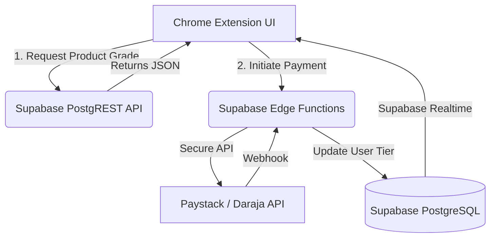

# Supabase Migration Strategy: Building a Thin-Client, Zero-Trust Architecture

Moving the heavy product databases (Naivas/Carrefour) and payment logic out of the Chrome Extension and into **Supabase** is critical. This transition will drastically reduce the extension bundle size, ensure compliance with Chrome Web Store policies, and secure your payment flows behind a Zero-Trust architecture.

## 1. Architectural Shift: From Fat-Client to Thin-Client

Currently, the extension bundles logic and potentially data directly within its source code.

**The New Architecture:**
The Chrome Extension will become a "Thin Client". It will handle UI rendering, DOM manipulation (injecting NutriScores on e-commerce sites), and capturing user intent. All heavy lifting, data storage, and secret management will be delegated to Supabase.

---

## 2. Database Migration (Carrefour & Naivas Datasets)

Bundling thousands of product entries in the extension inflates the bundle size and makes updating the database impossible without releasing a new version to the Web Store.

### The Shift

- Move the `carrefour` and `naivas` product datasets into a structured **Supabase PostgreSQL Database**.
- The extension will query product data on-the-fly as the user browses the supermarket websites.

### Constraints & Fixes

> [!WARNING]
> **Constraint - Latency:** Fetching data over the network for every product on a supermarket page can cause UI pop-in and feel sluggish compared to a local database.
>
> **Fix:** Implement **Supabase Edge Cache** and local **IndexedDB caching** in the extension. When the user visits a category page, the extension batches product IDs and requests them via a single API call, caching the results locally for 24 hours.

---

## 3. Payment System Strategy (Zero-Trust Backend)

As outlined in the core security rule: **Never handle sensitive API keys or transaction verification logic directly inside a Chrome Extension.**

We will use **Supabase Edge Functions** (built on Deno) as our secure proxy backend.

### A. Daraja API (M-Pesa)

- **The Shift:** The extension sends the phone number and user JWT to an Edge Function (`/mpesa-initiate`). The Edge Function holds the Safaricom Consumer Keys securely, generates the OAuth token, and triggers the STK Push.
- **The Webhook:** A second Edge Function (`/mpesa-webhook`) listens for Safaricom's callback, verifies the IP whitelist, and updates the `user_account` table in Supabase to `premium: true`.
- **The UX:** Instead of manually long-polling every 3 seconds from the extension, we can leverage **Supabase Realtime**. The extension listens to changes on the user's database row. When the webhook updates the row to `premium`, the extension instantly pushes the user to the Dashboard.

### B. Paystack API (Cards)

- **The Shift:** Due to Chrome Extension Content Security Policy (CSP), injecting `https://js.paystack.co/v1/inline.js` natively will be blocked or flagged during Web Store review.
- **Constraints & Fixes:**

> [!IMPORTANT]
> **Constraint - Chrome CSP:** Inline external scripts are forbidden in Manifest V3.
>
> **Fix - Secure Web Redirect (Recommended):** The extension calls an Edge Function to create a transaction. The function returns a Paystack `authorization_url`. The extension opens a new browser tab to this URL. After payment, Paystack redirects to a Supabase-hosted success page, which uses cross-tab messaging or Supabase Realtime to tell the extension the payment succeeded.
>
> **Alternative Fix - Sandboxed Iframe:** Create an HTML file in the extension (`sandbox.html`) that loads the Paystack JS. Embed this via an `<iframe>` in the Onboarding Wizard.

---

## 4. Authentication & Security Transition

### The Shift

Move away from basic local state management to **Supabase Auth**.

- When the user signs up via the Wizard (or Google OAuth), they authenticate against Supabase.
- Supabase issues a secure JWT.
- Every time the extension queries the product database or initiates a payment, it attaches this JWT.
- **Row Level Security (RLS)** in PostgreSQL ensures users can only read product data if they are authenticated, and can only see their own payment history.

## 5. Execution Roadmap

If this strategy aligns with your vision, the execution plan will be:

1. **Setup Supabase:** Create a new project, design the SQL schema for users, payments, and supermarket products.
2. **Data Ingestion:** Write a script to migrate the existing extension JSON product datasets to PostgreSQL.
3. **Edge Functions:** Deploy the M-Pesa STK Push, Webhook, and Paystack initialization functions.
4. **Extension Refactor:** Rip out the mocked backend logic in `OnboardingWizard.tsx` and replace it with `@supabase/supabase-js` client calls. Apply the Web Redirect (or Iframe) fix for Paystack.

## User Review Required

> [!CAUTION]
> Before we begin writing the migration code, I need you to decide on the Paystack UX workaround:
>
> 1. **Secure Web Redirect** (Opens a new tab for payment, very reliable and secure).
> 2. **Sandboxed Iframe** (Keeps the user inside the extension popup, but requires intricate iframe message-passing).
>
> Which approach do you prefer for Paystack?
